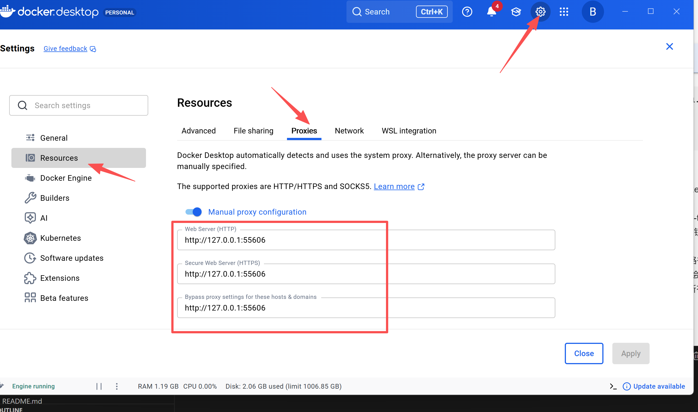

# 项目部署

- [项目部署](#项目部署)
  - [参考资料](#参考资料)
  - [流程](#流程)
  - [操作](#操作)
    - [创建 Dockerfile](#创建-dockerfile)
    - [Docker 构建镜像](#docker-构建镜像)
    - [运行 Docker 容器](#运行-docker-容器)

## 参考资料

- [使用 docker 轻松部署你的 Go 项目](https://cloud.tencent.com/developer/article/2461531)

## 流程

- 创建 Dockerfile
- Docker 构建镜像
- 运行 Docker 容器

## 操作

### 创建 Dockerfile

Dockerfile 是一个用于定义 Docker 容器镜像构建过程的脚本文件。它包含了一组指令，告诉 Docker 如何创建镜像。

接下来我们需要在 go-shop 项目根目录下创建并编写 Dockerfile 文件，以帮助我们实现自动化构建和高效部署。

```Dockerfile
# 使用官方的 Go 语言镜像作为基础镜像
# 这里使用 Go 1.25.0 版本的 Alpine Linux 镜像
FROM golang:1.25.0-alpine AS builder

# 设置工作目录为 /app
# 所有后续操作都会在这个目录下进行
WORKDIR /app

# 将当前项目目录的所有文件拷贝到容器的 /app 目录中
COPY . .

# 设置 Go 模块代理为 https://goproxy.cn（在中国加速模块下载），并下载项目的依赖
RUN go env -w GOPROXY=https://goproxy.cn,direct && go mod download

# 编译 Go 项目，生成可执行文件 go-shop
RUN go build -o go-shop ./cmd/main.go

# 使用一个更小的基础镜像（Alpine）来运行应用程序
# Alpine 是一个极简的 Linux 发行版，适合部署阶段
FROM alpine:latest

# 安装 tzdata 包，确保支持时区的配置
RUN apk add --no-cache tzdata

# 设置工作目录为 /app
WORKDIR /app

# 从编译阶段的镜像中拷贝编译后的二进制文件到运行镜像中
COPY --from=builder /app/go-shop /app/go-shop

# 暴露容器的 8080 端口，用于外部访问
EXPOSE 8080

# 设置容器启动时运行的命令
# 这里是运行编译好的可执行文件 go-shop
CMD ["/app/go-shop"]
```

说明：

- **多阶段构建**：我们先使用 golang:1.23.0-alpine 镜像来编译 Go 项目，然后使用 alpine:latest 来部署。这样可以减少最终的镜像大小。
- **暴露端口**： 通过 EXPOSE 指定应用程序监听的端口（这里是 8080）。

### Docker 构建镜像

!!! 配置 docker 代理

 

```bash

docker build -t go-shop:v0.1.0 .

# 检查本地镜像是否存在
docker images

# REPOSITORY   TAG       IMAGE ID       CREATED         SIZE
# go-shop      v0.1.0    2e00de4c2554   8 seconds ago   69MB
# nginx        latest    ca871a86d45a   4 days ago      225MB
```

解释：

- `docker build`：这是 Docker 用于构建镜像的命令。
- `-t go-shop:v0.1.0`：t 是 --tag 的缩写，用来给构建的 Docker 镜像命名。
- `.`：指定了构建上下文的路径，. 表示当前目录，Docker 引擎会从当前目录读取 Dockerfile 以及所有相关的项目文件并打包进镜像中。

### 运行 Docker 容器

```bash
docker run -p 8080:8080  go-shop:v0.1.0
```

其中：

`docker run`：基于指定的 Docker 镜像创建并启动一个容器实例。
`-p 8080:8080`：将本地主机的 8080 端口映射到容器的 8080 端口，以便你可以通过 localhost:8080 访问容器内的应用。
`go-shop:v0.1.0`：基于 go-shop 镜像来创建并运行容器。

这样，Go 项目将会在本地的 8080 端口上运行。你可以通过浏览器访问 <http://localhost:8080/posts/1，应该会看到> id: 1 的字样。
