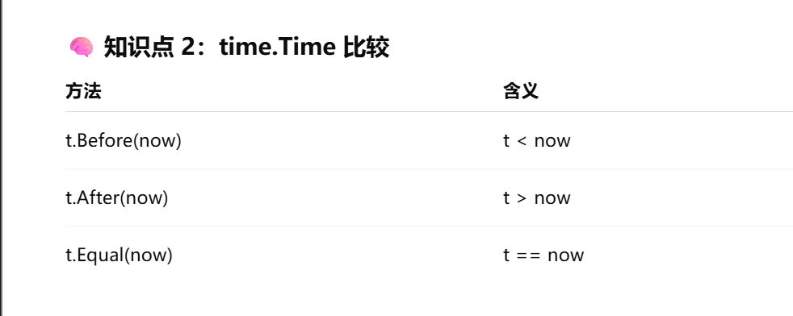

- [1. 环境搭建](#1-环境搭建)
  - [1️⃣ 安装 Go](#1️⃣-安装-go)
  - [2️⃣ 环境变量（Windows）](#2️⃣-环境变量windows)
  - [3️⃣ Go Modules（重点）](#3️⃣-go-modules重点)
- [2. 变量定义与输入输出](#2-变量定义与输入输出)
  - [变量定义方式](#变量定义方式)
  - [常量](#常量)
  - [输入输出](#输入输出)
  - [常用 fmt 占位符总结](#常用-fmt-占位符总结)
- [3. 基本数据类型](#3-基本数据类型)
  - [基本类型](#基本类型)
  - [零值（非常重要）](#零值非常重要)
- [4. 数组、切片、map](#4-数组切片map)
  - [数组（很少用）](#数组很少用)
  - [切片（核心）](#切片核心)
    - [append 规则（必背）](#append-规则必背)
    - [nil 切片 vs 空切片（面试常考）](#nil-切片-vs-空切片面试常考)
    - [make 创建切片](#make-创建切片)
    - [切片排序](#切片排序)
    - [切片本质](#切片本质)
  - [map](#map)
    - [核心特点](#核心特点)
    - [初始化（必须）](#初始化必须)
    - [map 的基本操作](#map-的基本操作)
    - [map 取值规则（重点）](#map-取值规则重点)
  - [三者对比（必背表）](#三者对比必背表)
  - [易错点总结](#易错点总结)
- [5. 判断语句](#5-判断语句)
  - [if 特有写法](#if-特有写法)
  - [switch（自动 break）](#switch自动-break)
  - [switch 枚举值（离散值判断）](#switch-枚举值离散值判断)
    - [特点](#特点)
  - [六、switch 的 fallthrough（少用但要懂）](#六switch-的-fallthrough少用但要懂)
    - [默认行为](#默认行为)
    - [使用 fallthrough](#使用-fallthrough)
    - [fallthrough 特点（⚠️重点）](#fallthrough-特点️重点)
- [6. for循环](#6-for循环)
  - [Go 只有 for](#go-只有-for)
  - [break / continue（流程控制）](#break--continue流程控制)
    - [break：跳出当前循环](#break跳出当前循环)
    - [continue：跳过本次循环](#continue跳过本次循环)
- [7. 函数（指针）](#7-函数指针)
  - [普通函数](#普通函数)
  - [多返回值（Go 精髓）](#多返回值go-精髓)
  - [指针](#指针)
- [8. init函数和defer函数](#8-init函数和defer函数)
  - [init（自动执行）](#init自动执行)
  - [defer（延迟执行）](#defer延迟执行)
- [9. 结构体](#9-结构体)
  - [初始化](#初始化)
  - [方法](#方法)
- [10. 自定义数据类型](#10-自定义数据类型)
- [11. 接口（interface）（⭐非常重要）](#11-接口interface非常重要)
  - [一、接口是什么](#一接口是什么)
  - [二、接口的实现（Go 核心思想）](#二接口的实现go-核心思想)
  - [三、接口的作用（为什么要用）](#三接口的作用为什么要用)
    - [1️⃣ 解耦（最重要）](#1️⃣-解耦最重要)
  - [四、空接口（Go 1.18 前）](#四空接口go-118-前)
  - [五、易错点](#五易错点)
  - [一句话总结](#一句话总结)
- [12. 协程和 Channel（⭐重中之重）](#12-协程和-channel重中之重)
  - [一、goroutine 是什么](#一goroutine-是什么)
  - [二、并发 vs 并行](#二并发-vs-并行)
  - [三、WaitGroup —— 等待 goroutine 执行完毕](#三waitgroup--等待-goroutine-执行完毕)
    - [WaitGroup 的作用（一句话）](#waitgroup-的作用一句话)
    - [核心三板斧（必背）](#核心三板斧必背)
    - [在本代码中的流程](#在本代码中的流程)
  - [四、Channel 是什么](#四channel-是什么)
    - [写 / 读](#写--读)
  - [五、带缓冲的 channel](#五带缓冲的-channel)
  - [六、典型使用场景](#六典型使用场景)
    - [worker 模型](#worker-模型)
  - [一句话总结](#一句话总结-1)
- [13. 线程安全与 sync.Map](#13-线程安全与-syncmap)
  - [一、为什么需要线程安全](#一为什么需要线程安全)
  - [二、Mutex（互斥锁）](#二mutex互斥锁)
  - [三、RWMutex（读写锁）](#三rwmutex读写锁)
  - [四、sync.Map（并发 map）](#四syncmap并发-map)
  - [五、易错点](#五易错点-1)
  - [一句话总结](#一句话总结-2)
- [14. 异常处理](#14-异常处理)
  - [一、Go 只有两种“异常处理思路”](#一go-只有两种异常处理思路)
    - [1️⃣ error —— 处理**业务级错误**（必须掌握）](#1️⃣-error--处理业务级错误必须掌握)
    - [2️⃣ panic / recover —— 处理**程序级错误**（慎用）](#2️⃣-panic--recover--处理程序级错误慎用)
  - [二、panic + recover 的执行顺序（必背）](#二panic--recover-的执行顺序必背)
  - [三、调用栈打印（排查问题核心）](#三调用栈打印排查问题核心)
  - [四、error 的“向上抛”标准模式](#四error-的向上抛标准模式)
  - [五、panic vs error 的使用对照表](#五panic-vs-error-的使用对照表)
  - [六、一句话终极总结](#六一句话终极总结)
- [15. 泛型（Go 1.18+）](#15-泛型go-118)
- [16. 文件操作](#16-文件操作)
- [17. 单元测试](#17-单元测试)
- [18. 反射（进阶但重要）](#18-反射进阶但重要)
  - [一、反射是什么](#一反射是什么)
  - [二、Type / Value](#二type--value)
  - [三、反射修改值（必须是指针）](#三反射修改值必须是指针)
  - [四、反射的实际用途](#四反射的实际用途)
  - [五、缺点](#五缺点)
  - [一句话总结](#一句话总结-3)
- [19. 网络编程（TCP / HTTP / RPC / Gin）](#19-网络编程tcp--http--rpc--gin)
  - [一、TCP（最底层，所有都靠它）](#一tcp最底层所有都靠它)
  - [二、HTTP（建立在 TCP 之上）](#二http建立在-tcp-之上)
  - [三、RPC（服务之间的“函数调用”）](#三rpc服务之间的函数调用)
    - [1️⃣ RPC 是什么](#1️⃣-rpc-是什么)
    - [2️⃣ RPC 建立在什么之上？](#2️⃣-rpc-建立在什么之上)
    - [3️⃣ RPC vs HTTP（一句话）](#3️⃣-rpc-vs-http一句话)
  - [四、Gin（Go Web 框架）](#四gingo-web-框架)
  - [五、四者关系（最终关系图）](#五四者关系最终关系图)
  - [六、一句话超级终结（必背）](#六一句话超级终结必背)
  - [七、你现在该怎么理解](#七你现在该怎么理解)
- [20. 部署（工程必会）](#20-部署工程必会)
  - [一、本地编译](#一本地编译)
  - [二、交叉编译（最常用）](#二交叉编译最常用)
  - [三、Docker 部署](#三docker-部署)
  - [四、生产部署要点](#四生产部署要点)
  - [一句话总结](#一句话总结-4)
- [21 Go `time` 包核心知识点](#21-go-time-包核心知识点)
  - [一、time.Sleep —— 程序休眠（阻塞）](#一timesleep--程序休眠阻塞)
    - [1️⃣ 基本用法](#1️⃣-基本用法)
  - [二、time.Duration（核心概念 ⭐⭐⭐⭐⭐）](#二timeduration核心概念-)
    - [1️⃣ time.Sleep 的参数是什么？](#1️⃣-timesleep-的参数是什么)
  - [三、Go 内置的时间单位常量（必背）](#三go-内置的时间单位常量必背)
    - [1️⃣ 示例对照理解](#1️⃣-示例对照理解)
  - [四、为什么要这样设计？（理解点）](#四为什么要这样设计理解点)
  - [五、time.Sleep 的常见使用场景（你以后一定会用）](#五timesleep-的常见使用场景你以后一定会用)
    - [1️⃣ 定时打印 / 心跳](#1️⃣-定时打印--心跳)
    - [2️⃣ 重试间隔](#2️⃣-重试间隔)
    - [3️⃣ 限流 / 防刷](#3️⃣-限流--防刷)
  - [六、时间格式化（Go 独有设计 ⭐⭐⭐⭐⭐）](#六时间格式化go-独有设计-)
    - [1️⃣ 基本写法](#1️⃣-基本写法)
  - [七、为什么是 2006-01-02 15:04:05？（重点理解）](#七为什么是-2006-01-02-150405重点理解)
    - [Go 的规则不是“符号”，而是**示例时间**](#go-的规则不是符号而是示例时间)
  - [八、时间格式模板对照表（必背）](#八时间格式模板对照表必背)
    - [例子对照理解](#例子对照理解)
  - [九、为什么不能用 yyyy-MM-dd？（必懂）](#九为什么不能用-yyyy-mm-dd必懂)
  - [十、常见新手错误（你现在就避坑）](#十常见新手错误你现在就避坑)
  - [十一、time 包你现在需要掌握的最小集合（总结）](#十一time-包你现在需要掌握的最小集合总结)

# 1. 环境搭建

## 1️⃣ 安装 Go

* 官网：[https://go.dev/dl/](https://go.dev/dl/)
* 验证安装：

```bash
go version
```

## 2️⃣ 环境变量（Windows）

```text
GOROOT = Go 安装目录
GOPATH = 工作区（Go 1.18 后可不用）
```

## 3️⃣ Go Modules（重点）

```bash
go mod init project-name #初始化go的依赖管理文件，创建一个go.mod文件
go mod tidy #整理模块依赖，确保 go.mod 文件准确反映项目实际使用的依赖。
```

📌 **结论**：
现在 Go 项目 **100% 用 go mod**

---

# 2. 变量定义与输入输出

## 变量定义方式

```go
var a int = 10
var b = 20
c := 30 // 常用
```

## 常量

```go
const Pi = 3.14
```

## 输入输出

```go
fmt.Println("hello")
fmt.Printf("age=%d\n", age)

fmt.Scan(&age)
```

⚠️ `:=` 只能在函数里用

---

## 常用 fmt 占位符总结
| 占位符    | 作用        |
| ------ | --------- |
| `%v`   | 任意类型（最常用） |
| `%T`   | 变量类型      |
| `%d`   | 整数        |
| `%f`   | 浮点数       |
| `%.nf` | 保留 n 位小数  |
| `%s`   | 字符串       |
| `%#v`  | Go 语法格式输出 |

---

# 3. 基本数据类型

## 基本类型

```go
int, int64
float32, float64
bool
string
```

## 零值（非常重要）

| 类型      | 零值    |
| ------- | ----- |
| int     | 0     |
| bool    | false |
| string  | ""    |
| pointer | nil   |

📌 Go **不会有未初始化的垃圾值**

---

# 4. 数组、切片、map

## 数组（很少用）

```go
var arr [3]int
```

## 切片（核心）

```go
s := []int{1,2,3}
s = append(s, 4)
```

### append 规则（必背）

* `append` 可能会：

  * 复用原数组
  * **或创建新数组并拷贝**
* 不能假设 append 后底层数组不变

---
### nil 切片 vs 空切片（面试常考）

| 表达式              | 是否为 nil |
| ---------------- | ------- |
| `var s []int`    | true    |
| `make([]int, 0)` | false   |
| `[]int{}`        | false   |

📌 `nil` 切片可以直接 `append`

---

### make 创建切片

```go
make([]T, len, cap)
```

* `len`：当前长度
* `cap`：容量（可选）

---

### 切片排序

* 需要 `sort` 包
* 常用于 `[]int / []string`

```go
sort.Ints(s)                    // 升序
sort.Sort(sort.Reverse(...))    // 降序
```

---

### 切片本质

> 指向数组的 **引用结构**

---

## map

### 核心特点

* 无序的 `key-value` 集合
* **key 必须是可比较类型**
* value 可以是任意类型
* **引用类型**

---


### 初始化（必须）

```go
m := make(map[string]int)
m := map[string]int{"a": 1}
```

❌ 未初始化直接赋值会 panic

---

### map 的基本操作

* 取值：`v := m[key]`
* 赋值：`m[key] = value`
* 删除：`delete(m, key)`

---

### map 取值规则（重点）

```go
v := m["not_exist"]      // v 是零值
v, ok := m["not_exist"]  // ok == false
```

| 写法    | 含义          |
| ----- | ----------- |
| 一个返回值 | 只关心值（可能是零值） |
| 两个返回值 | 判断 key 是否存在 |

📌 **推荐用 `value, ok` 判断**

---

## 三者对比（必背表）

| 特性     | 数组 | 切片    | map  |
| ------ | -- | ----- | ---- |
| 长度     | 固定 | 可变    | 不适用  |
| 是否初始化  | 必须 | 可 nil | 必须   |
| 是否引用类型 | 否  | 是     | 是    |
| 常用程度   | 低  | ⭐⭐⭐⭐⭐ | ⭐⭐⭐⭐ |

---

## 易错点总结

1️⃣ 数组长度是类型的一部分
2️⃣ 切片不是数组，是对数组的引用
3️⃣ `nil` 切片 ≠ 空切片
4️⃣ map 使用前 **必须初始化**
5️⃣ map 取不存在的 key 不会 panic
6️⃣ map 是无序的，不能依赖遍历顺序

---

# 5. 判断语句

```go
if age > 18 {
} else {
}
```

## if 特有写法

```go
if x := 10; x > 5 {
}
```

## switch（自动 break）

```go
switch n {
case 1:
case 2:
default:
}
```

## switch 枚举值（离散值判断）

```go
switch week {
case 1:
    fmt.Println("周一")
case 2:
    fmt.Println("周二")
case 6, 7:
    fmt.Println("周末")
default:
    fmt.Println("错误")
}
```

### 特点

* 一个 case 可以匹配多个值
* 用于：状态码 / 星期 / 类型码


## 六、switch 的 fallthrough（少用但要懂）

### 默认行为

> Go 的 switch **命中一个 case 就结束**

---

### 使用 fallthrough

```go
switch {
case age <= 0:
    fmt.Println("未出生")
    fallthrough
case age <= 18:
    fmt.Println("未成年")
    fallthrough
case age <= 35:
    fmt.Println("青年")
default:
    fmt.Println("中年")
}
```

---

### fallthrough 特点（⚠️重点）

* **不判断下一个 case 条件**
* 强制继续执行下一个 case
* 很容易造成逻辑混乱

📌 实战建议：

> **知道即可，99% 情况不用**

---

# 6. for循环

## Go 只有 for

```go
for i := 0; i < 10; i++ {}
```

```go
for _, v := range arr {}
```

```go
for {
 break
}
```

---

## break / continue（流程控制）

### break：跳出当前循环

```go
for i := 0; i < 10; i++ {
    if i == 5 {
        break
    }
    fmt.Println(i)
}
```

---

### continue：跳过本次循环

```go
for i := 0; i < 5; i++ {
    if i == 2 {
        continue
    }
    fmt.Println(i)
}
```


# 7. 函数（指针）

## 普通函数

```go
func add(a, b int) int {
 return a + b
}
```

## 多返回值（Go 精髓）

```go
func div(a,b int) (int, error)
```

## 指针

```go
func inc(x *int) {
 *x++
}
```

📌 **想修改外部变量 → 用指针**

---

# 8. init函数和defer函数

## init（自动执行）

```go
func init() {
 fmt.Println("init")
}
```

* 在 main 前执行
* 常用于：配置、DB、Redis 初始化

## defer（延迟执行）

```go
defer file.Close()
```

📌 **先进后出（栈）**

---

# 9. 结构体

```go
type User struct {
 ID int
 Name string
}
```

## 初始化

```go
u := User{Name: "Tom"}
```

## 方法

```go
func (u User) Say() {}
func (u *User) SetName() {}
```

📌 **修改结构体 → 用指针接收者**

---

# 10. 自定义数据类型

```go
type MyInt int
```

📌 新类型 ≠ 原类型
👉 不能直接混用

---

# 11. 接口（interface）（⭐非常重要）

## 一、接口是什么

> **接口 = 行为的集合（方法集合）**

```go
type Reader interface {
 Read() string
}
```

接口**只关心“你能做什么”**，不关心你是谁。

---

## 二、接口的实现（Go 核心思想）

⚠️ **Go 没有 implements**

```go
type File struct {}

func (f File) Read() string {
 return "file data"
}
```

只要 **方法签名一致**，就自动实现接口。

```go
var r Reader
r = File{}
```

---

## 三、接口的作用（为什么要用）

### 1️⃣ 解耦（最重要）

```go
func ReadData(r Reader) {
 fmt.Println(r.Read())
}
```

👉 不依赖具体类型，只依赖接口
👉 **Controller 不依赖 Service 的具体实现**

---

## 四、空接口（Go 1.18 前）

```go
var x interface{}
x = 10
x = "hello"
```

现在基本被 **泛型** 替代。

---

## 五、易错点

❌ 接口不能实例化
❌ 方法名 / 参数 / 返回值 **必须完全一致**

---

## 一句话总结

> Go 接口是**隐式实现**的，用来做**解耦和多态**，是 Go 架构设计的核心。

---

# 12. 协程和 Channel（⭐重中之重）

## 一、goroutine 是什么

> goroutine = Go 的轻量线程

```go
go func() {
 fmt.Println("hello")
}()
```

📌 **不是新线程，是 Go runtime 调度**

---

## 二、并发 vs 并行

* 并发：任务交替执行
* 并行：多个 CPU 同时执行

Go **天生并发友好**

## 三、WaitGroup —— 等待 goroutine 执行完毕

```go
var wait sync.WaitGroup
```

### WaitGroup 的作用（一句话）

> **让主 goroutine 等待子 goroutine 执行完成**

---

### 核心三板斧（必背）

```go
wait.Add(n)   // 要等几个 goroutine
wait.Done()  // 一个 goroutine 结束
wait.Wait()  // 阻塞等待
```

---

### 在本代码中的流程

```go
wait.Add(2)
go jia()
go jiang()
wait.Wait()
```

👉 含义：

* 启动 2 个 goroutine
* 主线程 **阻塞**
* 直到两个 goroutine 都调用 `Done()`

---

## 四、Channel 是什么

> goroutine 之间 **通信的管道**

```go
ch := make(chan int)
```

### 写 / 读

```go
ch <- 1   // 写
x := <-ch // 读
```

⚠️ **默认阻塞**

---

## 五、带缓冲的 channel

```go
ch := make(chan int, 3)
ch <- 1
```

📌 有缓冲：不立刻阻塞

---

## 六、典型使用场景

### worker 模型

```go
jobs := make(chan int)

go func() {
 for job := range jobs {
  fmt.Println(job)
 }
}()
```

---

## 一句话总结

> goroutine 负责并发执行，channel 负责安全通信，避免共享内存。

---

# 13. 线程安全与 sync.Map

## 一、为什么需要线程安全

```go
go m["a"] = 1
go m["a"] = 2 // ❌ panic
```

👉 普通 map **不是并发安全的**

---

## 二、Mutex（互斥锁）

```go
var mu sync.Mutex

mu.Lock()
count++
mu.Unlock()
```

📌 最基础、最通用

---

## 三、RWMutex（读写锁）

```go
mu.RLock()
mu.RUnlock()
```

📌 读多写少时性能更好

---

## 四、sync.Map（并发 map）

```go
var m sync.Map
m.Store("a", 1)
v, ok := m.Load("a")
```

适合：

* 高并发
* 读多写少
* 缓存

---

## 五、易错点

❌ 忘记 Unlock
❌ 锁范围太大 → 性能差

---

## 一句话总结

> 高并发下要么用锁，要么用 sync.Map，绝不能裸用 map。

---

# 14. 异常处理


## 一、Go 只有两种“异常处理思路”

### 1️⃣ error —— 处理**业务级错误**（必须掌握）

* 通过 `return error` 向上返回
* **不影响程序运行**
* 是否处理由**调用方决定**
* Go 推荐、日常 99% 使用

```go
if err != nil {
	return err
}
```

**典型场景**

* 参数校验失败
* 数据库 / Redis / IO 错误
* 登录失败、数据不存在

👉 **Go 没有 try-catch，靠 error 传递**

---

### 2️⃣ panic / recover —— 处理**程序级错误**（慎用）

* `panic`：程序出现不可继续的严重问题
* `recover`：捕获 panic，防止程序直接崩溃
* `recover 只能写在 defer 中才有效`

```go
defer func() {
	if r := recover(); r != nil {
		// 兜底处理
	}
}()
```

**典型场景**

* 配置文件损坏
* 程序状态异常（理论不该发生）
* 框架 / goroutine 的最外层兜底

👉 **业务代码中不要主动 panic**

---

## 二、panic + recover 的执行顺序（必背）

1. 发生 `panic`
2. 函数开始**回溯调用栈**
3. 执行 `defer`
4. defer 中调用 `recover`
5. panic 被捕获，程序不崩

📌 **没有 recover → 程序直接退出**

---

## 三、调用栈打印（排查问题核心）

```go
debug.Stack()
```

* 获取当前 goroutine 的完整调用栈
* 类似 Java 的 `printStackTrace`
* 通常只在 panic recover 中使用

---

## 四、error 的“向上抛”标准模式

```go
func A() error {
	return B()
}

func B() error {
	return C()
}

func C() error {
	return errors.New("出错了")
}
```

**原则**

* 下层函数不做决定
* 上层函数决定怎么处理
* 逻辑清晰、易维护、易测试

---

## 五、panic vs error 的使用对照表

| 场景            | 用什么             |
| ------------- | --------------- |
| 用户输入错误        | error           |
| 业务校验失败        | error           |
| DB / Redis 错误 | error           |
| 程序无法继续        | panic           |
| 全局兜底          | panic + recover |

---

## 六、一句话终极总结

> **Go 用 error 解决“业务问题”，用 panic 解决“程序问题”，用 recover 保证程序不崩。**

---

# 15. 泛型（Go 1.18+）

```go
func Max[T int | float64](a, b T) T {
 if a > b { return a }
 return b
}
```

📌 **写工具库用**

---

# 16. 文件操作

```go
data, _ := os.ReadFile("a.txt")
os.WriteFile("b.txt", data, 0644)
```

---

# 17. 单元测试

```go
func TestAdd(t *testing.T) {
 if add(1,2)!=3 {
  t.Fail()
 }
}
```

```bash
go test ./...
```

---

# 18. 反射（进阶但重要）

## 一、反射是什么

> **运行时操作类型和值**

```go
reflect.TypeOf(x)
reflect.ValueOf(x)
```

---

## 二、Type / Value

```go
t := reflect.TypeOf(user)
v := reflect.ValueOf(user)
```

---

## 三、反射修改值（必须是指针）

```go
v := reflect.ValueOf(&user).Elem()
v.FieldByName("Name").SetString("Tom")
```

📌 **不是指针会 panic**

---

## 四、反射的实际用途

* Gin 参数绑定
* GORM ORM
* JSON 序列化

---

## 五、缺点

❌ 慢
❌ 难读
❌ 容易 panic

👉 **业务代码不要乱用**

---

## 一句话总结

> 反射是框架级工具，业务代码能不用就不用。

---

# 19. 网络编程（TCP / HTTP / RPC / Gin）

## 一、TCP（最底层，所有都靠它）

```go
ln, _ := net.Listen("tcp", ":8080")
conn, _ := ln.Accept()
```

**本质：**

* 只负责 **建立连接 + 传输字节**
* 不关心数据是什么意思

📌 关键词：**连接、字节流、可靠传输**

---

## 二、HTTP（建立在 TCP 之上）

```go
http.HandleFunc("/", func(w http.ResponseWriter, r *http.Request) {
	w.Write([]byte("hello"))
})
http.ListenAndServe(":8080", nil)
```

**本质：**

* 基于 TCP 的 **应用层协议**
* 规定了 **请求 / 响应格式**

📌 关键词：**URL / Method / Header / Body**

---

## 三、RPC（服务之间的“函数调用”）

### 1️⃣ RPC 是什么

> **RPC = 像调用本地函数一样，调用远程服务**

```go
user := GetUserByID(1) // 实际是远程调用
```

但底层其实是：

```
客户端 → TCP → 网络 → TCP → 服务端
```

---

### 2️⃣ RPC 建立在什么之上？

RPC **通常基于 TCP**，也可以：

* HTTP（如 gRPC over HTTP/2）
* 自定义协议

📌 RPC ≠ HTTP
📌 RPC 是 **通信方式**，不是协议格式本身

---

### 3️⃣ RPC vs HTTP（一句话）

| 对比项  | HTTP    | RPC    |
| ---- | ------- | ------ |
| 面向   | 资源（URL） | 方法（函数） |
| 风格   | REST    | 函数调用   |
| 常用场景 | Web 接口  | 微服务内部  |
| 性能   | 一般      | 高      |
| 易读性  | 高       | 较低     |

---

## 四、Gin（Go Web 框架）

> **Gin 是对 net/http 的高性能封装**

封装了：

* 路由
* 中间件
* 参数绑定
* JSON 返回

📌 **Gin 专注：HTTP Web 开发**

---

## 五、四者关系（最终关系图）

```
Gin        RPC框架（gRPC / Dubbo）
 ↓              ↓
HTTP        HTTP/2 或自定义协议
 ↓              ↓
TCP  ←——————— TCP
```

---

## 六、一句话超级终结（必背）

> **TCP 是地基，HTTP 是规范，RPC 是远程调用思想，Gin 是 Web 框架。**

---

## 七、你现在该怎么理解

* 写网页接口 → **Gin + HTTP**
* 服务调服务 → **RPC**
* 所有通信 → **TCP**

---

# 20. 部署（工程必会）

## 一、本地编译

```bash
go build
```

---

## 二、交叉编译（最常用）

```bash
GOOS=linux GOARCH=amd64 go build
```

---

## 三、Docker 部署

```dockerfile
FROM alpine
COPY app /
CMD ["/app"]
```

---

## 四、生产部署要点

* 配置用环境变量
* 日志不要用 fmt.Println
* 不要把 config 写死

---

## 一句话总结

> Go 程序天然适合 Docker 和云部署。

---

# 21 Go `time` 包核心知识点

## 一、time.Sleep —— 程序休眠（阻塞）

### 1️⃣ 基本用法

```go
time.Sleep(1 * time.Second)
```

含义：
👉 **让当前 goroutine 停止执行 1 秒**

> 注意：不是 CPU 睡眠，是 **当前协程阻塞**

---

## 二、time.Duration（核心概念 ⭐⭐⭐⭐⭐）

### 1️⃣ time.Sleep 的参数是什么？

```go
func Sleep(d Duration)
```

👉 `Duration` 本质是：

```go
type Duration int64 // 纳秒
```

📌 **单位是纳秒（ns）**

---

## 三、Go 内置的时间单位常量（必背）

```go
time.Nanosecond      // 纳秒
time.Microsecond    // 微秒
time.Millisecond    // 毫秒
time.Second         // 秒
time.Minute         // 分钟
time.Hour           // 小时
```

它们的本质是 **int64 的倍数关系**

---

### 1️⃣ 示例对照理解

```go
time.Sleep(1 * time.Second)       // 1 秒
time.Sleep(500 * time.Millisecond) // 0.5 秒
time.Sleep(2 * time.Minute)        // 2 分钟
time.Sleep(1 * time.Hour)          // 1 小时
```

📌 推荐写法：**“数字 × 单位”**

❌ 不推荐：

```go
time.Sleep(1000000000) // 不直观
```

---

## 四、为什么要这样设计？（理解点）

Go 这样设计的好处：

✅ **可读性极强**

```go
5 * time.Second
```

一眼就懂

✅ **编译期安全**
不能乱传 int

✅ **防止单位搞错（ms / s）**

---

## 五、time.Sleep 的常见使用场景（你以后一定会用）

### 1️⃣ 定时打印 / 心跳

```go
for {
    fmt.Println("heartbeat")
    time.Sleep(1 * time.Second)
}
```

---

### 2️⃣ 重试间隔

```go
for i := 0; i < 3; i++ {
    err := doSomething()
    if err == nil {
        break
    }
    time.Sleep(2 * time.Second)
}
```

---

### 3️⃣ 限流 / 防刷

```go
time.Sleep(200 * time.Millisecond)
```

---

## 六、时间格式化（Go 独有设计 ⭐⭐⭐⭐⭐）

### 1️⃣ 基本写法

```go
time.Now().Format("2006-01-02 15:04:05")
```

输出示例：

```text
2026-01-06 12:34:56
```


---

## 七、为什么是 2006-01-02 15:04:05？（重点理解）

### Go 的规则不是“符号”，而是**示例时间**

Go 选了一天作为 **时间模板**：

```text
2006-01-02 15:04:05
Mon Jan 2 15:04:05 MST 2006
```

📌 每一位都**有含义**

---

## 八、时间格式模板对照表（必背）

| 含义     | 固定写法 |
| ------ | ---- |
| 年      | 2006 |
| 月      | 01   |
| 日      | 02   |
| 时（24h） | 15   |
| 分      | 04   |
| 秒      | 05   |

---

### 例子对照理解

```go
time.Now().Format("2006/01/02")
```

👉 `2026/01/06`

```go
time.Now().Format("15:04:05")
```

👉 `12:34:56`

```go
time.Now().Format("2006-01-02 15:04")
```

👉 `2026-01-06 12:34`

---

## 九、为什么不能用 yyyy-MM-dd？（必懂）

```go
time.Now().Format("yyyy-MM-dd") // ❌
```

❌ 原因：

* Go 不解析 `yyyy`
* 不解析 `MM`
* 不解析 `dd`

👉 **Go 不使用占位符，而是“记忆时间”**

---

## 十、常见新手错误（你现在就避坑）

❌ 错误 1：忘了乘单位

```go
time.Sleep(1) // 几乎等于 0
```

---

❌ 错误 2：以为 15 是小时

```go
Format("HH:mm:ss") // ❌
```

---

❌ 错误 3：搞错 12 小时制

```go
Format("03:04:05") // 12 小时制
Format("15:04:05") // 24 小时制（推荐）
```

---

## 十一、time 包你现在需要掌握的最小集合（总结）

✅ `time.Sleep`
✅ `time.Duration`
✅ `time.Second / Minute / Hour`
✅ `time.Now()`
✅ `Format("2006-01-02 15:04:05")`

👉 这套已经能应付 **80% 后端场景**

---