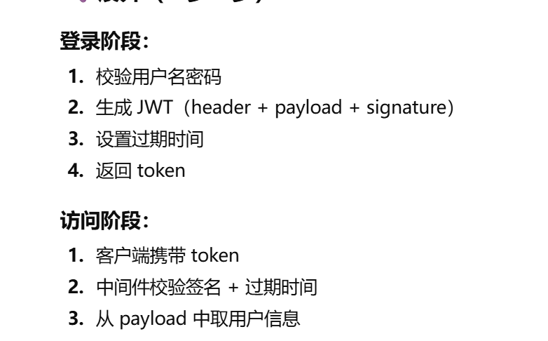
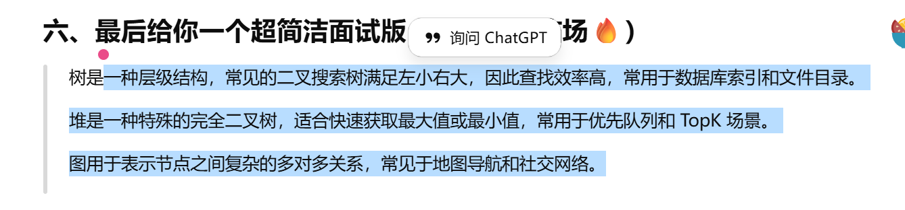

### 介绍一下 go 的并发：
（go runtine 是什么， sync 如何加锁，channl 如何信息同步 ）
>  在go语言中通过goroutine来进行并发编程，由go runtime 调度到os线程上运行，读写锁，互斥锁，channl主要是用于goroutine之间的通信和同步，channel 通过阻塞机制天然实现 goroutine 之间的同步

### docker 的构建流程：
（安装 docker -》 写 dockerfile【几个步骤，基础镜像，构建 go 程序，端口配置暴露】， dockere build， docker run）
>首先构建docker file，
>构建镜像
>启动docker

>Docker 构建流程一般是：
1️⃣ 编写 Dockerfile
2️⃣ 使用 docker build 构建镜像
3️⃣ 使用 docker run 启动容器
Dockerfile 中通常包括：基础镜像、拷贝代码、构建程序、暴露端口和启动命令。

### JWT 是什么？如何做认证和授权
（授权 token，然后中间件解析 jwt，校验，拿信息）
>JWT是一种无状态的登入凭证，主要用于前后端之间安全的传递信息
>首先解析用户发起的http请求，得到用户信息，
>然后在数据库中对比已存在的用户信息，判断是否正确，
>如果正确，将用户信息封装到jwt中，并设置过期时间，
>最后又jwt包和 secret 秘钥生成 token 返回给用户

>JWT 是一种 无状态的身份凭证，常用于登录认证。
用户登录成功后，服务端生成 JWT 并返回给客户端；
客户端之后的请求在 Header 中携带 token；
服务端通过中间件解析并校验 JWT，校验通过则完成认证和授权。

### go 和 java 的区别，以及 go 的优势？

goruntuine 原理，优势
线程和协程「goruntuine」内存多少
goroutine 什么时候发生阻塞
go 的 垃圾回收原理，go 历史上有几种机制，发展历史
GMP 模型是什么，大致流程是什么？
>go 相较于java而言，它的启动速度更快，部署更加简单

>优势：高并发，自带goroutine和channl、性能接近c语言，开发效率高于C语言，近几年而言工程化高，依赖包完善，工具链统一、开发和学习成本很低，go语言相较其他语言没有什么复杂的特性

>goroutine 由go runtime调度，运行在os线程上，优势：轻量、切换和创建成本低

>goroutine 相较线程初始栈小，大概只有几kb，而且不够会自动扩容，不想线程初始栈要2mb-8mb，大小固定

>只创建不关闭，goroutine数量一直增加

>Go 有自动 GC，主要用三色标记法，减少程序停顿。
>Go 使用并发的三色标记垃圾回收，通过减少 STW 时间来降低对程序运行的影响。

>go 用来调度goroutine 的模型
G:goroutineM:os线程p:逻辑处理器
在go中大量的goroutine由p来调度到少量的os线程上运行不需要为每个 goroutine 创建一个线程，
减少了线程创建和上下文切换的成本，

### 指针地址映射和操作系统关系？
进程和线程？（理解进程【内核态】/线程【用户态】、内核基础调度策略（FIFO、加权等待））
HTTP，TCP，UDP，IP 是什么？ 都位于哪个位置 【http，tcp 业务层， ip 数据链路层】
HTTP  和 TCP 的关系？ HTTPS 和 HTTP 的关系？
什么是 机器的 MAC 地址，更 IP 的关系？
网络 7层模型是什么？
TCP 三次牵手四次 挥手流程？
>

>进程之间相互隔离，切换成本大，线程共享进程资源，但还是有os调度，就是还要进入内核态。协成就不一样了，他把调度权交给了用户态，这使得可已在os线程上跑很多协成，内核基础调度策略（FIFO、加权等待））这个不是特别懂

>http 是客户和服务端进行交流的一种协议。
>HTTPS 在 HTTP 基础上加了 SSL/TLS 加密，更安全，防止数据被窃听和篡改。
>tcp 三次 是确认客户和服务收发能力
四次 闭连接需要分别进行

> 指针使用的是虚拟地址，操作系统通过虚拟内存机制，把虚拟地址映射到物理内存，从而实现内存隔离和安全。
> 

### 常用数据结构类型？
数组和链表的核心区别是什么？【内存连续，查快 O1， 链表插入删除快，查询只能顺序】
**数组和链表最大的区别在于存储方式不同。**

>**一、线性数据结构 (元素一对一关系)** 
>数组 (Array)：内存中连续存储，支持通过下标快速随机访问，但插入和删除操作较慢。
>
> 链表 (Linked List)：由节点链式存储，元素不连续，插入和删除快，但随机访问慢。
> 
> 栈 (Stack)：先进后出（LIFO），只能在栈顶进行插入和删除，常用于函数调用、表达式求值。
>
> 队列 (Queue)：先进先出（FIFO），常用于任务调度、缓存。

> **二、非线性数据结构 (元素一对多或多对多关系)**
> 散列表 (Hash Table/Map)：根据键（Key）直接访问值（Value），查找、插入、删除速度非常快（接近 \(O(1)\)）。
> 
> 树 (Tree)：层次结构，典型如二叉树、平衡二叉树、查找树（BST），用于高效查找和排序。
> 
> 堆 (Heap)：特殊的树形结构，常用于优先队列，快速获取最大值或最小值。
> 
> 图 (Graph)：节点间多对多关系，用于表示复杂的网络结构，如社交网络、路径规划。 

hashmap 的工作原理？ 【hash 对 值计算，然后进行冲突解决，和插入】
hashmap 如何解决冲突，有几种方式？ 【开放地址、再哈希、链地址法】
快速排序过程？通过设置前后指针，左右交换
冒泡排序过程？
堆排序过程？

二叉树和二叉搜索树（BST）的区别？

### 常用的 Linx 命令有哪些？ 【文件操作 ls，cd， mkdir， rm， find ，如何查看进程编号 ps -aux ，并且关闭进程 kill ，查看主机 ip a， ls 加上搜索  ls ｜grep】

### Docker 和 虚拟机区别？
 * 【进程级隔离 vs 硬件隔离】
 >Docker 是基于操作系统的进程级隔离，多个容器共享宿主机内核；
虚拟机是硬件级虚拟化，每个虚拟机都有完整的操作系统。

### K8s 的功能，和常用资源？ 
* 【容器生命周期管理，创建删除， 资源编排， cpu 和 内存 memory 设置大小，分配到不同的 节点（node），每个节点是一个机器或者虚拟机】
>Kubernetes 是一个容器编排平台，用于对 Docker 容器进行自动化部署、调度、扩缩容和管理。
它可以管理容器生命周期，进行资源调度，并通过 Service 实现服务发现和负载均衡。

>常用的有 Pod、Deployment、Service、Node。
Pod 是最小部署单元，Deployment 用于管理 Pod 副本和更新，Service 用于对外暴露服务。

### springboot or go项目中  controller /service/dao层区别和作用 
>Controller 负责接收请求和返回响应；
Service 负责业务逻辑处理；
DAO 负责数据访问，与数据库交互；
分层的好处是职责清晰、方便维护和测试