## go语言基础

- [go语言基础](#go语言基础)
  - [Go 的优点有什么？为什么要用 Go？](#go-的优点有什么为什么要用-go)
  - [相比Java/Python有什么优势？](#相比javapython有什么优势)
  - [make和new的区别？](#make和new的区别)
  - [go 为什么没有继承？](#go-为什么没有继承)
  - [interface 是什么？](#interface-是什么)
  - [数组和切片的区别？](#数组和切片的区别)
  - [defer 的执行顺序和使用场景？](#defer-的执行顺序和使用场景)
  - [go 有值传递和引用传递吗？](#go-有值传递和引用传递吗)
  - [go mod 是什么？](#go-mod-是什么)
  - [go build](#go-build)
- [Go 并发编程](#go-并发编程)
  - [goroutine 和线程的区别](#goroutine-和线程的区别)
  - [为什么 GMP 一定要有 P？](#为什么-gmp-一定要有-p)
  - [为什么可以开成千上万goroutine？](#为什么可以开成千上万goroutine)
  - [为什么 goroutine 阻塞 IO 不会把线程卡死？](#为什么-goroutine-阻塞-io-不会把线程卡死)
  - [进程、线程、协程的区别 ？](#进程线程协程的区别-)
  - [解释Go语言中的select语句及其使用场景](#解释go语言中的select语句及其使用场景)
  - [对已关闭 channel 读写会怎样？](#对已关闭-channel-读写会怎样)
  - [协程和内核线程的关系](#协程和内核线程的关系)
  - [goroutine 和 channel 的作用？](#goroutine-和-channel-的作用)
  - [context 是干嘛的？](#context-是干嘛的)
  - [goroutine 泄漏如何检测？](#goroutine-泄漏如何检测)
  - [怎么控制并发数](#怎么控制并发数)
  - [什么是channel，为什么它可以做到线程安全？](#什么是channel为什么它可以做到线程安全)
  - [解释一下锁是什么](#解释一下锁是什么)
  - [channel 为什么要 close？](#channel-为什么要-close)
  - [sync.WaitGroup 用来干嘛？](#syncwaitgroup-用来干嘛)
  - [什么是竞态条件？如何排查？](#什么是竞态条件如何排查)
  - [Mutex vs RWMutex](#mutex-vs-rwmutex)
- [Gin 框架](#gin-框架)
  - [Gin 相比 net/http 的优势](#gin-相比-nethttp-的优势)
  - [Gin 中间件执行顺序](#gin-中间件执行顺序)
  - [c.JSON / ShouldBindJSON 做了什么？](#cjson--shouldbindjson-做了什么)
  - [Gin 参数校验怎么做？](#gin-参数校验怎么做)
  - [如何获取各种参数](#如何获取各种参数)
  - [Gin 中 JWT 登录流程](#gin-中-jwt-登录流程)
- [GORM](#gorm)
  - [主要功能和流程](#主要功能和流程)
  - [什么是 ORM？为什么要用 GORM？](#什么是-orm为什么要用-gorm)
  - [GORM 的工作原理？](#gorm-的工作原理)
  - [GORM 和 database/sql 的关系](#gorm-和-databasesql-的关系)
  - [GORM 的优缺点](#gorm-的优缺点)
  - [GORM 的事务原理](#gorm-的事务原理)
  - [GORM 如何防止 SQL 注入？](#gorm-如何防止-sql-注入)
  - [gorm.Model 是什么？](#gormmodel-是什么)
  - [First / Take / Find](#first--take--find)
  - [Where 防 SQL 注入？](#where-防-sql-注入)
  - [Save vs Updates](#save-vs-updates)
  - [逻辑删除](#逻辑删除)
- [Mysql \& Rsdis](#mysql--rsdis)
  - [mysql \& redis 区别](#mysql--redis-区别)
  - [InnoDB是什么，和MyISAM有什么区别；有什么特点z](#innodb是什么和myisam有什么区别有什么特点z)
  - [事务是什么呢](#事务是什么呢)
  - [MySQL 事务的四大特性（ACID）](#mysql-事务的四大特性acid)
  - [索引是什么？为什么能加快查询？](#索引是什么为什么能加快查询)
  - [MySQL 锁机制](#mysql-锁机制)
  - [什么情况下索引会失效？](#什么情况下索引会失效)
  - [幻读](#幻读)
  - [Redis 缓存和数据库一致性怎么保证？](#redis-缓存和数据库一致性怎么保证)
  - [Redis 是什么？用来干嘛？](#redis-是什么用来干嘛)
  - [Redis 为什么快？](#redis-为什么快)
  - [数据结构 \& 场景](#数据结构--场景)
  - [单线程为什么高并发？](#单线程为什么高并发)
  - [分布式锁](#分布式锁)
  - [Redis 过期策略有哪些？](#redis-过期策略有哪些)
  - [Redis 内存淘汰策略](#redis-内存淘汰策略)
  - [缓存问题解决方案](#缓存问题解决方案)
  - [RDB 和 AOF 区别？](#rdb-和-aof-区别)
- [Linux \& 部署](#linux--部署)
- [Linux](#linux)
  - [常用的 Linx 命令有哪些？](#常用的-linx-命令有哪些)
  - [什么是 Shell 脚本？](#什么是-shell-脚本)
- [网络 \& 计算机基础](#网络--计算机基础)
- [网络](#网络)
  - [HTTP，TCP，UDP，IP 是什么？ 都位于哪个位置](#httptcpudpip-是什么-都位于哪个位置)
  - [七层分别有哪些，还有作用](#七层分别有哪些还有作用)
  - [TCP 三次握手、四次挥手](#tcp-三次握手四次挥手)
  - [流量控制（TCP 的能力）](#流量控制tcp-的能力)
  - [拥塞控制](#拥塞控制)
  - [Socket 编程](#socket-编程)
  - [HTTP 和 HTTPS 的区别？](#http-和-https-的区别)
  - [什么是 RPC](#什么是-rpc)
  - [什么 GRPC \& WebSocket](#什么-grpc--websocket)
  - [HTTP 常见状态码有哪些？](#http-常见状态码有哪些)
  - [RESTful API 是什么？](#restful-api-是什么)
  - [IP TCP HTTP](#ip-tcp-http)
- [操作系统](#操作系统)
  - [用户态和内核态？](#用户态和内核态)
  - [什么是 go 的GC](#什么是-go-的gc)
- [工程能力](#工程能力)
  - [你如何设计一个登录接口？](#你如何设计一个登录接口)
  - [接口超时怎么处理？](#接口超时怎么处理)
  - [如何做接口限流？](#如何做接口限流)
  - [Go 服务如何优雅关闭？](#go-服务如何优雅关闭)
  - [线上服务 CPU / 内存飙高怎么排查？](#线上服务-cpu--内存飙高怎么排查)
  - [登录状态放 Redis 还是 JWT？](#登录状态放-redis-还是-jwt)
  - [如何防止接口被重复提交？](#如何防止接口被重复提交)
  - [如何保证接口幂等性？](#如何保证接口幂等性)
  - [云原生](#云原生)

---

### Go 的优点有什么？为什么要用 Go？

**Go 是在性能、并发和开发效率之间取得很好平衡的一门语言，特别适合写高并发、长期运行的后端服务。**

- Go 的核心优势主要有四点：

>**并发能力强**，内置 goroutine 和 channel，
用非常简单的语法就能写高并发程序；
>**性能好**、接近 C/C++，但**开发效率**比 C/C++ 高很多；
>**工程化做得好**，标准库完善、工具链统一，
比如 go build、go test、go fmt，开箱即用
>**学习和维护成本低，语法简单**、没有太多复杂特性，
非常适合做后端服务和基础设施。

>Go 在设计上是为**服务端和高并发场景**量身定做的，
特别适合微服务、API 服务、网关、中间件这类系统

### 相比Java/Python有什么优势？
>
>相比 Java，Go 启动更快、部署更简单，
一个二进制就能跑；

>相比 Python，Go 是编译型语言，性能和并发能力更强，
更适合高并发场景。

### make和new的区别？
>
> new 只分配内存，返回指针
> make new + 初始化

### go 为什么没有继承？
>
> go 没有传统继承，只有通过结构体嵌套和接口来实现代码复用和多态
> **优点** 结构更清晰，耦合更低

### interface 是什么？
>
> interface 他是一组方只要一个方法的集合，只要一个类型实现了这些方法，就自动实现了这些接口，不需要显性声明

### 数组和切片的区别？
>
> 数组的长度是固定的。而切片的是动态的，会随着容量不足自动扩增

### defer 的执行顺序和使用场景？
>
> defer 在函数返回前执行（也就是在 return 之前），多个 defer 按后进先出执行
> **使用场景** 常用于释放资源（关闭文件、解锁、回滚事务 ）

### go 有值传递和引用传递吗？
>
> go 只有值传递没有引用传递，但 slice、map、channel 这些本身就包含指针，所以看起来像引用传递

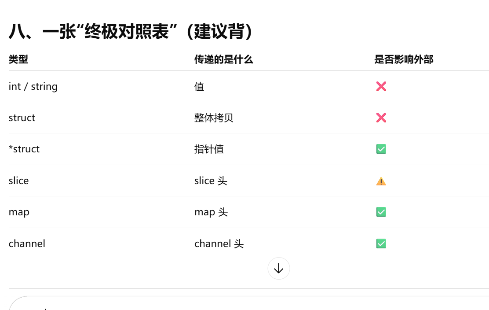

### go mod 是什么？
>是包管理工具，用来管理项目依赖。

### go build
> 会把 Go 代码编译成可执行文件


## Go 并发编程

### goroutine 和线程的区别
>
> goroutine 是轻量级协程，创建和切换成本低比os线程低

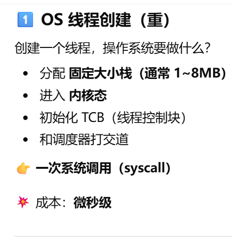
 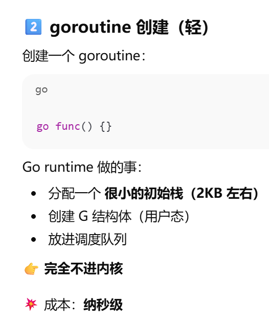

 > gorounine 之所以轻量级的原因初始栈很小，不够自动扩容
 > **详细解释** Go 使用的是 GMP 调度模型。
G 表示goroutine，M 表示操作系统线程，P 表示逻辑处理器。
程序里会有非常多的 goroutine，但真正运行的线程数量是有限的。
Go 通过 P 把大量 goroutine 调度到少量 OS 线程上执行，
也就是 N:M 的调度模型。
> **这样做的好处是**：
不需要为每个 goroutine 创建一个线程，
减少了线程创建和上下文切换的成本，
所以 goroutine 才能做到非常轻量。

### 为什么 GMP 一定要有 P？
>
> P 用来控制并行度并管理 goroutine 队列，
防止无限创建线程。

### 为什么可以开成千上万goroutine？
>
> 初始栈很小，不够自动扩容，由 go runtime 统一调度

>Go 能创建成千上万个 goroutine，是因为 goroutine 是用户态的轻量级线程，初始栈非常小并支持按需扩容，同时由 Go runtime 在用户态调度，将大量 goroutine 复用到少量 OS 线程上，从而极大降低了内存和调度开销

### 为什么 goroutine 阻塞 IO 不会把线程卡死？
>goroutine 在 IO 阻塞时，Go runtime 会将其挂起，
并复用底层 OS 线程去执行其他 goroutine，
通常通过非阻塞 IO 和多路复用机制，
避免线程被长期阻塞。

### 进程、线程、协程的区别 ？

> **进程解决的是资源隔离问题，线程解决的是并发执行问题。**
> 进程之间内存隔离,切换成本高;
> 线程共享进程资源,但仍然依赖操作系统.

>进程是资源分配的最小单位，线程是 CPU 调度的最小单位。

> 协程进一步把调度权交给用户态运行时，可以在少量线程上调度大量协程，所以并发能力更强、成本更低。
Go 的 goroutine 就是一种协程的实现。

### 解释Go语言中的select语句及其使用场景

 > - select语句：用于多路复用channel操作。可以等待多个channel中的任意一个操作完成。
> - 使用场景：实现超时控制、处理多个channel的并发操作、实现非阻塞的channel操作。

### 对已关闭 channel 读写会怎样？
>
> 读返回零值，写会 panic。
> 因为关闭表示不再接受新数据。

### 协程和内核线程的关系
>
> goroutine 由 Go runtime 调度，
最终运行在 OS 线程上。

### goroutine 和 channel 的作用？
>
> goroutine 用来并发执行
> channel 用于通信和同步

### context 是干嘛的？

* 防止 goroutine 泄漏。

>context 用来做协程取消、超时控制、传递请求级数据。
常用于 HTTP 请求链路和 goroutine 生命周期管理。

### goroutine 泄漏如何检测？

* 什么叫 goroutine 泄漏？

> goroutine 启动了，但一直没有退出，数量不断增加
- 如何检测

> 通过监控 goroutine 数量是否持续增长来判断是否发生泄漏。
实际排查可以使用 pprof 或 go tool trace 查看 goroutine 的状态和阻塞位置

### 怎么控制并发数

* channel 限流
  > 使用一个带缓冲的 channel 作为并发信号量，每启动一goroutine 先往 channel 写，结束时再释放。
  - worker pool
  >通过固定数量的 worker goroutine，
从 channel 中消费任务，
从而限制同时执行的任务数量。

### 什么是channel，为什么它可以做到线程安全？
>
>channel：用于goroutine之间通信的类型安全管道。
>线程安全：因为 Go runtime 在底层对 channel 的读写操作做了并发控制，
内部使用了锁等机制，
保证同一时间只有一个 goroutine 能修改 channel 的状态，
所以我们在使用 channel 时不需要自己再加锁。

### 解释一下锁是什么
>锁就是“排他钥匙”，同一时间只允许一个人用公共东西。

>锁用于保证并发环境下对共享资源的互斥访问，
>防止竞态条件的发生。
>同一时间只允许一个 goroutine 进入临界区，从而保证数据一致性。

### channel 为什么要 close？
>
>close 用来通知接收方“不会再有数据了”，
不是为了释放资源。

### sync.WaitGroup 用来干嘛？
>
>用来等待 goroutine 执行完成

### 什么是竞态条件？如何排查？
>
> 多个 goroutine 同时共享数据导致结果不确定；
> 可以用 go test -race 排查。

### Mutex vs RWMutex
>
> Mutex 是互斥锁，RWMutex 读写分离，读多写少时性能更好

## Gin 框架

### Gin 相比 net/http 的优势
>
> gin 性能高，路由快，支持中间件，参数绑定和校验，开发效率更高。
- Gin 做了什么？

> 基于 net/http 封装了一整套 Web 框架

### Gin 中间件执行顺序
>
> 像洋葱模型，请求时顺序执行，返回时反向执行。
- 为什么要反向执行？

> 前面做准备（鉴权、记录开始时间）
> 后面做收尾（释放资源、记录耗时）

### c.JSON / ShouldBindJSON 做了什么？
>
> c.JSON 是序列化返回，ShouldBindJSON 是读取 body 并反序列化，同时做参数校验。

### Gin 参数校验怎么做？
>
> 用 binding + validator，通过 struct tag 校验

> binding 解析
>validator.v10 做校验
>校验规则写在 结构体定义上
>校验逻辑统一、可复用

### 如何获取各种参数

``` go
c.Query()            获取 URL 参数
c.Param()            获取路径参数
c.ShouldBindJSON()   获取前端传来的 JSON 数据
```

### Gin 中 JWT 登录流程
>
>登录成功生成 token，前端带 token，中间件校验 token。

## GORM  

！！！面试会问理论 和原理，具体的 方法，用法都不会扣那么细节，

### 主要功能和流程

1. 连接数据库
2. 数据库常用操作
3. 如何事务一致性

### 什么是 ORM？为什么要用 GORM？
>
>ORM 本质是对象和关系型数据库之间的映射
> 把数据库表映射成结构体
> 把 sql 操作封装成代码的操作

>使用 GORM 可以减少手写 SQL，
提高开发效率，
同时还能避免一部分 SQL 注入问题。

### GORM 的工作原理？
>
> grom 通过反射结构体字段和 tag
> 把结构体映射成表结构
> 执行查询时，
会把链式调用转成 SQL，
再通过 database/sql 和数据库交互。

### GORM 和 database/sql 的关系
>
>GORM 是对 Go 标准库 database/sql 的一层封装，
底层真正和数据库打交道的还是 database/sql。

>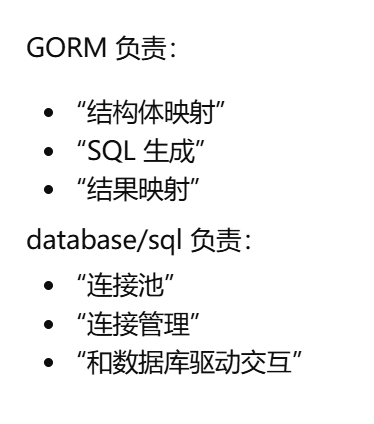

### GORM 的优缺点

* 优点
>
>- 开发效率高，减少 SQL
>- 结构体即表，代码可读性好
>- 内置事务、分页、预加载等能力

- 缺点
>
>- 底层是反射，性能略低
>- 复杂 sql 可读性差
>- 不如手写 sql 灵活

结构体即表，代码可读性好

内置事务、分页、预加载等能力

### GORM 的事务原理
>
>GORM 的事务本质还是数据库事务，
只是帮我们封装了 begin / commit / rollback，
出错就回滚，
底层还是用 database/sql 的事务接口

### GORM 如何防止 SQL 注入？
>
>GORM 默认使用 预编译 + 占位符 的方式构造 SQL，
把参数和 SQL 分开传递，
从而避免 SQL 注入。

### gorm.Model 是什么？
>
> 封装了 ID、CreatedAt、UpdatedAt、DeletedAt。

``` go
type Model struct {
    ID        uint
    CreatedAt time.Time
    UpdatedAt time.Time
    DeletedAt gorm.DeletedAt
}
```

- 作用
  >统一主键、自动时间戳、支持逻辑删除

### First / Take / Find
>
> First 有排序，Take 没排序，Find 查多条。

### Where 防 SQL 注入？
>
> 使用占位符，GORM 会自动处理。

```go
db.Where("name = ?", name)
```

### Save vs Updates
>
> save 更新所有；updates 只更新非零字段。

### 逻辑删除
>
>不真删数据
>填充 DeletedAt
>查询自动过滤

>GORM 的逻辑删除是通过 DeletedAt 字段实现的，
删除时不是真删，
而是更新删除时间；
查询时自动加条件过滤已删除的数据。

## Mysql & Rsdis

### mysql & redis 区别

- **关系型数据库**

> **代表**：**MySQL**、PostgreSQL、Oracle、SQL Server
  
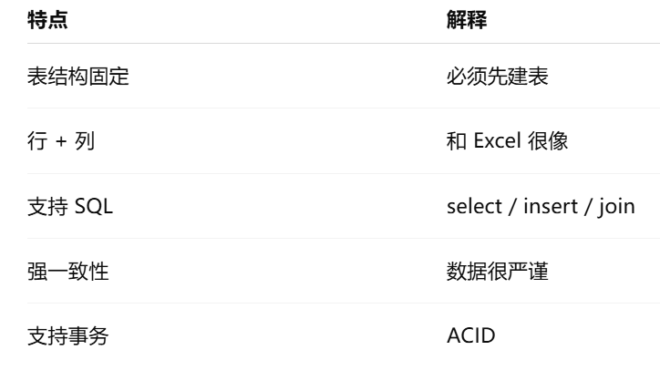

>**优点**
>
>- 数据结构清晰
>- 事务安全（钱、订单）
>- 复杂查询强（join、统计）

>**缺点**
>
>- 扩展性一般（横向扩容难）
>- 高并发下性能不如 Redis

- **非关系型数据库**

>**代表**：**Redis（Key-Value）**、MongoDB（文档）、Elasticsearch（搜索）、HBase（列存储）


>MySQL 是关系型数据库，适合存业务核心数据，支持事务和复杂查询；
Redis 属于非关系型内存数据库，主要用作缓存和高并发访问。
实际项目中通常是 MySQL 做主存，Redis 扛热点流量。
从数据库类型上看，关系型数据库强调结构和一致性，NoSQL 强调灵活性和扩展性，两者通常配合使用。

### InnoDB是什么，和MyISAM有什么区别；有什么特点z

* InnoDB、MyISAM是什么

> 它们是 MySQL 的「存数据的方式」(：存储引擎（Storage Engine）)
- 特点

>支持事务、行级锁、崩溃恢复。

>MyISAM 就一个查的快，其他都不支持

### 事务是什么呢
>事务是一组操作的集合，要么全部成功，要么全部失败，用来保证在并发和异常情况下，数据依然是正确的。

### MySQL 事务的四大特性（ACID）
>
>原子性（Atomicity）、一致性（Consistency）、隔离性（Isolation）、持久性（Durability）
- A 原子性：不能成功一半
- C 一致性：前后数据规则不被破坏
- I 隔离性：并发事务互不干扰
- D 持久性：提交后不会丢
  
> **举个实际的应用例子**

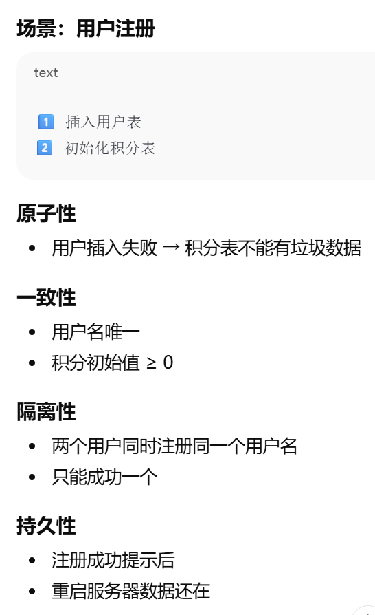

### 索引是什么？为什么能加快查询？
>
>索引是排好序的数据结构（B+ 树
>可以减少磁盘 IO，加快查询速度。

### MySQL 锁机制

* 锁是干嘛的？

>并发访问时保证数据一致性

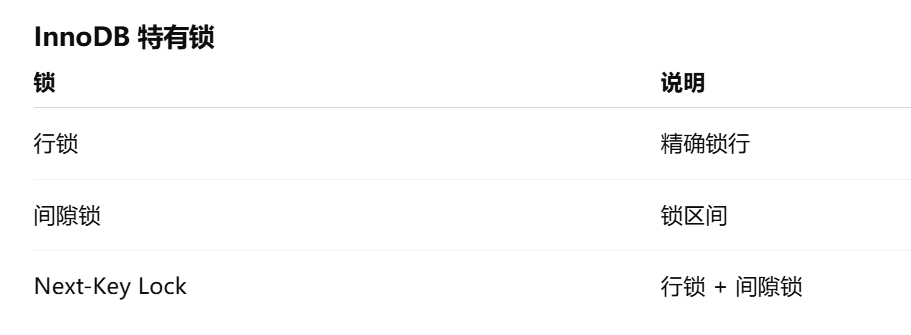

### 什么情况下索引会失效？

**索引是否生效，核心看能不能“顺着 B+ 树查”**

>- LIKE %xxx，左边有百分号，无法从索引起点查；
>- 对索引列做函数或计算，比如 YEAR(time)，索引结构被破坏；
>- 隐式类型转换，比如字符串字段用数字去查，导致索引失效；
>- 联合索引不符合最左前缀原则，比如 (name, age) 只用 age 查询。
  
### 幻读
>
> 同一事务中多次查询结果不一致，InnoDB 用 MVCC + 间隙锁解决。

### Redis 缓存和数据库一致性怎么保证？
>
>先更新数据库，再删除缓存；
>如果失败，通过重试或异步补偿。

### Redis 是什么？用来干嘛？
>
>内存数据库
>用于缓存、分布式锁、消息队列、计数器

### Redis 为什么快？
>
> 内存 + 单线程 + 高效数据结构。

### 数据结构 & 场景
>
>String 缓存，Hash 对象，List 队列，Set 去重，ZSet 排行榜。

> **String**   是 Redis 最基础的数据结构，本质是 key-value 结构，读取速度快，常用于缓存、Token、计数器、分布式锁等场景。

>**Hash** 更适合存储对象类型数据，比如用户信息、商品信息。相比多个 String，Hash 可以减少 key 数量，更方便管理对象字段。

>**List**是一个有序可重复列表，底层类似双向链表，支持两端插入和弹出，常用于消息队列、评论列表、时间线等场景。

>**Set** 是无序不可重复集合，自动去重，适合存储标签、点赞用户、共同好友等需要去重的场景。

>**Zset** 是带 score 的有序集合，Redis 会根据 score 自动排序，非常适合排行榜、热搜、积分排名等场景。
``` redis
SET name tom
INCR count
HSET user:1 name tom age 18
LPUSH queue 1
SADD users tom
ZADD rank 100 tom

```

### 单线程为什么高并发？
>
>避免上下文切换，IO 多路复用。

### 分布式锁
>
>Redis 分布式锁是利用 Redis 的 SET NX EX 命令实现的，通过 NX 保证互斥，EX 防止死锁，
>并通过唯一 value 和 Lua 脚本保证只有加锁的人才能解锁，
>常用于下单、扣库存等分布式并发场景。

### Redis 过期策略有哪些？
>
>定期删除 + 惰性删除。
- 扩展(内存满了怎么办)

>会触发 内存淘汰策略

### Redis 内存淘汰策略
>
> allkeys-lru、volatile-lru、noeviction
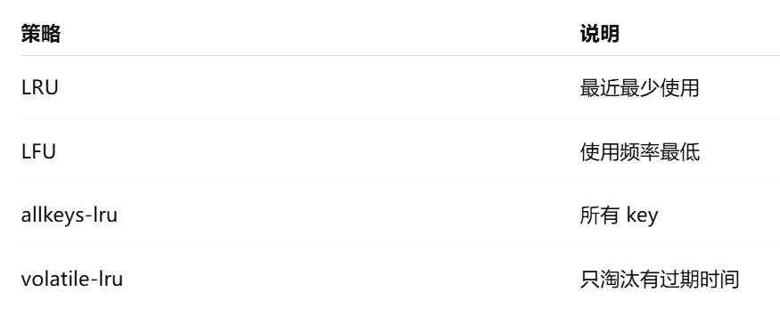

### 缓存问题解决方案
>
>布隆过滤器、互斥锁、随机过期时间。

>布隆过滤器用于快速判断数据是否不存在，
防止大量非法请求绕过缓存直接打到数据库。

>通过互斥锁控制并发，
防止缓存失效时大量请求同时访问数据库。

>通过给缓存设置随机过期时间，
避免大量 key 同时失效导致数据库压力骤增。


### RDB 和 AOF 区别？

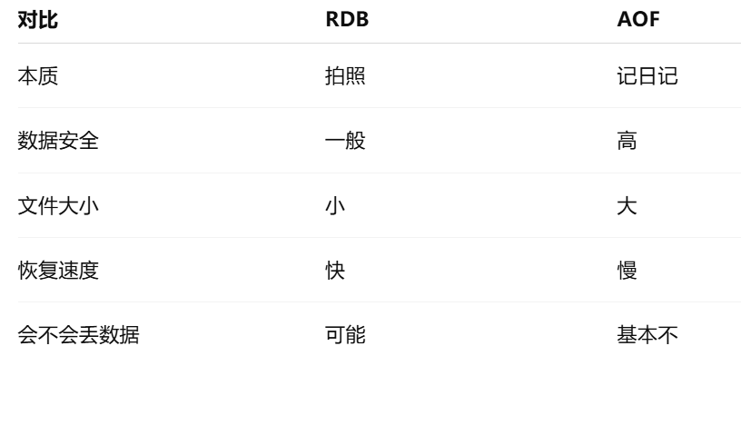

## Linux & 部署

## Linux

### 常用的 Linx 命令有哪些？ 
>文件操作：ls(查看目录)、cd（切换目录）、mkdir（创建目录）、rm（删除）、find（查找）、pwd（路径）

>进程管理：ps -aux 查看进程，kill 关闭进程

>网络信息：ip a 查看 IP

>管道与搜索：|、grep 用于命令组合和过滤


### 什么是 Shell 脚本？
>Shell 脚本是将多个 Linux 命令写入文件，由 Shell 解释执行，用于自动化运维操作。

## 网络 & 计算机基础

## 网络

### HTTP，TCP，UDP，IP 是什么？ 都位于哪个位置
>HTTP 是应用层协议，负责定义请求和响应的格式；
TCP 是传输层协议，提供可靠的、面向连接的传输；
UDP 也是传输层协议，但不保证可靠性，适合对实时性要求高的场景；
IP 是网络层协议，负责数据包的寻址和路由。

>HTTP 主要解决“数据怎么表达”的问题，比如请求方法、状态码和头信息；
TCP 负责数据的可靠传输，保证不丢包、不乱序；
UDP 不保证可靠性，但传输开销小、延迟低，常用于音视频和游戏；
IP 工作在网络层，负责把数据包从源主机发送到目标主机。

### 七层分别有哪些，还有作用
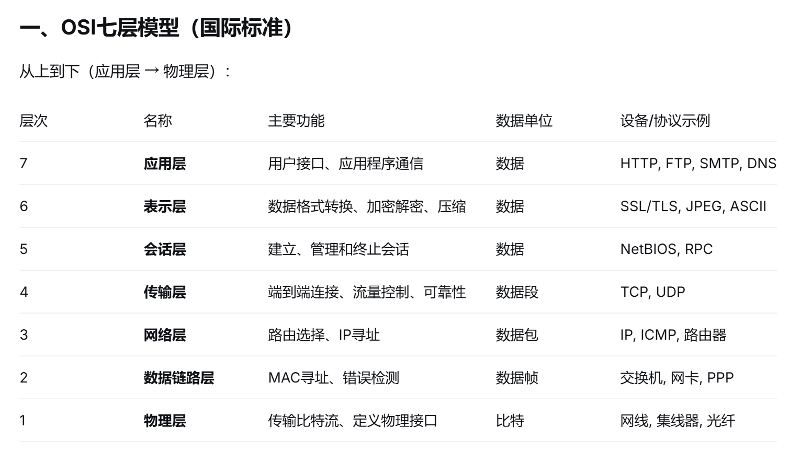

### TCP 三次握手、四次挥手

* 三次握手

>**TCP 三次握手是为了确认客户端和服务端双方的收发能力**
>
>- 第一次客户端发送 SYN，表示自己可以发送。
>- 第二次服务端返回 SYN+ACK，表示自己可以接收也可以发送。
>- 第三次客户端返回 ACK，表示自己也可以接收。
>- 通过三次握手，双方确认彼此的发送和接收能力都正常，从而建立连接。

- TCP 四次挥手

>**TCP 四次挥手是因为 TCP 是全双工协议，双方关闭连接需要分别进行**
>
>- 主动关闭方先发送 FIN，表示自己不再发送数据。
>- 被动方返回 ACK 确认。
>- 等被动方数据发送完后，再发送 FIN 表示自己也关闭。
>- 最后主动方返回 ACK，连接彻底关闭。

### 流量控制（TCP 的能力）
>
>流量控制是基于滑动窗口机制，防止接收方处理不过来

### 拥塞控制

* **为什么需要**: 网络本身也会被打爆

>TCP 通过慢启动和拥塞避免算法动态调整发送速率，防止网络拥塞。


- **总结**

>TCP 通过三次握手建立连接，四次挥手断开连接，并通过流量控制和拥塞控制保证通信稳定。

### Socket 编程

* Socket 编程到底是什么
  >使用操作系统提供的 API，直接基于 TCP/IP 收发字节
- Socket 四元组
  >源IP + 源端口 + 目标IP + 目标端口
- Socket 编程流程
  >**服务端**

  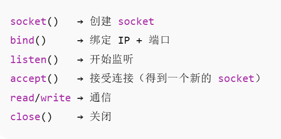

  >**客户端**

  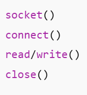

### HTTP 和 HTTPS 的区别？
>
>HTTPS 在 HTTP 基础上加了 SSL/TLS 加密，更安全，防止数据被窃听和篡改。

>HTTP 是一种明文传输协议，主要用于客户端和服务器之间的数据通信；
HTTPS 是在 HTTP 的基础上引入了 TLS 加密机制，提供了数据加密、身份校验和完整性保护，防止数据被窃听和篡改。
因此在涉及登录、支付等敏感信息时必须使用 HTTPS。

### 什么是 RPC
>
>**RPC**是一种远程过程调用机制，目的是让服务之间的调用像本地方法调用一样

### 什么 GRPC & WebSocket
>
>**gRPC** 是 Google 推出的高性能 RPC 框架，基于 HTTP/2 和 protobuf，常用于微服务内部通信。

>**WebSocket** 是一种支持全双工通信的协议，主要用于实时通信场景，如聊天和推送，不属于 RPC。

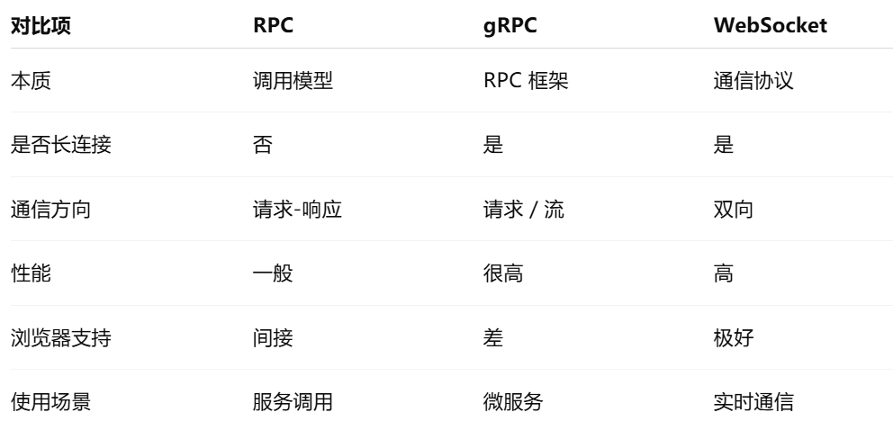

### HTTP 常见状态码有哪些？

* 200：成功
- 400：参数错误
- 401：未认证
- 403：没权限
- 404：接口不存在
- 500：服务端错误

哪些是客户端错误，哪些是服务端错误

### RESTful API 是什么？
>
> RESTful 是一种接口设计风格，用 HTTP 方法表示对资源的操作。

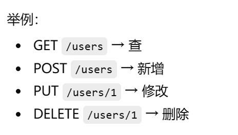

### IP TCP HTTP
>
>IP 负责寻址和路由，TCP 提供可靠传输，HTTP 基于 TCP 实现应用通信。

## 操作系统

### 用户态和内核态？
>
>用户态权限低，内核态权限高，系统调用时会从用户态切换到内核态。

### 什么是 go 的GC
>
>**自动帮你清理“已经没人用的内存**
>Go 有自动 GC，主要用三色标记法，减少程序停顿。

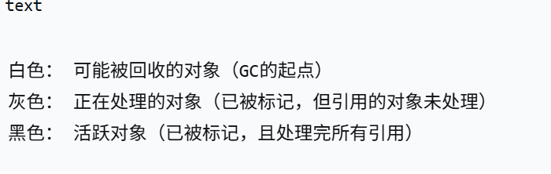

## 工程能力

### 你如何设计一个登录接口？
>
>校验参数 → 查用户 → 校验密码 → 生成 token → 返回。

### 接口超时怎么处理？
>
> 客户端超时 + 服务端 context 超时，
防止请求一直占用资源。

### 如何做接口限流？
>
>常见方式有令牌桶、漏桶，
实现上可以用 Redis 或本地限流。

### Go 服务如何优雅关闭？
>
> 监听系统信号，停止接收新请求，
等待正在执行的请求处理完再退出。

### 线上服务 CPU / 内存飙高怎么排查？
>
> 先看监控 → pprof → 定位热点函数或 goroutine 泄漏。

### 登录状态放 Redis 还是 JWT？
>
> JWT 无状态，性能好；Redis 可控性强，适合踢人和过期控制。

### 如何防止接口被重复提交？
>
>用 Redis + 唯一 key，或者前端生成请求 ID。

>防重复提交更多是接口层防止用户误操作；

### 如何保证接口幂等性？
>
> 多次请求，结果一致，比如用唯一约束、Redis 记录状态

>幂等性则是系统层保证在重试和异常情况下数据一致性


### 云原生
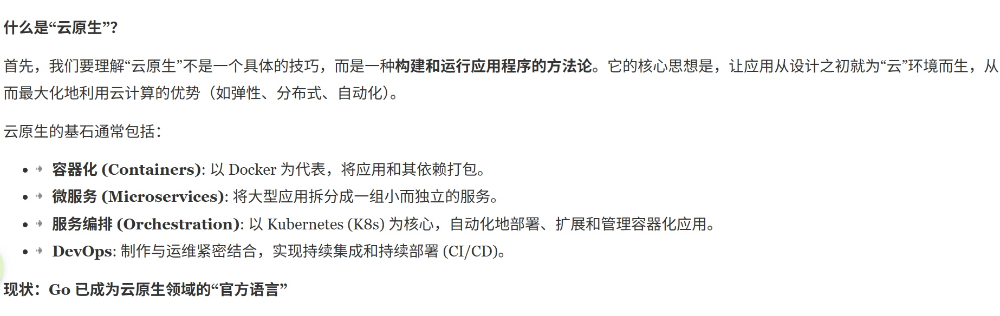


