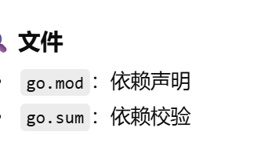

# 面试题目汇总
- [面试题目汇总](#面试题目汇总)
	- [go](#go)
		- [理论](#理论)
	- [性能](#性能)
		- [深入分析进程线程高并发原理](#深入分析进程线程高并发原理)
			- [协程](#协程)
			- [进程与线程](#进程与线程)
			- [高并发原理](#高并发原理)
			- [Go语言并发编程模型](#go语言并发编程模型)
			- [Go语言性能优势](#go语言性能优势)
		- [垃圾回收](#垃圾回收)
			- [Go的垃圾回收机制的特点：](#go的垃圾回收机制的特点)
			- [Go版本的变化：](#go版本的变化)
		- [程序](#程序)

## go


### 理论

- 什么是goroutine？它与传统线程的区别是什么？
  > goroutine是Go语言中轻量级的执行单元，由Go运行时调度，相比于传统线程，它的创建和销毁开销更小，且可以高效地实现并发编程。通过关键字go可以启动一个新的goroutine。
- 请解释一下通道（channel）在Go语言中的作用和用法。
  > 通道是用于goroutine之间进行通信和同步的数据结构。它可以安全地实现并发访问和数据传递。通道提供发送和接收操作，通过<-符号进行数据的发送和接收。例如，ch := make(chan int)创建一个整数类型的通道。
- 请描述一下如何使用通道实现协程间的数据共享和同步。
  >答案示例：通过通道，可以在多个协程之间进行数据共享和同步。一个协程可以将数据发送到通道，而另一个协程可以从通道接收该数据。通道提供了阻塞机制，发送操作和接收操作会根据通道的状态进行阻塞或解除阻塞，实现了协程间的同步。
- 请解释一下互斥锁（Mutex）在并发编程中的作用。
  >互斥锁是一种常用的并发控制机制，用于保护共享资源的访问。通过对关键代码块加锁和解锁操作，可以保证同一时间只有一个协程能够访问被保护的资源，避免竞态条件的发生。

- Go语言中的defer关键字有什么作用？
  > defer 常用于延迟调用函数，在函数返回之前调用
  >常用于资源释放，比如说关闭文件、返回锁、
  >当多个 defer 时，按先进后出执行
- 如何进行并发编程以及如何避免竞态条件（Race Condition）？
  > Go使用 gorouetine 进行并发编程
  * 在进行并发时，如何避免竞态条件
  >* 使用互斥锁或读写锁
  >* 使用channel通信
  >* atomic 原子操作

  > **Go 推荐 通过通信共享数据，而不是通过共享数据通信。**
- 什么是Go语言中的错误处理机制？如何处理错误？
  >  Go 没有异常机制，而是通过返回 error 显式表示是否出错。调用方需要判断 error 是否为 nil，从而决定是否继续执行。
- 
- 如何进行单元测试和基准测试（Benchmarking）？
  * Go 使用 testing 包进行测试
  > 单元测试：func TestXxx(t *testing.T)
  ```go
  func TestAdd(t *testing.T) {
    if Add(1, 2) != 3 {
        t.Fail()
    }
  }
  ```

  >基准测试：func BenchmarkXxx(b *testing.B)

  ``` go
  func BenchmarkAdd(b *testing.B) {
    for i := 0; i < b.N; i++ {
        Add(1, 2)
    }
  }
  ```

- Go语言中的并发安全（Concurrency Safety）是什么意思？
  > 多个gorouneit并发访问同一资源时，程序不会出错，不会出现竞态条件和脏数据的情况
- Go语言中的包管理工具有哪些？如何使用它们管理依赖？
  >go 通常使用 GO Modules（go.mod） 进行依赖管理
  * **常用命令**
  ``` go
  go mod init
  go get
  go mod tidy
  ```
  
- 如何处理JSON数据和HTTP请求？
  >Go 中处理 HTTP 请求时，使用 net/http 接收请求和返回响应；
  
  >请求体中的 JSON 数据通过 encoding/json 反序列化为结构体，处理完成后再将结构体序列化为 JSON 返回给客户端。
* 流程图
	```
	请求进来
	↓
	http.Request
	↓
	读 body
	↓
	json → struct
	↓
	业务处理
	↓
	struct → json
	↓
	http.ResponseWriter
	```
  
- 什么是Go语言中的反射（Reflection）？如何使用反射机制？
  >反射是指运行时获取变量的类型和值信息

  >Go 使用 reflect 包实现反射，常用于框架、通用库（如 ORM、JSON 解析
- 如何进行文件操作和目录操作？
  >go 通常使用 os 包进行文件目录操作
  ```go
  os.ReadFile()
  os.WriteFile()
  os.Mkdir()
  ```
- Go语言中的并发模式有哪些，例如生产者-消费者模式等？
  >Go 中常见并发模式包括生产者-消费者、Worker Pool、Fan-in/Fan-out 和 Pipeline。
  >这些模式基于 goroutine 和 channel，用于任务分 发、并发控制和结果汇总，能在保证并发安全的同时提高程序吞吐量。

 


## 性能

1. 使用性能分析工具： Go 提供了一些内置的性能分析工具，如 `go tool pprof` 和 `go trace`。使用这些工具可以定位程序中的性能瓶颈。`go tool pprof` 可以生成 CPU 和内存的分析报告，帮助你了解程序的 CPU 和内存使用情况。`go trace` 可以生成事件跟踪报告，帮助你分析 Goroutine 的创建、阻塞等情况。通过分析这些报告，可以找到程序的性能瓶颈并进行优化。
2. 减少内存分配： 在 Go 程序中，频繁的内存分配和垃圾回收会影响性能。可以通过重用对象、使用对象池、避免不必要的字符串拼接等方式来减少内存分配。使用 `sync.Pool` 可以创建对象池，重复使用对象，减少垃圾回收的压力。
3. 并发优化： 在 Go 中，使用 Goroutine 和通道可以实现高效的并发编程。可以将计算密集型的任务拆分成多个 Goroutine 并行执行，利用多核 CPU 的性能。合理使用并发控制的机制，如使用 `sync.Mutex` 进行资源访问控制、使用 `sync.WaitGroup` 进行并发任务的等待等。
4. 减少系统调用和 I/O 操作： I/O 操作通常是程序性能的瓶颈之一。减少不必要的系统调用、使用批量操作和异步操作可以提高程序的性能。对于频繁的文件操作，可以考虑使用内存缓存或者使用更高效的文件操作方式。
5. 使用高效的数据结构和算法： 合理选择数据结构和算法可以大幅提高程序的性能。例如，使用哈希表进行快速查找、使用平衡二叉树进行有序操作、使用位运算进行高效的位操作等。
6. 使用并发安全的组件： 在多线程环境下，使用并发安全的组件可以避免数据竞争和并发访问的问题。例如，使用带锁的数据结构、使用带缓冲的通道等。
7. 进行基准测试： 使用 Go 的基准测试框架可以对程序的性能进行量化和比较。通过编写基准测试用例，可以评估不同实现的性能，并找到需要优化的部分。


### 深入分析进程线程高并发原理

并解释为什么Go语言具有高性能需要涉及操作系统的进程和线程管理、调度机制以及Go语言的并发编程模型。

#### 协程
协程（goroutine）是一种轻量级的执行单位，是Go语言并发编程的基础。与传统的线程相比，协程的创建和销毁成本非常低，可以在少量的内核线程上运行大量的协程。协程由Go运行时（runtime）负责调度，采用抢占式调度策略，在运行时自动进行协程的切换。

协程的特点包括：
- 轻量级：一个协程的栈空间初始大小只有几KB，可以在程序中创建大量的协程而不会导致内存消耗过大。
- 独立的栈空间：每个协程都拥有独立的栈空间，使得协程之间的数据不会相互干扰，提高了并发编程的安全性。
- 内部调度：协程的调度由Go运行时负责，不依赖于操作系统的线程调度，可以根据需要动态地调整协程的执行顺序，提高并发性能。
- 通信机制：协程之间通过通道（channel）进行通信和同步，避免了显式的锁和竞态条件，简化了并发编程模型。

#### 进程与线程

- 进程是操作系统分配资源的最小单位，每个进程拥有独立的内存空间和上下文环境，进程间通信开销较大。
- 线程是进程中的执行单元，多个线程共享进程的内存空间和上下文环境，线程间通信开销较小。

#### 高并发原理

- 多进程并发：使用多个进程来处理并发请求，每个进程独立运行，可以充分利用多核处理器的能力。但进程间通信开销较大，需要使用IPC（进程间通信）机制，如管道、共享内存、消息队列等。
- 多线程并发：使用多个线程来处理并发请求，线程共享内存，可以更高效地进行数据共享和通信。但多线程编程需要处理线程同步和互斥问题，如锁、条件变量等，存在线程安全的风险。

#### Go语言并发编程模型

- Go语言采用了基于协程（goroutine）和通道（channel）的并发编程模型。
- 协程是Go语言提供的轻量级线程，由Go运行时负责调度，可以在少量的内核线程上运行大量的协程。
- 通道是协程之间进行通信和同步的机制，通过通道可以安全地传递数据，避免了显式的锁和竞态条件。

#### Go语言性能优势

- Goroutine的轻量级：相较于传统的操作系统线程，Goroutine的创建和销毁成本非常低，可以轻松创建数以千计的Goroutine，而不会消耗过多的系统资源。
- 内置的并发原语：Go语言提供了丰富的并发原语和工具，如通道、互斥锁、读写锁等，使并发编程更加简洁、安全、高效。
- 优秀的调度器：Go运行时具备自己的调度器，能够在多个Goroutine之间高效地调度执行，实现了高效的抢占式调度和任务均衡。
- 内存管理：Go运行时具备自动垃圾回收机制，有效地管理内存资源，减少了手动内存管理的负担。
- 并发编程模型的简单性：Go语言的并发编程模型相对简单，减少了对开发者的学习和使用成本，提高了开发效率和代码质量。

### 垃圾回收
####  Go的垃圾回收机制的特点：
- 标记-清除算法（Mark and Sweep）：Go语言的垃圾回收器使用了标记-清除算法进行垃圾回收。该算法通过标记所有活跃对象，然后清除未被标记的对象。这种方式可以处理不连续的内存空间，但会产生内存碎片。

- 并发垃圾回收：Go语言的垃圾回收器是并发执行的，即垃圾回收的过程与程序的执行同时进行，不会暂停整个程序的执行。Go运行时会在程序执行时自动触发垃圾回收，并尽量保证回收的效率和对程序的影响最小化。

- 分代回收：Go语言的垃圾回收器采用分代回收的策略。它将堆分成多个不同的代（generation），根据对象的存活时间将其分配到不同的代中。通过对不同代的垃圾回收策略进行优化，可以提高垃圾回收的效率。

#### Go版本的变化：
随着Go语言的版本迭代，垃圾回收机制也在不断改进和优化，以提供更好的性能和资源利用率。一些重要的垃圾回收机制变化如下：

- Go 1.3：
  - 在此版本中引入了并发标记（Concurrent Marking）的垃圾回收机制。垃圾回收器开始与程序并发执行，减少了垃圾回收对程序执行的停顿时间。
- Go 1.4：在此版本中改进了GC的并发能力，减少了垃圾回收对程序的影响，特别是在多核系统上的表现更好。
- Go 1.5：
  - 引入了新的GC调度器，称为GOGC调度器，以及增量垃圾回收（Incremental GC）算法。增量垃圾回收将垃圾回收工作分解为多个小步骤，并与程序执行并行进行，减少了垃圾回收对程序性能的影响。

- Go 1.6：
  - 在此版本中进一步改进了GC的表现，包括降低了GC停顿时间、提高了GC的并发性能，以及改进了内存使用情况。

- Go 1.8：
  - 引入了更快的GC算法，通过增量标记（Incremental Marking）和屏障优化（Barrier Elimination）来减少垃圾回收器的停顿时间。
- Go 1.11 
  - 版本引入了延迟清理（deferred cleanup）机制，将垃圾回收的清理工作从程序的执行阶段延迟到程序空闲阶段进行，减少了垃圾回收对程序执行的干扰。
- Go 1.12
  - 版本引入了写屏障优化（write barrier），通过优化内存访问模式，减少了垃圾回收器的负载和停顿时间。
- Go 1.13：
  - GC中引入了"Concurrent Scavenge"（并发清扫）阶段，这一阶段在STW（Stop The World）停顿期间并发运行，提高了GC的吞吐量。
- Go 1.14：
  - 引入了更快的垃圾回收器，改进了性能和延迟。
  - 提供了新的环境变量GODEBUG，可以用来调整和观察GC的行为和性能。
- Go 1.15：
  - 引入了对堆空间的"Scavenger"（清扫者）功能，用于自动释放长时间未使用的内存，并将其归还给操作系统。
  - 优化了GC算法和数据结构，提升了性能和内存利用率。
- Go 1.16：
  - 引入了"Read-Barrier Elimination"（读屏障消除）和"Write-Barrier Elimination"（写屏障消除）技术，进一步提高了GC的性能。
  - 通过减少写屏障的开销，改善了GC的吞吐量。
- Go 1.17：
  - 引入了"Scavenge Enhancements"（清扫增强）技术，通过减少STW的停顿时间和内存碎片，提高了GC的性能和可预测性。
  - 通过引入新的环境变量GOGC，可以更好地调整和优化GC的阈值。
- Go 1.19：
  - 引入了新的垃圾回收算法"Generational GC"（代际垃圾回收），用于优化内存回收的效率和延迟。
  - 优化了栈扫描和内存管理，提高了GC的性能和稳定性。

### 程序
- 编写一个程序，在两个并发的goroutine中交替打印奇数和偶数，要求使用通道进行数据传递和同步。
```go
package main

import "fmt"

func printNumbers(oddCh, evenCh chan bool) {
	for i := 1; i <= 10; i++ {
		if i%2 == 0 {
			fmt.Println("Even:", i)
			evenCh <- true
			<-oddCh
		} else {
			fmt.Println("Odd:", i)
			oddCh <- true
			<-evenCh
		}
	}
}

func main() {
	oddCh := make(chan bool)
	evenCh := make(chan bool)

	go printNumbers(oddCh, evenCh)

	oddCh <- true // Start with odd
	<-evenCh     // Wait for even to print the first number

	// Wait for goroutine to finish
	<-oddCh
}

```
- 编写一个并发程序，使用多个goroutine同时计算一组整数的平均值，并将结果返回到主goroutine中。
```go
package main

import "fmt"

func printNumbers(oddCh, evenCh chan bool) {
	for i := 1; i <= 10; i++ {
		if i%2 == 0 {
			fmt.Println("Even:", i)
			evenCh <- true
			<-oddCh
		} else {
			fmt.Println("Odd:", i)
			odd
			Ch <- true<-evenCh
		}
	}
}

func main() {
	oddCh := make(chan bool)
	evenCh := make(chan bool)

	go printNumbers(oddCh, evenCh)

	oddCh <- true // Start with odd
	<-evenCh     // Wait for even to print the first number

	// Wait for goroutine to finish
	<-oddCh
}

```
- 实现一个并发安全的计数器（Counter）类型，支持并发的增加和获取计数值的操作，要求使用互斥锁进行资源访问控制。
```go
package main

import (
	"fmt"
	"sync"
)

type Counter struct {
	value int
	mutex sync.Mutex
}

func (c *Counter) Increment() {
	c.mutex.Lock()
	defer c.mutex.Unlock()
	c.value++
}

func (c *Counter) GetValue() int {
	c.mutex.Lock()
	defer c.mutex.Unlock()
	return c.value
}

func main() {
	counter := Counter{}

	var wg sync.WaitGroup
	wg.Add(10)

	for i := 0; i < 10; i++ {
		go func() {
			counter.Increment()
			wg.Done()
		}()
	}

	wg.Wait()

	fmt.Println("Counter:", counter.GetValue())
}
```
- 使用通道实现一个生产者-消费者模型的并发程序，其中生产者生成随机数并发送到通道，消费者从通道接收随机数并打印出来。
```go
package main

import (
	"fmt"
	"math/rand"
	"time"
)

func producer(numbersCh chan<- int, doneCh <-chan struct{}) {
	rand.Seed(time.Now().UnixNano())

	for {
		select {
		case <-doneCh:
			return
		default:
			num := rand.Intn(100)
			numbersCh <- num
			fmt.Println("Produced:", num)
			time.Sleep(time.Second)
		}
	}
}

func consumer(numbersCh <-chan int, doneCh chan<- struct{}) {
	for num := range numbersCh {
		fmt.Println("Consumed:", num)
	}

	doneCh <- struct{}{}
}

func main() {
	numbersCh := make(chan int)
	doneCh := make(chan struct{})

	go producer(numbersCh, doneCh)
	go consumer(numbersCh, doneCh)

	time.Sleep(5 * time.Second)

	close(numbersCh)
	<-doneCh
}


```
- 编写一个并发程序，模拟多个用户同时登录系统，要求使用读写锁（RWMutex）实现对用户登录状态的并发读写控制。

```go
package main

import (
	"fmt"
	"sync"
	"time"
)

type User struct {
	ID       int
	Username string
	LoggedIn bool
}

type UserStore struct {
	users map[int]*User
	lock  sync.RWMutex
}

func (us *UserStore) Login(userID int) {
	us.lock.Lock()
	defer us.lock.Unlock()

	user := us.users[userID]
	if user != nil {
		user.LoggedIn = true
		fmt.Printf("User %s logged in\n", user.Username)
	}
}

func (us *UserStore) Logout(userID int) {
	us.lock.Lock()
	defer us.lock.Unlock()

	user := us.users[userID]
	if user != nil {
		user.LoggedIn = false
		fmt.Printf("User %s logged out\n", user.Username)
	}
}

func (us *UserStore) IsLoggedIn(userID int) bool {
	us.lock.RLock()
	defer us.lock.RUnlock()

	user := us.users[userID]
	if user != nil {
		return user.LoggedIn
	}

	return false
}

func main() {
	userStore := &UserStore{
		users: make(map[int]*User),
	}

	// Create users
	for i := 1; i <= 5; i++ {
		userStore.users[i] = &User{
			ID:       i,
			Username: fmt.Sprintf("User%d", i),
			LoggedIn: false,
		}
	}

	var wg sync.WaitGroup

	// Simulate login
	for i := 1; i <= 5; i++ {
		wg.Add(1)
		go func(userID int) {
			defer wg.Done()

			time.Sleep(time.Duration(userID) * time.Second)
			userStore.Login(userID)
		}(i)
	}

	// Simulate check login status
	for i := 1; i <= 5; i++ {
		wg.Add(1)
		go func(userID int) {
			defer wg.Done()

			time.Sleep(time.Duration(userID) * time.Second)
			loggedIn := userStore.IsLoggedIn(userID)
			fmt.Printf("User %s is logged in: %v\n", userStore.users[userID].Username, loggedIn)
		}(i)
	}

	wg.Wait()
}

```
在上述示例中，UserStore代表用户存储，使用map存储多个用户对象。Login方法用于将用户标记为已登录，Logout方法用于将用户标记为已注销，IsLoggedIn方法用于检查用户的登录状态。

在Login和Logout方法中，我们使用写锁（lock.Lock()和lock.Unlock()）来保护对用户状态的并发写入。

在IsLoggedIn方法中，我们使用读锁（lock.RLock()和lock.RUnlock()）来允许多个goroutine并发地读取用户状态，因为读取操作不会改变数据。

在主函数中，我们创建了5个用户，并分别模拟了用户登录和检查登录状态的并发操作。使用WaitGroup等待所有goroutine完成。

通过使用读写锁（RWMutex），我们可以实现对用户登录状态的并发读写控制，确保在多个goroutine同时访问用户状态时的安全性。
