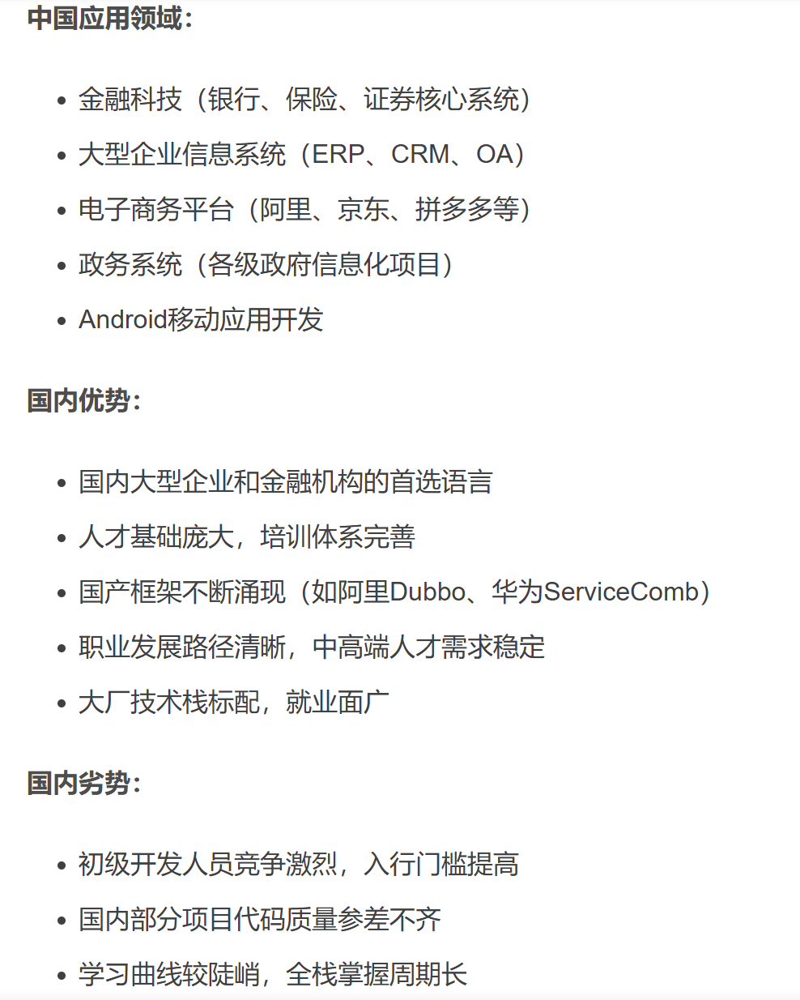
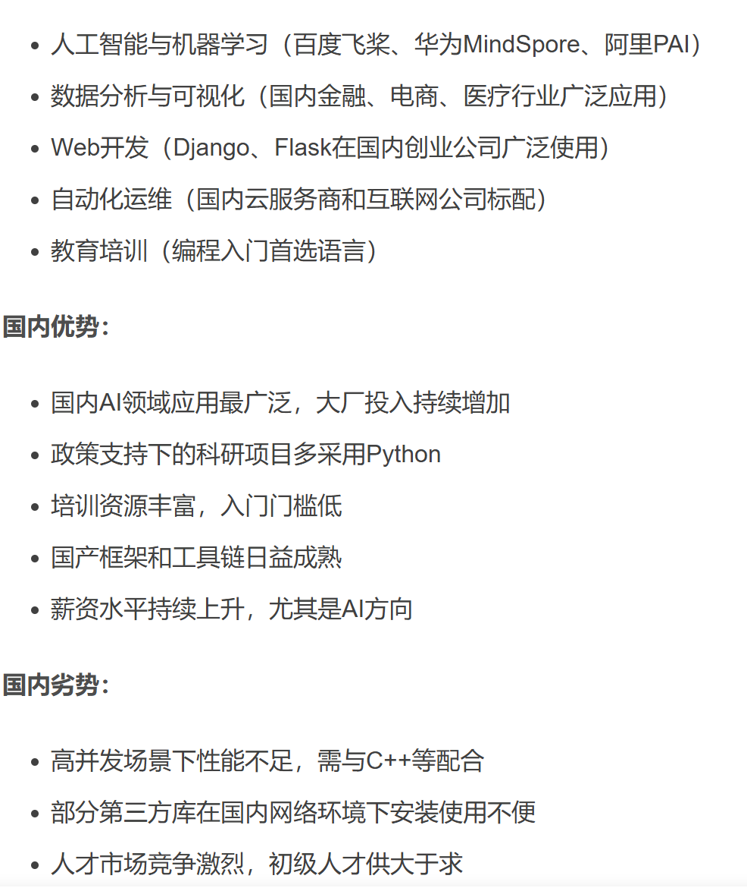
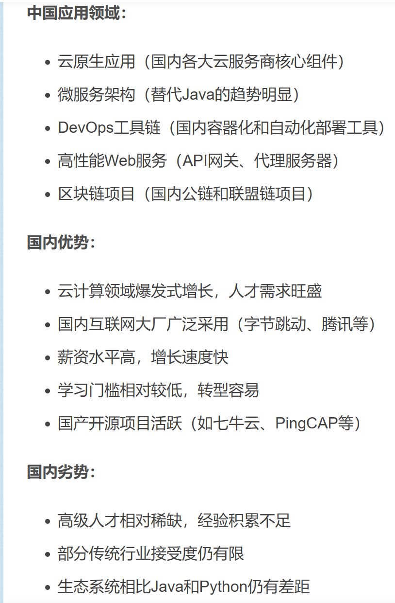
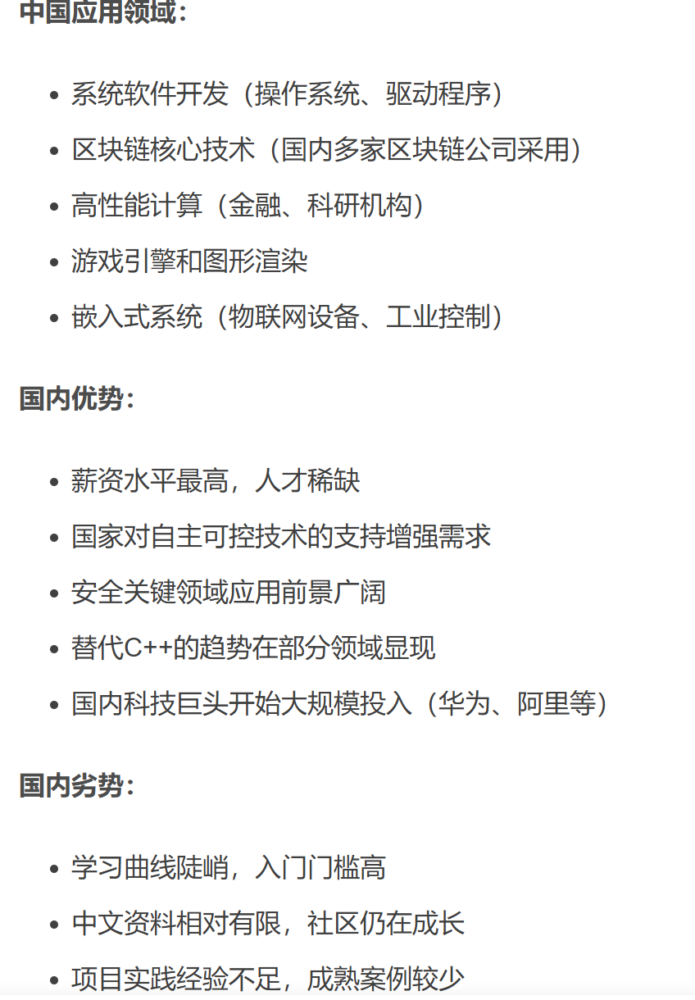
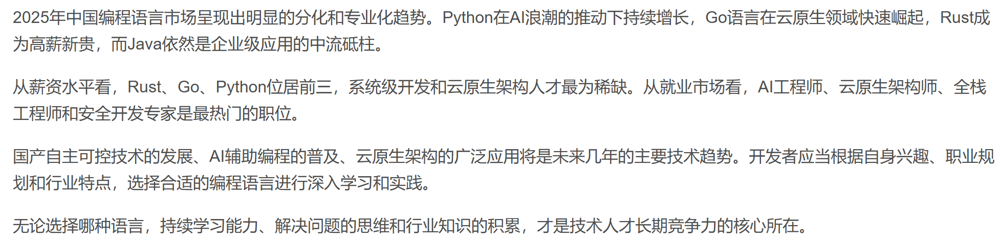

### 较火语言终结报告
**分析一下 java & python & go & rust ，还有现在市场比较火的编程语言，并且应用场景，市场占用比例，特性**
> 当今编程语言其中比较火的语言主要有java、python、JavaScript、Rust、Go、Kotlin等等，其中。
> 
> java：企业级后端开发的常青树。在金融、电商、大型分布式系统（Spring Boot/Cloud）中地位稳固，也是安卓原生开发（Kotlin正在挑战其地位）的主要语言之一。（全球占比约 8%~10%）（岗位最多（尤其国内），外包 / 中小企业 / 传统公司需求很大。低水平 Java 人才饱和了）（只会CRUD不够还得会简单的微服务讲清楚原理）
>
> 

> python：语法简单、动态类型（开发效率高）、库生态极强（AI、数据分析）。在人工智能、数据科学、机器学习领域占据主导地位。同时广泛用于后端开发（如FastAPI, Django）、自动化脚本和科学计算（全球第一，约 25%~30%（AI推动））（AI / 数据分析需求大，但是数据分析偏学历）
>
>

> go：编译型语言（性能高）原生支持并发（goroutine）语法简洁（比 Java 简单）。云原生时代的宠儿。语法简单、并发性能极强（goroutine），是Docker、Kubernetes等云基础设施的主要开发语言。非常适合构建高并发的后端服务、中间件和微服务。（占比约 2%~5%，增长快（互联网公司偏爱））(就业：云原生 / 后端。基本要求有项目经验，本科，初级岗位少)
>
>

> Rust：目前系统级语言中最受追捧。以其内存安全、无需垃圾回收的高性能著称。被广泛应用于操作系统、区块链、嵌入式开发以及WebAssembly（Wasm）领域。微软、谷歌等大厂都在用Rust重构底层组件。（占比低（<2%））（要求高，公司更看经验）
>
>

> 