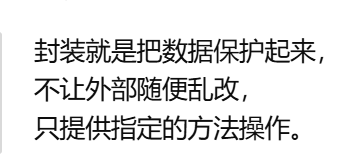
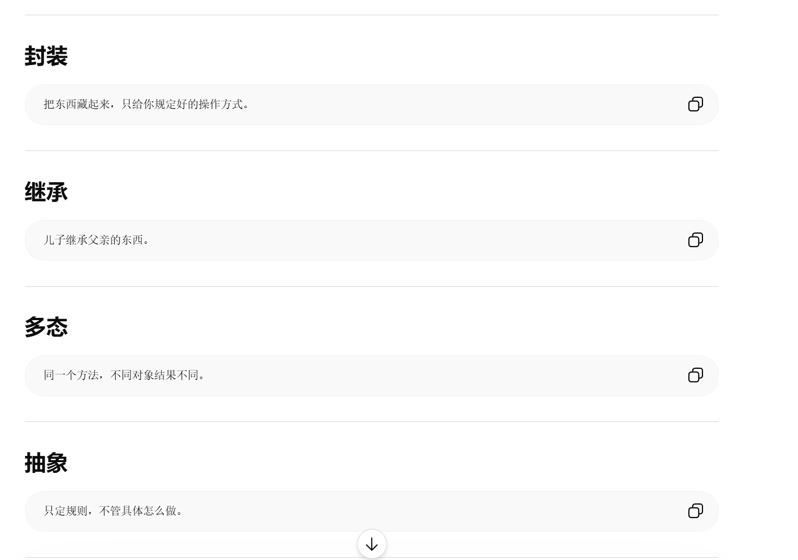
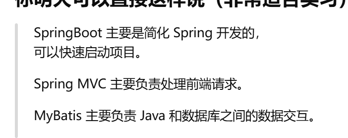
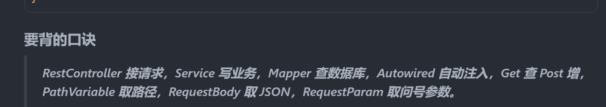

# Java 实习面试复习指南

> 针对：上海米思软件科技 · Java 实习工程师  
> 技术栈：Spring Boot + MyBatis + Vue/uni-app  
> 建议：按章节顺序学，每章末尾有「自测题」

---

## 目录

1. [Java 基础](#一java-基础)
2. [Spring 与三层架构](#二spring-与三层架构)
3. [SQL 必会](#三sql-必会)
4. [Spring 常用注解](#四spring-常用注解)
5. [前端相关（Vue / uni-app）](#五前端相关vue--uni-app)
6. [你的 Vue 项目怎么讲](#六你的-vue-项目怎么讲)
7. [开发工具与 Linux](#七开发工具与-linux)
8. [面试高频题与参考答案](#八面试高频题与参考答案)
9. [自我介绍模板](#九自我介绍模板)
10. [今晚学习 checklist](#十今晚学习-checklist)

---

## 一、Java 基础

### 1.1 *面向对象（OOP）四个概念

| 概念 | 含义 | 例子 |
|------|------|------|
| **封装** | 把数据和方法包在类里，隐藏细节 | `private` 字段 + `public` getter/setter |
| **继承** | 子类继承父类的属性和方法 | `class Dog extends Animal` |
| **多态** | 同一方法，不同对象有不同表现 | 父类引用指向子类对象 |
| **抽象** | 只定义规范，不写具体实现 | 接口 `interface`、抽象类 |



### 1.2 *常用数据类型

```java
// 基本类型
int age = 20;
double price = 9.9;
boolean flag = true;

// 引用类型
String name = "张三";
```

### 1.3 *常用集合（必记区别）

| 集合 | 特点 | 使用场景 |
|------|------|----------|
| **ArrayList** | 有序、可重复、查快改慢 | 存列表，如用户列表 |
| **HashMap** | 键值对，通过 key 快速找 value | 存映射，如 id → 用户对象 |
| **HashSet** | 不重复 | 去重 |

**面试一句话：**  
ArrayList 像一排编号的座位；HashMap 像字典，用 key 查 value。

### 1.4 异常处理

```java
try {
    // 可能出错的代码
    int result = 10 / 0;
} catch (Exception e) {
    // 出错时执行
    System.out.println("出错了：" + e.getMessage());
} finally {
    // 无论是否出错都会执行
}
```

### 1.5 *接口 vs 抽象类

| | 接口 interface | 抽象类 abstract class |
|--|----------------|----------------------|
| 方法 | 主要是规范（Java 8+ 可有默认方法） | 可以有已实现的方法 |
| 继承 | 类可以实现多个接口 | 只能继承一个类 |
| 使用 | 定义「能做什么」 | 定义「是什么」的共性 |

TODO 举个实际例子

### 1.6 自测题

- [ ] 什么是封装？为什么要用 private？
- [ ] ArrayList 和 HashMap 分别用来干什么？
- [ ] try-catch-finally 各干什么？

---

## 二、Spring 与三层架构

### 2.1 整体流程（必背，建议手画一遍）

```
用户 / 浏览器 / 小程序
        ↓  HTTP 请求（GET / POST）
┌─────────────────────────────────┐
│  Controller 控制层               │  ← Spring MVC / @RestController
│  接收请求、返回 JSON              │
└─────────────────────────────────┘
        ↓
┌─────────────────────────────────┐
│  Service 业务层                  │  ← @Service
│  处理业务逻辑、校验、计算          │
└─────────────────────────────────┘
        ↓
┌─────────────────────────────────┐
│  Mapper / DAO 持久层             │  ← MyBatis @Mapper
│  执行 SQL，读写数据库             │
└─────────────────────────────────┘
        ↓
   MySQL / PostgreSQL
```

### 2.2 为什么要分三层？

1. **职责清晰**：改界面不影响数据库，改 SQL 不影响业务逻辑
2. **好维护**：代码结构清楚，团队协作方便
3. **好测试**：可以单独测 Service 层

### 2.3 各框架是什么（用自己的话背）

| 框架 | 一句话解释 |
|------|-----------|
| **Spring** | Java 开发的基础框架，管理对象、依赖注入 |
| **Spring Boot** | 简化 Spring 配置，快速启动 Web 项目，内嵌 Tomcat |
| **Spring MVC** | 处理 HTTP 请求，把 URL 映射到 Java 方法 |
| **MyBatis** | 持久层框架，写 SQL 操作数据库，结果映射成 Java 对象 |
| **Spring Security** | 安全框架，做登录、权限控制 |
| **Maven** | 项目管理工具，管理依赖 jar 包、编译打包 |



### 2.4 Spring Boot 示例代码（看懂即可）

**Controller 层：**

```java
@RestController
@RequestMapping("/api/user")
public class UserController {

    @Autowired
    private UserService userService;

    @GetMapping("/{id}")
    public User getUser(@PathVariable Long id) {
        return userService.getById(id);
    }

    @PostMapping
    public String addUser(@RequestBody User user) {
        userService.save(user);
        return "添加成功";
    }
}
```

**Service 层：**

```java
@Service
public class UserService {

    @Autowired
    private UserMapper userMapper;

    public User getById(Long id) {
        return userMapper.selectById(id);
    }

    public void save(User user) {
        userMapper.insert(user);
    }
}
```

**Mapper 层（MyBatis）：**

```java
@Mapper
public interface UserMapper {
    User selectById(Long id);
    void insert(User user);
}
```

对应 XML 或注解 SQL：

```sql
SELECT * FROM user WHERE id = #{id}
INSERT INTO user (name, age) VALUES (#{name}, #{age})
```

### 2.5 GET 和 POST 区别

| | GET | POST |
|--|-----|------|
| 用途 | 查询数据 | 提交/新增数据 |
| 参数位置 | URL 后面 `?id=1` | 请求体 body |
| 是否安全 | 参数暴露在地址栏 | 相对更安全 |
| 示例 | 查用户列表 | 注册用户、提交表单 |

### 2.6 自测题

- [ ] 能画出：浏览器 → Controller → Service → Mapper → 数据库
- [ ] Spring Boot 和 Spring 有什么区别？
- [ ] MyBatis 是干什么的？
- [ ] GET 和 POST 分别用来做什么？

---

## 三、SQL 必会

> JD 明确要求「熟练掌握 SQL」，这部分很可能考

### 3.1 基本增删改查（CRUD）

```sql
-- 查：查询所有用户
SELECT * FROM user;

-- 查：带条件
SELECT name, age FROM user WHERE age > 18;

-- 查：排序（DESC 降序，ASC 升序）
SELECT * FROM user ORDER BY age DESC;

-- 查：分页（MySQL）
SELECT * FROM user LIMIT 10 OFFSET 0;

-- 增
INSERT INTO user (name, age) VALUES ('张三', 20);

-- 改
UPDATE user SET age = 21 WHERE id = 1;

-- 删
DELETE FROM user WHERE id = 1;
```

### 3.2 联表查询

```sql
-- 内连接：只返回两表都匹配的行
SELECT u.name, o.order_no
FROM user u
INNER JOIN orders o ON u.id = o.user_id;

-- 左连接：保留左表全部，右表没有的填 NULL
SELECT u.name, o.order_no
FROM user u
LEFT JOIN orders o ON u.id = o.user_id;
```

**一句话：**
- **INNER JOIN**：只要两边都有的
- **LEFT JOIN**：以左表为主，右表没有也显示

### 3.3 聚合与分组

```sql
-- 统计人数
SELECT COUNT(*) FROM user;

-- 按部门统计人数
SELECT department, COUNT(*) AS total
FROM employee
GROUP BY department;

-- 分组后过滤（WHERE 是分组前，HAVING 是分组后）
SELECT department, COUNT(*) AS total
FROM employee
GROUP BY department
HAVING COUNT(*) > 5;
```

### 3.4 重要概念

| 概念 | 解释 |
|------|------|
| **主键 Primary Key** | 唯一标识一行，不能重复，如 `id` |
| **外键 Foreign Key** | 关联另一张表的主键，如 `user_id` |
| **索引 Index** | 加快查询速度，类似书的目录 |
| **SQL 注入** | 恶意拼接 SQL；防护：用预编译 `#{}`，不要拼接字符串 |

### 3.5 -- MyBatis 里怎么防 SQL 注入

```java
// 安全 ✅ 用 #{}
SELECT * FROM user WHERE id = #{id}

// 危险 ❌ 用 ${} 拼接用户输入
SELECT * FROM user WHERE name = '${name}'
```

### 3.6 自测题

- [ ] 手写：查 age > 18 的用户，按 age 降序
- [ ] 手写：INSERT 一条用户记录
- [ ] INNER JOIN 和 LEFT JOIN 区别？
- [ ] 主键和外键是什么？

---

## 四、-- Spring 常用注解

| 注解 | 作用 | 用在哪 |
|------|------|--------|
| `@RestController` | 标记控制器，返回值自动转 JSON | Controller 类 |
| `@Controller` | 控制器（传统 MVC，返回页面） | Controller 类 |
| `@Service` | 标记业务层 | Service 类 |
| `@Mapper` | 标记 MyBatis 数据层 | Mapper 接口 |
| `@Autowired` | 自动注入依赖 | 字段或构造方法 |
| `@RequestMapping("/api")` | 映射 URL 前缀 | 类或方法 |
| `@GetMapping` | 处理 GET 请求 | 方法 |
| `@PostMapping` | 处理 POST 请求 | 方法 |
| `@PutMapping` | 处理 PUT 请求（更新） | 方法 |
| `@DeleteMapping` | 处理 DELETE 请求 | 方法 |
| `@PathVariable` | 取 URL 里的参数，如 `/user/{id}` | 方法参数 |
| `@RequestBody` | 取请求体 JSON 转对象 | 方法参数 |
| `@RequestParam` | 取 URL 查询参数，如 `?name=xx` | 方法参数 |

**示例：**



```
GET  /api/user/5        → @GetMapping + @PathVariable id=5
POST /api/user          → @PostMapping + @RequestBody User
GET  /api/user?name=张三 → @GetMapping + @RequestParam name
```

---

## 五、前端相关（Vue / uni-app）

> JD 要求：Vue.js、Element UI、uni-app、微信小程序

### 5.1 各技术一句话

| 技术 | 是什么 |
|------|--------|
| **HTML** | 网页结构 |
| **CSS** | 网页样式 |
| **JavaScript** | 网页交互逻辑 |
| **Vue.js** | 前端框架，数据驱动视图，组件化开发 |
| **Element UI** | 基于 Vue 的 UI 组件库（表格、表单、按钮等） |
| **uni-app** | 一套代码编译成小程序、App、H5 |
| **微信小程序** | 运行在微信里的轻量应用 |
| **HBuilderX** | 开发 uni-app 的 IDE |
| **axios** | 前端发 HTTP 请求的工具 |

### 5.2 Vue 核心概念（你项目里都用到了）

| 概念 | 语法 | 作用 |
|------|------|------|
| 插值 | `{{ message }}` | 显示数据 |
| 绑定属性 | `:class="xxx"` | 动态 class |
| 事件 | `@click="send"` | 点击触发方法 |
| 双向绑定 | `v-model="input"` | 输入框和数据同步 |
| 条件渲染 | `v-if="show"` | 满足条件才显示 |
| 列表渲染 | `v-for="item in list"` | 循环渲染 |
| 响应式 | `ref()` | 数据变了，页面自动更新 |

### 5.3 前后端分离

```
前端（Vue）                    后端（Spring Boot）
  负责：页面、交互、展示    ←→   负责：业务逻辑、数据库
  通过 HTTP + JSON 通信
  axios.post('/api/chat', { question: '你好' })
  收到：{ reply: '你好，有什么可以帮你？' }
```

### 5.4 没做过 uni-app 怎么说

> 我做过 Vue 3 项目，组件、数据绑定、事件、列表渲染这些概念是通的。uni-app 基于 Vue 语法，我可以很快上手。

---

## 六、你的 Vue 项目怎么讲

### 6.1 项目一句话

> AI 聊天助手：Vue 3 前端 + Node.js 后端，用户输入问题，后端调用 AI API 返回答案，页面实时显示聊天气泡。

### 6.2 项目结构（面试能说出来）

```
ai-chat-vuenew/          前端
  main.js                入口，挂载 Vue
  App.vue                根组件，背景 + 标题
  components/ChatBox.vue  聊天核心：消息列表、输入、发送
  api/ai.js              axios 请求后端

ai-server/               后端
  server.js              Express 接口 POST /api/chat
  .env                   API Key（不能放前端）
```

### 6.3 发送一条消息的流程（2 分钟版）

1. 用户在输入框打字，`v-model` 绑定到 `input`
2. 点发送或按 Enter，触发 `send()` 函数
3. 先把用户消息 `push` 进 `messages` 数组，页面立刻显示用户气泡
4. 再 `push` 一条「正在生成回复...」占位
5. `await getAIReply(text)` 通过 axios 请求后端
6. 后端收到问题，调用 AI API，返回 `{ reply }`
7. 找到最后一条 AI 消息，替换成真实回复
8. `scrollToBottom()` 滚到底部

### 6.4 可能被问的问题

| 问题 | 参考答案 |
|------|----------|
| 前后端怎么通信？ | axios 发 POST 到 `http://localhost:7666/api/chat`，传 `{ question }`，返回 `{ reply }` |
| 什么是响应式？ | Vue 的 ref，改 `messages.value` 页面自动更新 |
| 为什么要有后端？ | API Key 不能写在前端；后端做中转和安全 |
| v-for 是干什么的？ | 遍历 messages 数组，每条消息渲染一个气泡 |
| async/await 干什么？ | 等网络请求完成再更新界面，不会卡死页面 |

---

## 七、开发工具与 Linux

### 7.1 工具说明

| 工具 | 用途 |
|------|------|
| **IntelliJ IDEA** | Java 开发主力 IDE |
| **VS Code / Cursor** | 前端开发 |
| **Maven** | Java 依赖管理、编译打包；`pom.xml` 里写依赖 |
| **Git** | 版本控制，记录代码变更，团队协作 |
| **SVN** | 老项目常用的版本控制，和 Git 类似 |
| **Postman** | 测试 API 接口 |
| **Navicat / DBeaver** | 可视化操作数据库 |

### 7.2 Maven 常用命令

```bash
mvn clean          # 清理编译结果
mvn compile        # 编译
mvn package        # 打包成 jar
mvn spring-boot:run  # 运行 Spring Boot 项目
```

### 7.3 Linux 基本命令（知道即可）

```bash
ls          # 列出文件
cd 目录名    # 进入目录
pwd         # 当前路径
cat 文件名   # 查看文件内容
grep 关键词 文件名  # 搜索内容
ps          # 查看进程
kill 进程号  # 结束进程
```

### 7.4 Git 基本命令

```bash
git clone 地址      # 克隆项目
git status         # 查看状态
git add .          # 添加改动
git commit -m "说明"  # 提交
git push           # 推送到远程
git pull           # 拉取最新代码
```

---

## 八、面试高频题与参考答案

### Java 基础

**Q1：Java 和 JavaScript 有什么区别？**

> Java 是编译型语言，运行在 JVM 上，主要用于后端和企业开发。JavaScript 是脚本语言，最初在浏览器运行，现在 Node.js 也能做后端。两者名字像，但是不同的语言。

**Q2：== 和 equals 区别？**

> `==` 比较基本类型值是否相等；比较对象时比较内存地址。`equals` 比较对象内容是否相等（需要类重写 equals 方法）。

**Q3：String 为什么不可变？**

> String 设计为不可变，线程安全，且可以复用字符串常量池，节省内存。

### Spring

**Q4：什么是依赖注入（DI）？**

> 对象之间的依赖不由自己 new，而是 Spring 容器自动注入。比如 Controller 需要 Service，用 `@Autowired` 就行，不用自己 `new UserService()`。

**Q5：Spring Boot 解决了什么问题？**

> 以前 Spring 要配很多 XML，Spring Boot 用自动配置，开箱即用，内嵌 Tomcat，一个 jar 就能跑。

**Q6：@RestController 和 @Controller 区别？**

> `@RestController` = `@Controller` + `@ResponseBody`，直接返回 JSON 数据。`@Controller` 传统上返回 HTML 页面。

### 数据库

**Q7：数据库事务是什么？**

> 一组 SQL 要么全部成功，要么全部失败。比如转账：扣钱和加钱必须同时成功，不能只扣不加。

**Q8：如何优化慢 SQL？**

> 加索引、避免 SELECT *、减少联表、用 EXPLAIN 分析执行计划。

### 网络 / HTTP

**Q9：HTTP 状态码 200、404、500 是什么意思？**

> 200 成功；404 资源不存在；500 服务器内部错误。

**Q10：Cookie 和 Session 区别？**

> Cookie 存在浏览器；Session 存在服务器。常用 Cookie 存 Session ID，服务器用这个 ID 找到用户会话。

### 项目 / 行为

**Q11：遇到 bug 怎么处理？**

> 先复现问题 → 看控制台/日志 → 定位是前端还是后端 → 查资料或问同事 → 小步修改 → 测试验证 → 记录文档。

**Q12：不会的技术怎么办？**

> 先看官方文档和报错信息，再查博客/视频，写小 demo 验证，还不行就问同事。我学 Vue 项目就是这样自学的。

**Q13：为什么想来我们公司实习？**

> 贵司做 Java + Vue 前后端，和我目前学习方向一致。我有 Vue 项目经验，希望能在真实企业项目里把 Java 后端练扎实，跟着团队做维护和二次开发。

---

## 九、自我介绍模板

> 把【】里的内容换成你自己的，背熟 1 分钟版

### 1 分钟版

```
面试官您好，我叫【姓名】，是【学校】【专业】【年级】的学生。

我主要在学习 Java 后端和 Vue 前端。最近自学做了一个 AI 聊天项目：
前端用 Vue 3，通过 axios 和后端通信；
后端用 Node.js 提供 REST 接口，调用 AI API 返回结果。
我负责页面布局、消息列表、异步请求和前后端联调。

虽然后端 demo 用的不是 Java，但我理解 Controller、Service、持久层
这种分层思想，也在学 Spring Boot 和 MyBatis，SQL 基础在巩固。

我学习能力强，代码习惯比较规范，沟通和文档意识也不错。
希望能在贵司实习，参与真实的 Java 项目维护和开发。谢谢。
```

### 30 秒精简版

```
您好，我是【姓名】，【学校】【专业】学生。
自学做过 Vue 3 聊天项目，理解前后端分离和 REST API。
正在学 Spring Boot + MyBatis + SQL，希望来贵司实习做 Java 开发。
```

---

## 十、今晚学习 checklist

按顺序打勾，完成一项勾一项：

### 必做（约 4 小时）

- [ ] **手画一遍** 浏览器 → Controller → Service → Mapper → 数据库
- [ ] **背熟** Spring Boot、Spring MVC、MyBatis 各一句话
- [ ] **手写 5 条 SQL**：SELECT 条件查询、INSERT、UPDATE、JOIN、GROUP BY
- [ ] **背 10 个注解**：RestController、Service、Mapper、Autowired、Get/PostMapping 等
- [ ] **把 Vue 项目讲 3 遍**（30 秒版 + 2 分钟版）
- [ ] **背自我介绍** 1 分钟版
- [ ] **过一遍** 第八章 13 道高频题

### 选做（有时间再看）

- [ ] B 站看「Spring Boot 入门」前 2 小时
- [ ] 了解 uni-app、Element UI 是什么
- [ ] 看 Linux 基本命令 ls、cd、cat、grep
- [ ] 准备 2 个问面试官的问题

### 明天面试前

- [ ] 简历打印（项目写：Vue 聊天 + axios + 前后端分离）
- [ ] 查路线，提前 15 分钟到
- [ ] 带笔和纸（可能要写 SQL 或画架构）

---

## 附录：JD 关键词对照表

| JD 写的 | 你要会的程度 |
|---------|-------------|
| Java JDK | 基础语法、OOP、集合 ⭐⭐⭐ |
| Spring / Spring Boot | 三层架构、注解 ⭐⭐⭐ |
| MyBatis | 是什么、怎么写 SQL ⭐⭐⭐ |
| MySQL / PostgreSQL / SQL | 增删改查、联表 ⭐⭐⭐ |
| Vue.js | 你做过项目 ⭐⭐⭐ |
| uni-app / 微信小程序 | 知道概念 ⭐ |
| Spring Security | 知道是管登录权限的 ⭐ |
| Maven / Git / SVN | 知道用途 ⭐⭐ |
| Linux | 基本命令 ⭐ |
| 修 bug / 二次开发 / 文档 | 准备行为面试话术 ⭐⭐⭐ |

---

*祝你面试顺利！*
