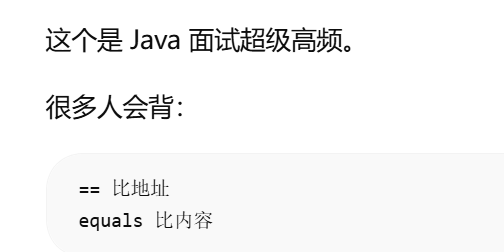
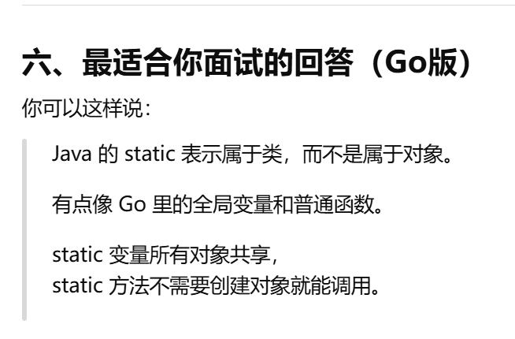
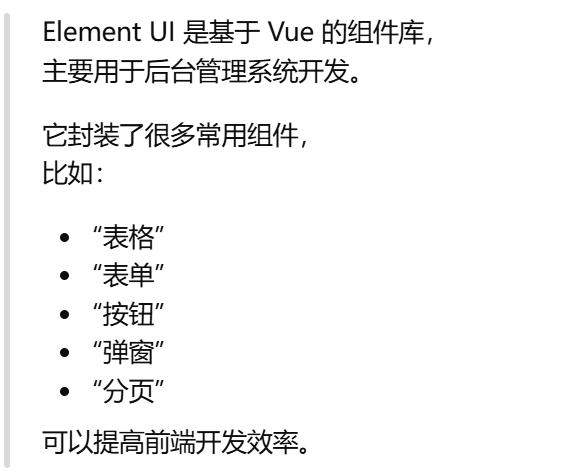

# Java 实习面试题集（含参考答案）

> 适用：Java 实习 / 初级后端 + Vue 前端  
> 用法：先盖住答案自己答 → 再对照 → 不会的标红反复看  
> 你有 Go 基础：每章附 **Go 对照** 帮助理解

---

## 目录

1. [Java 基础（20 题）](#一java-基础)
2. [面向对象（10 题）](#二面向对象)
3. [集合与常用类（10 题）](#三集合与常用类)
4. [Spring / Spring Boot（15 题）](#四spring--spring-boot)
5. [MyBatis 与数据库（15 题）](#五mybatis-与数据库)
6. [SQL 实操题（10 题）](#六sql-实操题)
7. [HTTP / Web / 网络（10 题）](#七http--web--网络)
8. [Vue / 前后端（8 题）](#八vue--前后端)
9. [项目与行为面试（12 题）](#九项目与行为面试)
10. [手写代码题（5 题）](#十手写代码题)

---

## 一、Java 基础

### 1. Java 和 JavaScript 有什么区别？

<details>
<summary>参考答案</summary>

- **Java**：编译型，运行在 JVM，主要用于后端、企业开发。
- **JavaScript**：脚本语言，最初在浏览器运行，Node.js 也可做后端。
- 两者名字像，但是**完全不同的语言**。

**Go 对照：** Java 像「编译版、带 class 的强类型语言」，和 Go 都是做后端的，但语法不同。

</details>

---

### 2. JDK、JRE、JVM 分别是什么？

<details>
<summary>参考答案</summary>

| 名称 | 是什么 |
|------|--------|
| **JVM** | Java 虚拟机，运行 `.class` 字节码 |
| **JRE** | JVM + 核心类库，只能运行不能开发 |
| **JDK** | JRE + 开发工具（javac 编译器等），开发必装 |

</details>

---

### 3. == 和 equals 的区别？

<details>
<summary>参考答案</summary>

- `==`：基本类型比较值；引用类型比较**内存地址**是否同一个对象。
- `equals`：比较对象**内容**是否相等（String 等类已重写）。

```java
String a = new String("hi");
String b = new String("hi");
a == b;       // false，不是同一个对象
a.equals(b);  // true，内容相同
```



</details>

---

### 4. String 为什么是不可变的？

<details>
<summary>参考答案</summary>

- `String` 内部字符数组 `final`，创建后不能改。
- 好处：**线程安全**、可以复用**字符串常量池**、作为 HashMap 的 key 更安全。

</details>

---

### 5. final、finally、finalize 的区别？

<details>
<summary>参考答案</summary>

| 关键字 | 作用 |
|--------|------|
| **final** | 修饰类不可继承、方法不可重写、变量不可改 |
| **finally** | try-catch 里无论是否异常都会执行的代码块 |
| **finalize** | 对象回收前调用的方法（已过时，了解即可） |

</details>

---

### 6. 基本类型有哪些？

<details>
<summary>参考答案</summary>

`byte, short, int, long, float, double, char, boolean`

引用类型：类、接口、数组、String 等。

</details>

---

### 7. int 和 Integer 区别？

<details>
<summary>参考答案</summary>

- `int`：基本类型
- `Integer`：包装类，可以为 `null`，有自动装箱拆箱

```java
Integer a = 10;   // 自动装箱
int b = a;        // 自动拆箱
```

</details>

---

### 8. 什么是异常？Checked 和 Unchecked 区别？

<details>
<summary>参考答案</summary>

- **Checked 异常**：编译期必须处理，如 `IOException`
- **Unchecked 异常**：运行时异常，如 `NullPointerException`、`ArrayIndexOutOfBoundsException`

```java
try {
    // 可能出错
} catch (Exception e) {
    e.printStackTrace();
} finally {
    // 一定执行
}
```

**Go 对照：** Java 的 try-catch ≈ Go 的 `if err != nil`

</details>

---

### 9. 接口和抽象类有什么区别？

<details>
<summary>参考答案</summary>

| | 接口 interface | 抽象类 abstract class |
|--|----------------|----------------------|
| 继承 | 类可实现**多个**接口 | 只能**继承一个**类 |
| 方法 | 主要是抽象方法（Java 8+ 可有默认方法） | 可以有已实现的方法 |
| 使用 | 定义「能做什么」 | 定义「是什么」的共性 |

**Go 对照：** 接口 ≈ Go 的 `interface`

</details>

---

### 10. 重载和重写的区别？

<details>
<summary>参考答案</summary>

| | 重载 Overload | 重写 Override |
|--|---------------|--------------|
| 位置 | 同一个类，方法名相同 | 子类重写父类方法 |
| 参数 | 参数列表必须不同 | 参数列表相同 |
| 目的 | 同名不同功能 | 子类改变父类行为 |

</details>

---

### 11. public、private、protected 区别？

<details>
<summary>参考答案</summary>

| 修饰符 | 访问范围 |
|--------|----------|
| public | 任何地方 |
| protected | 同包 + 子类 |
| 默认（不写） | 同包 |
| private | 仅本类 |

**Go 对照：** Go 用大写/小写控制导出，Java 用这四个关键字。

</details>

---

### 12. static 关键字作用？

<details>
<summary>参考答案</summary>

- 属于**类**而不是对象
- 静态变量：所有对象共享一份
- 静态方法：可直接 `类名.方法()` 调用，不能访问非静态成员


</details>


---

### 13. Java 和 Go 都能做后端，你会怎么选？

<details>
<summary>参考答案（开放题）</summary>

> Go 编译快、部署简单，适合云原生和高并发；Java 生态成熟，企业项目多，Spring 框架完善。我两种都有接触，来实习是希望把 Java 企业开发练扎实，和团队技术栈对齐。

</details>

---

### 14～20. 快速自测（自己先答）

| 题号 | 问题 | 关键词 |
|------|------|--------|
| 14 | 什么是多态？ | 同一引用，不同子类不同表现 |
| 15 | 什么是封装？ | private 隐藏细节，public 暴露接口 |
| 16 | 什么是继承？ | extends，复用父类 |
| 17 | break 和 continue？ | break 跳出循环；continue 跳过本次 |
| 18 | 数组和 ArrayList？ | 数组长度固定；ArrayList 可变 |
| 19 | 什么是泛型？ | `List<String>` 编译期类型安全 |
| 20 | 什么是反射？ | 运行时获取类信息（了解即可） |

---

## 二、面向对象

### 21. 面向对象四大特性？

<details>
<summary>参考答案</summary>

封装、继承、多态、抽象。

</details>

---

### 22. 什么是多态？举个例子。

<details>
<summary>参考答案</summary>

父类引用指向子类对象，调用方法时执行子类实现。

```java
Animal a = new Dog();
a.speak();  // 汪汪，而不是父类的叫声
```

</details>

---

### 23～30. 快速题

| 题号 | 问题 | 要点 |
|------|------|------|
| 23 | 构造方法作用？ | 创建对象时初始化 |
| 24 | 无参和有参构造？ | 重载；没写时默认无参 |
| 25 | this 关键字？ | 指向当前对象 |
| 26 | super 关键字？ | 调用父类构造或方法 |
| 27 | 为什么用接口？ | 解耦、多实现、规范 |
| 28 | 深拷贝和浅拷贝？ | 浅拷贝只复制引用；深拷贝复制对象内容 |
| 29 | 单例模式是什么？ | 一个类只有一个实例（了解） |
| 30 | 开闭原则？ | 对扩展开放，对修改关闭（了解） |

---

## 三、集合与常用类

### 31. ArrayList 和 LinkedList 区别？

<details>
<summary>参考答案</summary>

| | ArrayList | LinkedList |
|--|-----------|------------|
| 底层 | 数组 | 双向链表 |
| 查 | 快 | 慢 |
| 增删 | 慢（要移动元素） | 快 |

**Go 对照：** ArrayList ≈ `slice`

</details>

---

### 32. HashMap 原理（简答）？

<details>
<summary>参考答案</summary>

- 键值对存储，通过 hash 定位桶
- 查询平均 O(1)
- **线程不安全**；多线程用 `ConcurrentHashMap`
- JDK 8：数组 + 链表 + 红黑树

**Go 对照：** HashMap ≈ `map`

</details>

---

### 33. HashMap 和 Hashtable 区别？

<details>
<summary>参考答案</summary>

| | HashMap | Hashtable |
|--|---------|-----------|
| 线程安全 | 否 | 是（已过时） |
| null | 允许一个 null 键 | 不允许 |
| 性能 | 更快 | 较慢 |

</details>

---

### 34～40. 快速题

| 题号 | 问题 | 要点 |
|------|------|------|
| 34 | ArrayList 和数组？ | ArrayList 可变、有方法；数组固定 |
| 35 | Set 特点？ | 不重复 |
| 36 | HashSet 原理？ | 基于 HashMap |
| 37 | Iterator 作用？ | 遍历集合 |
| 38 | Comparable 和 Comparator？ | 自然排序 vs 外部比较器 |
| 39 | 集合遍历方式？ | for、增强 for、Iterator |
| 40 | 为什么用集合不用数组？ | 动态扩容、API 丰富 |

---

## 四、Spring / Spring Boot

### 41. 什么是 Spring？

<details>
<summary>参考答案</summary>

Java 企业级开发框架，核心是 **IoC（控制反转）** 和 **AOP（面向切面）**，简化开发，管理对象生命周期和依赖关系。

</details>

---

### 42. 什么是 Spring Boot？解决什么问题？

<details>
<summary>参考答案</summary>

- 简化 Spring 配置，**开箱即用**
- **内嵌 Tomcat**，不用单独部署 Web 服务器
- 自动配置，快速创建 Web 项目
- 用 `main` 方法或 jar 就能跑

**Go 对照：** 像 `go run main.go` + gin，一把梭启动 Web 服务。

</details>

---

### 43. 什么是 Spring MVC？

<details>
<summary>参考答案</summary>

Spring 中处理 **HTTP 请求** 的模块，把 URL 映射到 Java 方法，返回 JSON 或页面。

**Go 对照：** `r.GET("/user/:id", handler)`

</details>

---

### 44. 三层架构是哪三层？

<details>
<summary>参考答案</summary>

```
Controller 控制层  → 接 HTTP 请求，返回 JSON
Service    业务层  → 业务逻辑
Mapper/DAO 持久层 → 操作数据库（MyBatis）
```

**Go 对照：** handler → service → repository

</details>

---

### 45. 为什么要分三层？

<details>
<summary>参考答案</summary>

- 职责清晰，各干各的
- 好维护：改 SQL 不影响 Controller
- 好测试：可单独测 Service
- 团队协作方便

</details>

---

### 46. 常用注解（必背）

<details>
<summary>参考答案</summary>

| 注解 | 作用 |
|------|------|
| `@RestController` | 控制器，返回 JSON |
| `@Controller` | 控制器，常返回页面 |
| `@Service` | 业务层 |
| `@Mapper` | MyBatis 数据层 |
| `@Autowired` | 自动注入依赖 |
| `@GetMapping` | GET 请求 |
| `@PostMapping` | POST 请求 |
| `@PathVariable` | URL 路径参数 `/user/{id}` |
| `@RequestBody` | 请求体 JSON |
| `@RequestParam` | URL 查询参数 `?name=xx` |

</details>

---

### 47. 什么是依赖注入（DI）？

<details>
<summary>参考答案</summary>

对象需要的依赖不由自己 `new`，而是由 **Spring 容器** 自动注入。

```java
@Autowired
UserService userService;  // 不用 new UserService()
```

**好处：** 解耦、方便换实现、方便测试。

</details>

---

### 48. @RestController 和 @Controller 区别？

<details>
<summary>参考答案</summary>

- `@RestController` = `@Controller` + `@ResponseBody`，方法返回值**直接转 JSON**
- `@Controller` 传统用于返回 **HTML 页面**（配合视图）

前后端分离项目一般用 `@RestController`。

</details>

---

### 49. Spring Boot 启动流程（简答）？

<details>
<summary>参考答案</summary>

1. 运行主类 `xxxApplication` 的 `main` 方法
2. 加载自动配置
3. 内嵌 Tomcat 启动
4. 扫描 `@Component`、`@Service`、`@Controller` 等注解注册 Bean

</details>

---

### 50～55. 快速题

| 题号 | 问题 | 要点 |
|------|------|------|
| 50 | 什么是 IoC？ | 控制权交给 Spring 容器 |
| 51 | 什么是 AOP？ | 面向切面，如日志、事务（了解） |
| 52 | @Component 作用？ | 注册为 Spring Bean |
| 53 | @Configuration？ | 配置类 |
| 54 | application.yml 作用？ | 配置文件：端口、数据库等 |
| 55 | Maven 是什么？ | Java 依赖管理、打包工具，类似 go mod |

---

## 五、MyBatis 与数据库

### 56. 什么是 MyBatis？

<details>
<summary>参考答案</summary>

持久层框架，开发者**写 SQL**，MyBatis 把查询结果**映射成 Java 对象**。

**Go 对照：** `db.QueryRow(...).Scan(&user)`

</details>

---

### 57. #{} 和 ${} 区别？

<details>
<summary>参考答案</summary>

| | #{} | ${} |
|--|-----|------|
| 方式 | 预编译参数 | 字符串拼接 |
| 安全 | 防 SQL 注入 ✅ | 有注入风险 ❌ |
| 使用 | 传参数值 | 动态表名、列名（慎用） |

```xml
SELECT * FROM user WHERE id = #{id}   <!-- 推荐 -->
```

**Go 对照：** `#{}` ≈ SQL 里的 `?` 占位符

</details>

---

### 58. 如何防止 SQL 注入？

<details>
<summary>参考答案</summary>

1. 使用预编译：`#{}` 或 `PreparedStatement`
2. 不要拼接用户输入到 SQL
3. 校验参数

</details>

---

### 59. 数据库事务是什么？

<details>
<summary>参考答案</summary>

一组 SQL **要么全成功，要么全失败**。

例子：转账扣款和加款必须同时成功。

**ACID（了解）：** 原子性、一致性、隔离性、持久性。

</details>

---

### 60. 主键、外键、索引？

<details>
<summary>参考答案</summary>

| 概念 | 说明 |
|------|------|
| 主键 | 唯一标识一行，如 `id` |
| 外键 | 关联另一张表主键，如 `orders.user_id` |
| 索引 | 加快查询，类似目录；过多影响写入 |

</details>

---

### 61. MySQL 和 PostgreSQL 区别（了解）？

<details>
<summary>参考答案</summary>

都是关系型数据库，SQL 语法大部分相通。PostgreSQL 功能更强；MySQL 在国内更常见。实习岗知道「都会用 SQL」即可。

</details>

---

### 62～70. 快速题

| 题号 | 问题 | 要点 |
|------|------|------|
| 62 | JDBC 是什么？ | Java 连接数据库的标准 API |
| 63 | 连接池作用？ | 复用连接，提高性能 |
| 64 | 左连接和内连接？ | INNER 交集；LEFT 保留左表 |
| 65 | 慢 SQL 怎么优化？ | 加索引、避免 SELECT *、EXPLAIN |
| 66 | 什么是 ORM？ | 对象关系映射，MyBatis/Hibernate |
| 67 | MyBatis 和 Hibernate？ | MyBatis 手写 SQL 灵活；Hibernate 全自动 |
| 68 | 什么是脏读？ | 事务隔离相关（了解） |
| 69 | char 和 varchar？ | char 定长；varchar 变长 |
| 70 | DELETE 和 TRUNCATE？ | DELETE 可回滚逐行；TRUNCATE 清空表快 |

---

## 六、SQL 实操题

> 表结构：
> `user(id, name, age, department)`
> `orders(id, user_id, order_no, amount)`

### 71. 查询 age > 18 的用户，按 age 降序

<details>
<summary>参考答案</summary>

```sql
SELECT id, name, age
FROM user
WHERE age > 18
ORDER BY age DESC;
```

</details>

---

### 72. 插入一条用户：张三，20 岁，技术部

<details>
<summary>参考答案</summary>

```sql
INSERT INTO user (name, age, department)
VALUES ('张三', 20, '技术部');
```

</details>

---

### 73. 把 id=1 的用户年龄改为 21

<details>
<summary>参考答案</summary>

```sql
UPDATE user SET age = 21 WHERE id = 1;
```

</details>

---

### 74. 删除 id=5 的用户

<details>
<summary>参考答案</summary>

```sql
DELETE FROM user WHERE id = 5;
```

</details>

---

### 75. 查用户姓名和他的订单号（联表）

<details>
<summary>参考答案</summary>

```sql
SELECT u.name, o.order_no
FROM user u
INNER JOIN orders o ON u.id = o.user_id;
```

</details>

---

### 76. 统计每个部门的人数

<details>
<summary>参考答案</summary>

```sql
SELECT department, COUNT(*) AS total
FROM user
GROUP BY department;
```

</details>

---

### 77. 统计金额大于 1000 的订单数，按用户分组

<details>
<summary>参考答案</summary>

```sql
SELECT user_id, COUNT(*) AS cnt
FROM orders
WHERE amount > 1000
GROUP BY user_id;
```

</details>

---

### 78. 查询没有订单的用户（左连接）

<details>
<summary>参考答案</summary>

```sql
SELECT u.*
FROM user u
LEFT JOIN orders o ON u.id = o.user_id
WHERE o.id IS NULL;
```

</details>

---

### 79. 分页查询用户（MySQL）

<details>
<summary>参考答案</summary>

```sql
SELECT * FROM user
ORDER BY id
LIMIT 10 OFFSET 0;   -- 第 1 页，每页 10 条
```

</details>

---

### 80. 查询年龄最大的 3 个用户

<details>
<summary>参考答案</summary>

```sql
SELECT * FROM user
ORDER BY age DESC
LIMIT 3;
```

</details>

---

## 七、HTTP / Web / 网络

### 81. GET 和 POST 区别？

<details>
<summary>参考答案</summary>

| | GET | POST |
|--|-----|------|
| 用途 | 查询 | 提交/新增 |
| 参数 | URL `?id=1` | 请求体 body |
| 缓存 | 可缓存 | 一般不缓存 |
| 幂等 | 幂等 | 一般不幂等 |

</details>

---

### 82. HTTP 状态码 200、400、404、500？

<details>
<summary>参考答案</summary>

| 状态码 | 含义 |
|--------|------|
| 200 | 成功 |
| 400 | 请求参数错误 |
| 401 | 未认证 |
| 403 | 无权限 |
| 404 | 资源不存在 |
| 500 | 服务器内部错误 |

你项目里：`400` 没传 question，`500` 调 AI 失败。

</details>

---

### 83. 什么是 RESTful？

<details>
<summary>参考答案</summary>

一种 API 设计风格，用 HTTP 方法表示操作：

- GET 查询
- POST 新增
- PUT 更新
- DELETE 删除

URL 表示资源，如 `/api/user/1`

</details>

---

### 84. Cookie 和 Session 区别？

<details>
<summary>参考答案</summary>

| | Cookie | Session |
|--|--------|---------|
| 存在哪 | 浏览器 | 服务器 |
| 大小 | 有限 | 服务端可控 |
| 典型用法 | 存 Session ID | 存登录状态 |

</details>

---

### 85. 什么是 CORS？

<details>
<summary>参考答案</summary>

跨域资源共享。浏览器限制：前端 `localhost:5173` 访问后端 `localhost:7666` 属于跨域，后端要设置 `cors()` 允许。

你项目：`server.js` 第 9 行 `app.use(cors())`

</details>

---

### 86. 前后端分离是什么？

<details>
<summary>参考答案</summary>

- 前端：Vue 负责页面和交互
- 后端：Spring Boot 提供 JSON API
- 通过 HTTP + JSON 通信

你项目就是典型前后端分离。

</details>

---

### 87～90. 快速题

| 题号 | 问题 | 要点 |
|------|------|------|
| 87 | HTTPS 和 HTTP？ | HTTPS 加密 |
| 88 | 什么是 JSON？ | 轻量数据格式，`{"key":"value"}` |
| 89 | Token 认证？ | 登录后发 token，请求带 token |
| 90 | 什么是幂等？ | 多次请求结果相同，GET 幂等 |

---

## 八、Vue / 前后端

### 91. Vue 是什么？

<details>
<summary>参考答案</summary>

渐进式 JavaScript 前端框架，**数据驱动视图**，组件化开发。

</details>

---

### 92. v-for、v-if、v-model 作用？

<details>
<summary>参考答案</summary>

| 指令 | 作用 |
|------|------|
| v-for | 循环渲染列表 |
| v-if | 条件显示 |
| v-model | 双向绑定，如输入框 |

</details>

---

### 93. 什么是响应式（ref）？

<details>
<summary>参考答案</summary>

数据变了，页面**自动更新**，不用手动操作 DOM。

```js
const messages = ref([])
messages.value.push({ role: 'user', content: '你好' })
```

</details>

---

### 94. axios 是干什么的？

<details>
<summary>参考答案</summary>

前端发 HTTP 请求的工具。

```js
axios.post('/api/chat', { question: '你好' })
```

**Go 对照：** `http.Post` 或 `http.Client`

</details>

---

### 95. uni-app 和 Element UI 是什么？

<details>
<summary>参考答案</summary>

- **Element UI**：Vue 的 UI 组件库（表格、表单、按钮）

- **uni-app**：基于 Vue，一套代码出小程序 + App + H5

</details>

---

### 96～98. 快速题

| 题号 | 问题 | 要点 |
|------|------|------|
| 96 | 组件化是什么？ | 页面拆成可复用组件，如 ChatBox |
| 97 | 什么是 SPA？ | 单页应用，不刷新整页 |
| 98 | props 和 emit？ | 父传子 props；子传父 emit |

---

## 九、项目与行为面试

### 99. 介绍一下你的项目

<details>
<summary>参考答案（2 分钟）</summary>

> AI 聊天助手，前后端分离。前端 Vue 3 + Vite，核心组件 ChatBox，用 ref 管理消息列表，v-for 渲染气泡，axios 请求后端。后端 Node.js Express，提供 POST `/api/chat`，接收 question 和可选设置（systemPrompt、temperature），调用 AI API 返回 reply。API Key 放 .env 不暴露前端。我负责页面、联调、消息展示和设置功能。

</details>

---

### 100. 你的项目对应三层架构吗？

<details>
<summary>参考答案</summary>

> 流程一致。Controller 对应 `app.post` 接请求和返回 JSON；Service 对应组消息、调 AI 的业务逻辑；Mapper 对应 axios 调外部 API 取数据。正式 Java 项目会拆成三个类，并用 MyBatis 访问 MySQL。

</details>

---

### 101. 为什么 API Key 不能放前端？

<details>
<summary>参考答案</summary>

> 前端代码用户都能看到，Key 会泄露。放后端 .env，由服务器代为请求 AI，更安全。

</details>

---

### 102. 遇到 bug 怎么处理？

<details>
<summary>参考答案</summary>

1. 复现问题
2. 看浏览器控制台 / 后端日志
3. 定位前端还是后端
4. 查文档、搜索、小步修改
5. 改完再测，记录原因

</details>

---

### 103. 不会的技术怎么办？

<details>
<summary>参考答案</summary>

> 先看官方文档和报错，再查教程，写最小 demo 验证，还不行请教同事。我学 Vue 项目就是这样自学的。

</details>

---

### 104. 为什么来我们公司实习？

<details>
<summary>参考答案</summary>

> 贵司 Java + Vue 技术栈和我学习方向一致，岗位是维护和二次开发，我希望能参与真实项目，把 Spring Boot 和数据库能力练扎实。

</details>

---

### 105. 你的优缺点？

<details>
<summary>参考答案</summary>

**优点：** 学习能力强，有 Go 和 Vue 项目经验，能独立查资料解决问题。  
**缺点：** Java 企业项目实战经验还少，正在系统补 Spring 和 SQL，入职后会快速跟上。

</details>

---

### 106～110. 快速题

| 题号 | 问题 | 要点 |
|------|------|------|
| 106 | 为什么用 Git？ | 版本控制、协作、回滚 |
| 107 | 冲突怎么处理？ | 沟通、合并、以主分支为准 |
| 108 | 实习期望？ | 学技术、参与真实项目 |
| 109 | 能接受加班吗？ | 诚实回答 |
| 110 | 问面试官什么？ | 实习生做什么、有没有导师、技术栈 |

---

## 十、手写代码题

### 111. 反转字符串

<details>
<summary>参考答案</summary>

```java
public String reverse(String s) {
    return new StringBuilder(s).reverse().toString();
}
```

</details>

---

### 112. 判断回文字符串

<details>
<summary>参考答案</summary>

```java
public boolean isPalindrome(String s) {
    int l = 0, r = s.length() - 1;
    while (l < r) {
        if (s.charAt(l) != s.charAt(r)) return false;
        l++; r--;
    }
    return true;
}
```

</details>

---

### 113. 数组去重

<details>
<summary>参考答案</summary>

```java
public int[] unique(int[] nums) {
    Set<Integer> set = new HashSet<>();
    for (int n : nums) set.add(n);
    return set.stream().mapToInt(i -> i).toArray();
}
```

</details>

---

### 114. 两数之和（经典）

<details>
<summary>参考答案</summary>

```java
public int[] twoSum(int[] nums, int target) {
    Map<Integer, Integer> map = new HashMap<>();
    for (int i = 0; i < nums.length; i++) {
        int need = target - nums[i];
        if (map.containsKey(need)) {
            return new int[]{map.get(need), i};
        }
        map.put(nums[i], i);
    }
    return new int[]{};
}
```

</details>

---

### 115. SQL：查每个用户订单总金额

<details>
<summary>参考答案</summary>

```sql
SELECT u.name, SUM(o.amount) AS total_amount
FROM user u
JOIN orders o ON u.id = o.user_id
GROUP BY u.id, u.name;
```

</details>

---

## 附：模拟面试自测卷（30 分钟）

盖住答案，看能答几题：

| 模块 | 抽 3 题自测 |
|------|-------------|
| Java 基础 | 1、3、9 |
| Spring | 42、44、46 |
| SQL | 71、75、76 |
| 网络 | 81、82、86 |
| 项目 | 99、100、101 |

**目标：** 10 题里能流畅答出 7 题以上。

---

## 附：面试前一天必背清单

- [ ] 三层架构 + 你 server.js 对应关系
- [ ] Spring Boot / MVC / MyBatis 各一句话
- [ ] 10 个注解表格
- [ ] 5 条 SQL 默写
- [ ] 项目 30 秒 + 2 分钟介绍
- [ ] 1 分钟自我介绍
- [ ] GET/POST、200/404/500
- [ ] SQL 注入怎么防

---

*祝你面试顺利！*
