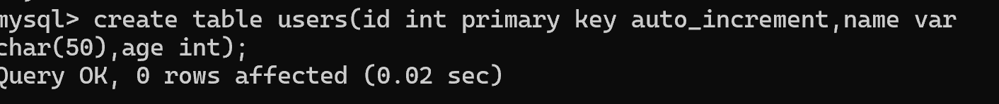
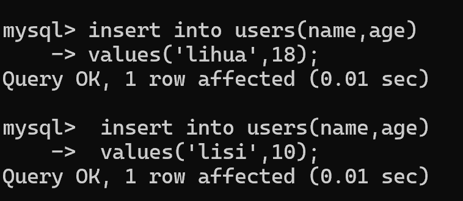
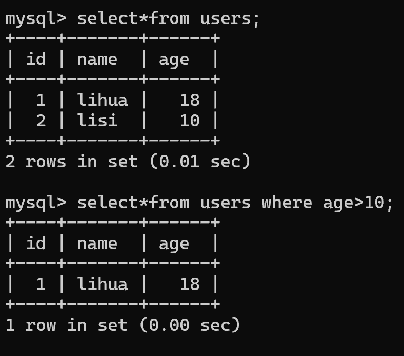
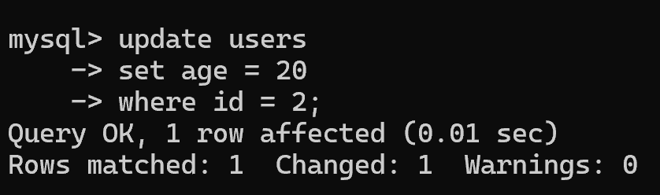
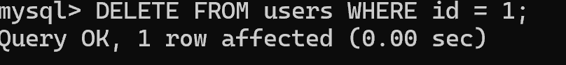
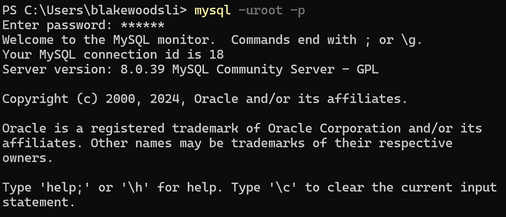

# MySQL 基础总结
- [MySQL 基础总结](#mysql-基础总结)
  - [MySQL 是什么](#mysql-是什么)
  - [安装 MySQL](#安装-mysql)
  - [ref](#ref)
    - [使用 Docker（推荐）](#使用-docker推荐)
  - [MySQL 基本概念](#mysql-基本概念)
    - [1️⃣ 数据库（Database）](#1️⃣-数据库database)
    - [2️⃣ 表（Table）](#2️⃣-表table)
    - [3️⃣ 行 \& 列](#3️⃣-行--列)
  - [MySQL 常见数据类型](#mysql-常见数据类型)
    - [1️⃣ 数值类型](#1️⃣-数值类型)
    - [2️⃣ 字符串类型](#2️⃣-字符串类型)
    - [3️⃣ 时间类型](#3️⃣-时间类型)
  - [CRUD（核心）](#crud核心)
  - [一、准备表（create）](#一准备表create)
    - [1️⃣ 建表（标准示例）](#1️⃣-建表标准示例)
    - [查看表](#查看表)
  - [二、增（create / insert）](#二增create--insert)
    - [2️⃣ 插入一条数据](#2️⃣-插入一条数据)
    - [3️⃣ 插入多条数据](#3️⃣-插入多条数据)
  - [三、查（read / select）](#三查read--select)
    - [4️⃣ 查询全部](#4️⃣-查询全部)
    - [5️⃣ 查询指定字段](#5️⃣-查询指定字段)
    - [6️⃣ 条件查询（where）](#6️⃣-条件查询where)
    - [7️⃣ and / or](#7️⃣-and--or)
    - [8️⃣ 排序（order by）](#8️⃣-排序order-by)
    - [9️⃣ 分页（limit）](#9️⃣-分页limit)
  - [四、改（update）](#四改update)
    - [🔟 更新一条数据（一定要 where）](#-更新一条数据一定要-where)
    - [更新多个字段](#更新多个字段)
  - [五、删（delete）](#五删delete)
    - [1️⃣ 删除一条](#1️⃣-删除一条)
    - [2️⃣ 删除所有（慎用）](#2️⃣-删除所有慎用)
  - [六、进阶（非常常用）](#六进阶非常常用)
    - [3️⃣ 统计数量（count）](#3️⃣-统计数量count)
    - [4️⃣ 去重（distinct）](#4️⃣-去重distinct)
    - [5️⃣ 模糊查询（like）](#5️⃣-模糊查询like)
  - [常见约束（非常重要）](#常见约束非常重要)
    - [1️⃣ 主键（PRIMARY KEY）](#1️⃣-主键primary-key)
    - [2️⃣ 非空（NOT NULL）](#2️⃣-非空not-null)
    - [3️⃣ 唯一（UNIQUE）](#3️⃣-唯一unique)
  - [索引（重点）](#索引重点)
    - [什么是索引](#什么是索引)
    - [创建索引](#创建索引)
    - [什么时候建索引](#什么时候建索引)
  - [事务（Transaction）](#事务transaction)
    - [事务四大特性（ACID）](#事务四大特性acid)
    - [事务示例](#事务示例)
  - [MySQL 常见使用场景](#mysql-常见使用场景)
  - [MySQL + Redis（重点）](#mysql--redis重点)
    - [为什么一起用？](#为什么一起用)
    - [标准架构（你后端必会）](#标准架构你后端必会)
  - [MySQL 命令行操作](#mysql-命令行操作)
    - [登录](#登录)
  - [](#)
    - [查看数据库](#查看数据库)
    - [查看表](#查看表-1)
    - [查看表结构](#查看表结构)
- [一、MySQL 是什么（一定会问）](#一mysql-是什么一定会问)
  - [1. 什么是 MySQL？](#1-什么是-mysql)
- [二、关系型数据库是什么？](#二关系型数据库是什么)
  - [面试高频](#面试高频)
    - [什么是关系型数据库？](#什么是关系型数据库)
- [三、MySQL 常见数据类型（必问）](#三mysql-常见数据类型必问)
  - [1. int](#1-int)
  - [2. varchar](#2-varchar)
  - [3. text](#3-text)
  - [4. datetime](#4-datetime)
- [四、主键是什么（超级高频）](#四主键是什么超级高频)
  - [什么是主键？](#什么是主键)
- [五、索引（超级超级高频）](#五索引超级超级高频)
- [1. 什么是索引？](#1-什么是索引)
- [举个例子](#举个例子)
- [2. 索引的优缺点](#2-索引的优缺点)
  - [优点](#优点)
  - [缺点](#缺点)
- [3. 哪些字段适合加索引？](#3-哪些字段适合加索引)
- [4. 什么情况下索引会失效？](#4-什么情况下索引会失效)
  - [（1）like '%xx'](#1like-xx)
  - [（2）对字段使用函数](#2对字段使用函数)
  - [（3）字符串不加引号](#3字符串不加引号)
- [六、聚簇索引 和 非聚簇索引](#六聚簇索引-和-非聚簇索引)
  - [聚簇索引](#聚簇索引)
  - [非聚簇索引](#非聚簇索引)
- [七、事务（超级高频）](#七事务超级高频)
- [1. 什么是事务？](#1-什么是事务)
- [2. 事务四大特性（ACID）](#2-事务四大特性acid)
  - [A — 原子性（Atomicity）](#a--原子性atomicity)
  - [C — 一致性（Consistency）](#c--一致性consistency)
  - [I — 隔离性（Isolation）](#i--隔离性isolation)
  - [D — 持久性（Durability）](#d--持久性durability)
- [八、事务隔离级别（重点）](#八事务隔离级别重点)
- [1. 脏读](#1-脏读)
- [2. 不可重复读](#2-不可重复读)
- [3. 幻读](#3-幻读)
- [MySQL 默认隔离级别](#mysql-默认隔离级别)
- [九、MySQL 存储引擎（高频）](#九mysql-存储引擎高频)
- [1. InnoDB（最常用）](#1-innodb最常用)
- [2. MyISAM](#2-myisam)
- [十、行锁和表锁](#十行锁和表锁)
  - [行锁](#行锁)
  - [表锁](#表锁)
- [十一、delete、truncate、drop 区别](#十一deletetruncatedrop-区别)
- [1. delete](#1-delete)
- [2. truncate](#2-truncate)
- [3. drop](#3-drop)
- [十二、char 和 varchar 区别](#十二char-和-varchar-区别)
- [char](#char)
- [varchar](#varchar)
- [十三、什么是 SQL 注入？](#十三什么是-sql-注入)
  - [错误写法](#错误写法)
- [正确方式](#正确方式)
- [十四、什么是慢查询？](#十四什么是慢查询)
  - [慢查询](#慢查询)
- [十五、如何优化 SQL？](#十五如何优化-sql)
- [SQL 优化思路](#sql-优化思路)
  - [1. 给查询字段加索引](#1-给查询字段加索引)
  - [2. 避免 select \*](#2-避免-select-)
  - [3. 避免大量 join](#3-避免大量-join)
  - [4. 避免 where 使用函数](#4-避免-where-使用函数)
  - [5. 分页优化](#5-分页优化)
- [十六、什么是回表？](#十六什么是回表)
- [十七、什么是覆盖索引？](#十七什么是覆盖索引)
- [十八、MySQL 执行一条 SQL 的过程](#十八mysql-执行一条-sql-的过程)
- [简单版回答](#简单版回答)
- [十九、你必须知道的 SQL](#十九你必须知道的-sql)
- [查询](#查询)
- [条件查询](#条件查询)
- [插入](#插入)
- [更新](#更新)
- [删除](#删除)
- [排序](#排序)
- [分页](#分页)
- [二十、面试最容易问的一套](#二十面试最容易问的一套)
- [高频 TOP 10](#高频-top-10)
  - [1. 什么是索引？](#1-什么是索引-1)
  - [2. 索引为什么快？](#2-索引为什么快)
  - [3. 哪些情况索引失效？](#3-哪些情况索引失效)
  - [4. 什么是事务？](#4-什么是事务)
  - [5. ACID 是什么？](#5-acid-是什么)
  - [6. MySQL 默认隔离级别？](#6-mysql-默认隔离级别)
  - [7. InnoDB 和 MyISAM 区别？](#7-innodb-和-myisam-区别)
  - [8. delete/truncate/drop 区别？](#8-deletetruncatedrop-区别)
  - [9. 什么是 SQL 注入？](#9-什么是-sql-注入)
  - [10. 如何优化 SQL？](#10-如何优化-sql)
- [二十一、适合实习生的加分回答](#二十一适合实习生的加分回答)
  - [“项目里 MySQL 怎么用的？”](#项目里-mysql-怎么用的)
- [二十二、最后给你一套“面试保命技巧”](#二十二最后给你一套面试保命技巧)
  - [话术 1](#话术-1)
  - [话术 2](#话术-2)
  - [话术 3](#话术-3)

## MySQL 是什么

**概念说明：**

* 基于 **磁盘** 的 **关系型数据库（RDBMS）**
* 使用 **SQL（结构化查询语言）**
* 支持 **事务、索引、外键**
* 数据以 **表（Table）** 的形式存储

**常见用途：**

* 用户系统
* 订单系统
* 商品数据
* 业务核心数据（最终可信数据）

---

## 安装 MySQL

## ref

* [MySQL 官方下载](https://dev.mysql.com/downloads/)
* [Docker 安装 MySQL（推荐）](https://hub.docker.com/_/mysql)

---

### 使用 Docker（推荐）

```bash
docker run -d \
  --name mysql \
  -p 3306:3306 \
  -e MYSQL_ROOT_PASSWORD=123456 \
  mysql:8.0
```

**说明：**

* `-p 3306:3306`：端口映射
* `MYSQL_ROOT_PASSWORD`：root 密码
* 默认字符集建议后续设置为 `utf8mb4`

---

## MySQL 基本概念

### 1️⃣ 数据库（Database）

* 数据库是 **表的集合**
* 一个项目一般对应一个数据库

```sql
CREATE DATABASE test_db;
USE test_db;
```


---

### 2️⃣ 表（Table）

* 表 = 行（Row）+ 列（Column）
* 类似 Excel

```sql
CREATE TABLE user (
  id INT PRIMARY KEY AUTO_INCREMENT,
  name VARCHAR(50),
  age INT
);
```



---

### 3️⃣ 行 & 列

* 一行：一条数据
* 一列：一个字段

---

## MySQL 常见数据类型

### 1️⃣ 数值类型

| 类型      | 说明     |
| ------- | ------ |
| INT     | 整数     |
| BIGINT  | 长整型    |
| DECIMAL | 金额（推荐） |

---

### 2️⃣ 字符串类型

| 类型      | 说明         |
| ------- | ---------- |
| VARCHAR | 变长字符串（最常用） |
| CHAR    | 定长字符串      |
| TEXT    | 大文本        |

---

### 3️⃣ 时间类型

| 类型        | 说明   |
| --------- | ---- |
| DATETIME  | 日期时间 |
| TIMESTAMP | 时间戳  |

---

## CRUD（核心）

## 一、准备表（create）

### 1️⃣ 建表（标准示例）

```sql
create table users (
  id int primary key auto_increment,
  name varchar(50) not null,
  age int
);
```

### 查看表

```sql
show tables;
desc users;
```

---

## 二、增（create / insert）

### 2️⃣ 插入一条数据

```sql
insert into users (name, age)
values ('tom', 18);
```


### 3️⃣ 插入多条数据

```sql
insert into users (name, age)
values
  ('jack', 20),
  ('lucy', 22),
  ('bob', 17);
```

---

## 三、查（read / select）

### 4️⃣ 查询全部

```sql
select * from users;
```

---

### 5️⃣ 查询指定字段

```sql
select name, age from users;
```

---

### 6️⃣ 条件查询（where）

```sql
select * from users where age > 18;
```



---

### 7️⃣ and / or

```sql
select * from users
where age > 18 and name = 'jack';
```

---

### 8️⃣ 排序（order by）

```sql
select * from users
order by age desc;
```

* `desc`：降序
* `asc`：升序（默认）

---

### 9️⃣ 分页（limit）

```sql
select * from users
limit 0, 2;
```

* 第一个参数：起始位置
* 第二个参数：条数

---

## 四、改（update）

### 🔟 更新一条数据（一定要 where）

```sql
update users
set age = 21
where name = 'jack';
```


⚠️ **没有 where = 全表更新（事故）**

---

### 更新多个字段

```sql
update users
set name = 'jacky', age = 22
where id = 2;
```

---

## 五、删（delete）

### 1️⃣ 删除一条

```sql
delete from users
where id = 4;
```



---

### 2️⃣ 删除所有（慎用）

```sql
delete from users;
```

---

## 六、进阶（非常常用）

### 3️⃣ 统计数量（count）

```sql
select count(*) from users;
```

---

### 4️⃣ 去重（distinct）

```sql
select distinct age from users;
```

---

### 5️⃣ 模糊查询（like）

```sql
select * from users
where name like 'j%';
```

* `j%`：以 j 开头

---

## 常见约束（非常重要）

### 1️⃣ 主键（PRIMARY KEY）

```sql
id INT PRIMARY KEY AUTO_INCREMENT
```

* 唯一
* 不为空

---

### 2️⃣ 非空（NOT NULL）

```sql
name VARCHAR(50) NOT NULL
```

---

### 3️⃣ 唯一（UNIQUE）

```sql
email VARCHAR(100) UNIQUE
```

---

## 索引（重点）

### 什么是索引

* 类似 **书的目录**
* 加快查询速度
* 用空间换时间

---

### 创建索引

```sql
CREATE INDEX idx_user_name ON user(name);
```

---

### 什么时候建索引

✅

* WHERE 条件
* JOIN 字段
* 经常查询的字段

❌

* 数据量小
* 经常更新的字段

---

## 事务（Transaction）

### 事务四大特性（ACID）

* **A** 原子性
* **C** 一致性
* **I** 隔离性
* **D** 持久性

---

### 事务示例

```sql
START TRANSACTION;

UPDATE account SET money = money - 100 WHERE id = 1;
UPDATE account SET money = money + 100 WHERE id = 2;

COMMIT;
-- ROLLBACK;
```

---

## MySQL 常见使用场景

* 用户表（user）
* 订单表（order）
* 商品表（product）
* 日志数据（持久化）

---

## MySQL + Redis（重点）

### 为什么一起用？

| MySQL | Redis |
| ----- | ----- |
| 持久化   | 高速    |
| 慢     | 快     |
| 可靠    | 缓存    |

---

### 标准架构（你后端必会）

```text
请求 → Redis（命中直接返回）
        ↓
      MySQL → 写回 Redis
```

---

## MySQL 命令行操作

### 登录

```bash
mysql -uroot -p
```

---

### 查看数据库

```sql
SHOW DATABASES;
```

---

### 查看表

```sql
SHOW TABLES;
```

---

### 查看表结构

```sql
DESC user;
```


当然可以，下面我给你整理一套：

* ✅ 面试高频 MySQL 基础题
* ✅ 每题通俗解释
* ✅ 你必须知道的核心知识点
* ✅ 初中级后端（Java/Go）常问内容
* ✅ 适合背诵的“面试话术”

你现在主要目标不是“数据库专家”，而是：

> 面试官问你 MySQL，你能：
>
> * 知道是什么
> * 能解释原理
> * 能说出应用场景
> * 能回答优化思路

这就已经超过很多实习生了。

---

# 一、MySQL 是什么（一定会问）

## 1. 什么是 MySQL？

面试回答：

> MySQL 是一个关系型数据库，用来存储结构化数据。
>
> 数据以“表”的形式保存，表和表之间可以建立关系。
>
> 后端项目中常用 MySQL 存储：
>
> * 用户信息
> * 订单数据
> * 商品数据
> * 日志数据
>
> Java 中通常配合 Spring Boot + MyBatis/JPA 使用，
> Go 中通常配合 GORM 或 database/sql 使用。

---

# 二、关系型数据库是什么？

## 面试高频

### 什么是关系型数据库？

你可以这样说：

> 关系型数据库的数据是按“表”来组织的。
>
> 比如：
>
> 用户表：
>
> | id | name |
> | -- | ---- |
> | 1  | tom  |
>
> 订单表：
>
> | id | user_id |
> | -- | ------- |
> | 1  | 1       |
>
> 通过 user_id 就能找到属于哪个用户。
>
> 这种“表与表之间的关系”就叫关系型数据库。

---

# 三、MySQL 常见数据类型（必问）

## 1. int

整数：

```sql
age int
```

---

## 2. varchar

字符串：

```sql
name varchar(50)
```

意思：

> 最多存 50 个字符。

常用于：

* 用户名
* 手机号
* 地址

---

## 3. text

大文本：

```sql
content text
```

用于：

* 文章内容
* 评论内容

---

## 4. datetime

时间：

```sql
create_time datetime
```

---

# 四、主键是什么（超级高频）

## 什么是主键？

你可以这样回答：

> 主键是表中唯一标识一条数据的字段。
>
> 主键不能重复，也不能为空。
>
> 一般使用 id 作为主键。

例如：

```sql
id bigint primary key
```

意思：

> 每条数据都有唯一 id。

---

# 五、索引（超级超级高频）

这个是面试最喜欢问的。

---

# 1. 什么是索引？

你可以这样说：

> 索引类似书的目录。
>
> 没有索引：
>
> MySQL 需要一行一行找数据。
>
> 有索引：
>
> MySQL 可以快速定位数据位置。

---

# 举个例子

用户表：

| id | username |
| -- | -------- |
| 1  | tom      |
| 2  | jack     |

如果：

```sql
select * from user where username='tom'
```

给 username 加索引后：

```sql
create index idx_username on user(username);
```

查询速度会快很多。

---

# 2. 索引的优缺点

## 优点

* 查询快
* 提高检索效率

## 缺点

* 占空间
* 插入更新会变慢

因为：

> 更新数据时，索引也要维护。

---

# 3. 哪些字段适合加索引？

适合：

* 经常查询的字段
* where 条件字段
* order by 字段
* join 字段

例如：

```sql
where username = ?
```

---

# 4. 什么情况下索引会失效？

这个经常问。

## （1）like '%xx'

```sql
like '%tom'
```

前面用了 `%`

索引容易失效。

因为：

> 不知道从哪里开始匹配。

---

## （2）对字段使用函数

```sql
where year(create_time)=2025
```

---

## （3）字符串不加引号

```sql
where phone = 123
```

phone 是 varchar。

可能导致索引失效。

---

# 六、聚簇索引 和 非聚簇索引

实习可能问。

---

## 聚簇索引

你可以简单记：

> 数据和索引放在一起。

MySQL InnoDB 主键索引就是聚簇索引。

---

## 非聚簇索引

> 索引和数据分开。

查完索引还要再查一次数据。

---

# 七、事务（超级高频）

---

# 1. 什么是事务？

面试回答：

> 事务是一组操作，要么全部成功，要么全部失败。

比如：

转账：

* A 扣钱
* B 加钱

必须一起成功。

---

# 2. 事务四大特性（ACID）

这个几乎必问。

---

## A — 原子性（Atomicity）

> 事务不可分割。

要么都成功，要么都失败。

---

## C — 一致性（Consistency）

> 数据必须保持正确状态。

比如：

转账前后总金额不变。

---

## I — 隔离性（Isolation）

> 多个事务互不影响。

---

## D — 持久性（Durability）

> 提交后的数据永久保存。

即使数据库宕机也不会丢。

---

# 八、事务隔离级别（重点）

---

# 1. 脏读

读到了别人没提交的数据。

---

# 2. 不可重复读

同一个事务里：

第一次查：

```sql
100
```

第二次查：

```sql
200
```

数据变了。

---

# 3. 幻读

查询出来“多了几行”。

---

# MySQL 默认隔离级别

```text
可重复读（Repeatable Read）
```

---

# 九、MySQL 存储引擎（高频）

---

# 1. InnoDB（最常用）

特点：

* 支持事务
* 支持行锁
* 支持外键

现在基本默认都是 InnoDB。

---

# 2. MyISAM

特点：

* 查询快
* 不支持事务
* 表锁

现在很少用了。

---

# 十、行锁和表锁

---

## 行锁

> 只锁某一行数据。

别人还能操作其他行。

并发高。

---

## 表锁

> 整张表锁住。

别人都不能操作。

并发低。

---

# 十一、delete、truncate、drop 区别

超级高频。

---

# 1. delete

```sql
delete from user;
```

特点：

* 删除数据
* 表结构还在
* 可以回滚

---

# 2. truncate

```sql
truncate table user;
```

特点：

* 快速清空表
* 不能回滚（很多场景）
* 自增 id 重置

---

# 3. drop

```sql
drop table user;
```

特点：

* 表直接没了

---

# 十二、char 和 varchar 区别

---

# char

固定长度。

```sql
char(10)
```

即使存：

```text
abc
```

也会占 10 长度。

---

# varchar

可变长度。

更省空间。

通常用 varchar 更多。

---

# 十三、什么是 SQL 注入？

这个很爱问。

---

## 错误写法

```java
sql = "select * from user where name='"+name+"'"
```

用户可能输入：

```sql
' or 1=1 --
```

导致：

全表被查。

---

# 正确方式

使用：

* PreparedStatement
* MyBatis 参数
* 占位符

例如：

```sql
where name = ?
```

---

# 十四、什么是慢查询？

---

## 慢查询

执行时间很长的 SQL。

原因：

* 没索引
* 全表扫描
* join 太复杂
* 数据量太大

---

# 十五、如何优化 SQL？

面试很喜欢。

你可以这样答：

---

# SQL 优化思路

## 1. 给查询字段加索引

---

## 2. 避免 select *

只查需要字段。

---

## 3. 避免大量 join

---

## 4. 避免 where 使用函数

---

## 5. 分页优化

避免：

```sql
limit 100000,10
```

---

# 十六、什么是回表？

中级会问。

你简单记：

> 先查索引，
> 再根据主键回到原表查数据。

这就叫回表。

---

# 十七、什么是覆盖索引？

> 查询的数据全部都在索引里。

不用回表。

速度更快。

---

# 十八、MySQL 执行一条 SQL 的过程

很加分。

---

# 简单版回答

```text
客户端
↓
连接器
↓
SQL解析
↓
优化器
↓
执行器
↓
存储引擎
↓
返回结果
```

---

# 十九、你必须知道的 SQL

---

# 查询

```sql
select * from user;
```

---

# 条件查询

```sql
select * from user where id = 1;
```

---

# 插入

```sql
insert into user(name,age) values('tom',18);
```

---

# 更新

```sql
update user set age=20 where id=1;
```

---

# 删除

```sql
delete from user where id=1;
```

---

# 排序

```sql
order by create_time desc
```

---

# 分页

```sql
limit 0,10
```

---

# 二十、面试最容易问的一套

你重点背：

---

# 高频 TOP 10

## 1. 什么是索引？

---

## 2. 索引为什么快？

---

## 3. 哪些情况索引失效？

---

## 4. 什么是事务？

---

## 5. ACID 是什么？

---

## 6. MySQL 默认隔离级别？

---

## 7. InnoDB 和 MyISAM 区别？

---

## 8. delete/truncate/drop 区别？

---

## 9. 什么是 SQL 注入？

---

## 10. 如何优化 SQL？

---

# 二十一、适合实习生的加分回答

如果面试官问：

## “项目里 MySQL 怎么用的？”

你可以这样说：

> 项目中 MySQL 主要用于存储用户信息和业务数据。
>
> 比如登录注册功能中：
>
> * 用户账号
> * 密码
> * 创建时间
>
> 都保存在 MySQL 中。
>
> 后端通过 ORM 框架或者 SQL 与数据库交互。
>
> 常用操作包括：
>
> * 查询用户
> * 新增用户
> * 更新数据
> * 分页查询

---

# 二十二、最后给你一套“面试保命技巧”

不会时别硬编。

可以这样说：

---

## 话术 1

> 这个我目前项目里接触不深，
> 但我知道它主要是用于……

---

## 话术 2

> 我目前理解是这样的……

---

## 话术 3

> 我之前了解过一点，
> 但还没有深入研究源码。

---

这比瞎说强很多。

---

如果你愿意，我还能继续帮你整理：

* ✅ MySQL 面试八股（背诵版）
* ✅ Redis 高频面试题
* ✅ Java 后端面试题
* ✅ Go 后端面试题
* ✅ Spring Boot 面试题
* ✅ SQL 练习题
* ✅ MySQL 索引底层（B+树）
* ✅ 一套“实习生最常见面试题”

这些都是你现在非常可能被问到的。
