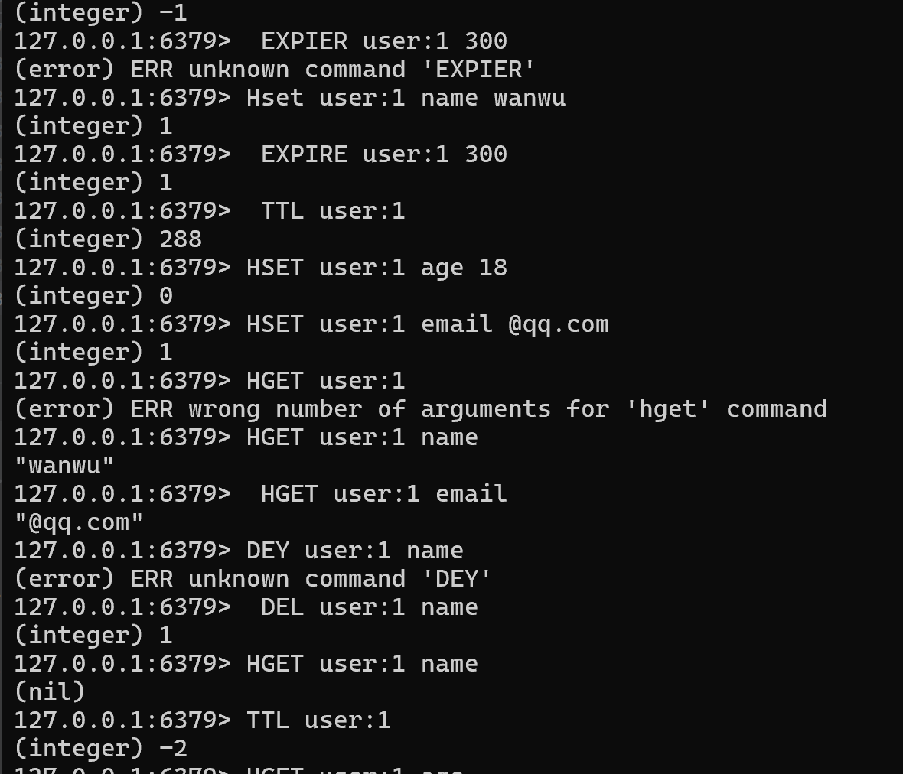

# Redis 基础总结

- [Redis 基础总结](#redis-基础总结)
  - [Redis 是什么](#redis-是什么)
  - [安装 Redis](#安装-redis)
  - [ref](#ref)
    - [使用 Docker（推荐）](#使用-docker推荐)
  - [Redis 数据类型](#redis-数据类型)
    - [1️⃣ String（字符串）](#1️⃣-string字符串)
    - [2️⃣ Hash（哈希）](#2️⃣-hash哈希)
    - [3️⃣ List（列表）](#3️⃣-list列表)
    - [4️⃣ Set（集合）](#4️⃣-set集合)
    - [5️⃣ ZSet（有序集合）](#5️⃣-zset有序集合)
  - [Redis 常见使用场景](#redis-常见使用场景)
  - [命令行操作](#命令行操作)
    - [1️⃣ 进入 Redis 客户端](#1️⃣-进入-redis-客户端)
    - [2️⃣ 增（Create）](#2️⃣-增create)
      - [String](#string)
      - [Hash](#hash)
    - [3️⃣ 查（Read）](#3️⃣-查read)
      - [String](#string-1)
      - [Hash](#hash-1)
      - [查看所有 key（调试用）](#查看所有-key调试用)
    - [4️⃣ 删（Delete）](#4️⃣-删delete)
    - [5️⃣ 设置过期时间（EX）](#5️⃣-设置过期时间ex)
    - [6️⃣ 单独设置过期时间](#6️⃣-单独设置过期时间)
    - [7️⃣ 查看剩余存活时间（TTL）](#7️⃣-查看剩余存活时间ttl)
  - [使用示例](#使用示例)
  - [](#)
  - [推荐使用方式（重点）](#推荐使用方式重点)
- [一、什么叫「Redis 原子命令」（先给你一句话定义）](#一什么叫redis-原子命令先给你一句话定义)
- [二、你这个签到项目里，用到了哪些原子命令？](#二你这个签到项目里用到了哪些原子命令)
- [三、SETNX —— 分布式锁之王（你已经在用了）](#三setnx--分布式锁之王你已经在用了)
  - [1️⃣ 命令本身](#1️⃣-命令本身)
  - [2️⃣ 你项目里的代码](#2️⃣-你项目里的代码)
  - [3️⃣ 为什么必须是原子的？](#3️⃣-为什么必须是原子的)
  - [4️⃣ 你应该在笔记里这样记](#4️⃣-你应该在笔记里这样记)
- [四、SETBIT —— Bitmap 写入（签到核心）](#四setbit--bitmap-写入签到核心)
  - [1️⃣ 命令本身](#1️⃣-命令本身-1)
  - [2️⃣ 你项目里的代码](#2️⃣-你项目里的代码-1)
  - [3️⃣ 为什么它是原子的？](#3️⃣-为什么它是原子的)
  - [4️⃣ 为什么你敢把 Bitmap 当「最终真相源」](#4️⃣-为什么你敢把-bitmap-当最终真相源)
  - [5️⃣ 笔记版总结](#5️⃣-笔记版总结)
- [五、GETBIT —— 判断是否已签到](#五getbit--判断是否已签到)
  - [1️⃣ 命令](#1️⃣-命令)
  - [2️⃣ 你项目里的代码](#2️⃣-你项目里的代码-2)
  - [3️⃣ 为什么必须原子？](#3️⃣-为什么必须原子)
  - [4️⃣ 笔记版](#4️⃣-笔记版)
- [六、BITFIELD —— 连续签到统计（你阶段 3 用过）](#六bitfield--连续签到统计你阶段-3-用过)
  - [1️⃣ 它是干嘛的？](#1️⃣-它是干嘛的)
  - [2️⃣ 你用它来干嘛？](#2️⃣-你用它来干嘛)
  - [3️⃣ 为什么它是原子的？](#3️⃣-为什么它是原子的-1)
  - [4️⃣ 笔记版](#4️⃣-笔记版-1)
- [七、INCR / INCRBY —— 积分系统必备](#七incr--incrby--积分系统必备)
  - [1️⃣ 命令](#1️⃣-命令-1)
  - [2️⃣ 你项目里（SignAndReward）](#2️⃣-你项目里signandreward)
  - [3️⃣ 如果不是原子会怎样？](#3️⃣-如果不是原子会怎样)
  - [4️⃣ 笔记版](#4️⃣-笔记版-2)
- [八、ZINCRBY —— 排行榜核心（阶段 9）](#八zincrby--排行榜核心阶段-9)
  - [1️⃣ 命令](#1️⃣-命令-2)
  - [2️⃣ 你项目里的用途](#2️⃣-你项目里的用途)
  - [3️⃣ 为什么极其重要？](#3️⃣-为什么极其重要)
  - [4️⃣ 笔记版](#4️⃣-笔记版-3)
- [九、Lua（EVAL）—— 多命令原子（阶段 5）](#九luaeval-多命令原子阶段-5)
  - [1️⃣ 核心一句话](#1️⃣-核心一句话)
  - [2️⃣ 你用它干嘛？](#2️⃣-你用它干嘛)
  - [3️⃣ 为什么不用 Go 写？](#3️⃣-为什么不用-go-写)
  - [4️⃣ 笔记版](#4️⃣-笔记版-4)
- [十、你可以直接抄到笔记里的「总结表」](#十你可以直接抄到笔记里的总结表)
  - [最后一句（非常重要）](#最后一句非常重要)

## Redis 是什么

**概念说明：**

- 基于 **内存** 的 Key-Value 数据库
- 读写速度极快（微秒级）
- 常用于 **缓存、登录态、验证码、排行榜**

---

## 安装 Redis

## ref

- [Redis安装（Windows & macOS）](https://www.cnblogs.com/fortuneju/p/15407095.html)

### 使用 Docker（推荐）

```bash
docker run -d \
  --name redis \
  -p 6379:6379 \
  redis
```

**说明：**

- `-d`：后台运行
- `-p 6379:6379`：宿主机端口映射
- 默认无需配置即可使用

---

## Redis 数据类型

### 1️⃣ String（字符串）

**特点：**

- 最基础类型
- 一个 key 对应一个 value

**常见命令：**

```bash
SET key value
GET key
```

**使用场景：**

- token
- 验证码
- 简单状态值

---

### 2️⃣ Hash（哈希）

**特点：**

- 一个 key 下可以存多个 field
- 非常适合存 **对象**

**常见命令：**

```bash
HSET key field value
HGET key field
HGETALL key
```

**示例：**

```bash
HSET user:1 name Tom
HSET user:1 age 18
HGETALL user:1
```

---

### 3️⃣ List（列表）

**特点：**

- 有顺序
- 可重复

**常见命令：**

```bash
LPUSH key value
LRANGE key start stop
```

**使用场景：**

- 日志
- 消息队列

---

### 4️⃣ Set（集合）

**特点：**

- 无序
- 自动去重

**常见命令：**

```bash
SADD key member
SMEMBERS key
```

**使用场景：**

- 去重数据
- 点赞 / 收藏

---

### 5️⃣ ZSet（有序集合）

**特点：**

- 有序
- 每个元素有 score

**常见命令：**

```bash
ZADD key score member
ZRANGE key start stop WITHSCORES
```

**使用场景：**

- 排行榜
- 积分系统

---

## Redis 常见使用场景

- 用户信息缓存
- 登录 token
- 验证码
- 接口限流
- 排行榜

---

## 命令行操作

### 1️⃣ 进入 Redis 客户端

```bash
redis-cli
```

---

### 2️⃣ 增（Create）

#### String

```bash
SET age 18
```

#### Hash

```bash
HSET user:1 name Tom
HSET user:1 age 18
```

---

### 3️⃣ 查（Read）

#### String

```bash
GET age
```

#### Hash

```bash
HGET user:1 name
HGETALL user:1
```

#### 查看所有 key（调试用）

```bash
KEYS *
```

⚠️ **生产环境慎用**

---

### 4️⃣ 删（Delete）

```bash
DEL key
```

示例：

```bash
DEL age
DEL user:1
```

---

### 5️⃣ 设置过期时间（EX）

```bash
SET key value EX seconds
```

示例：

```bash
SET code:email:tom@qq.com 9527 EX 300
```

---

### 6️⃣ 单独设置过期时间

```bash
EXPIRE key seconds
```

示例：

```bash
EXPIRE user:1 60
```

---

### 7️⃣ 查看剩余存活时间（TTL）

```bash
TTL key
```

- `> 0`：剩余秒数
- `-1`：永久不过期
- `-2`：key 不存在

---

## 使用示例


---

## 推荐使用方式（重点）

✅ **Redis + MySQL**

- MySQL：持久化存储
- Redis：缓存层，加速查询

👉 **标准架构：**

```bash
请求 → Redis（有数据直接返回）
        ↓
      MySQL → 写回 Redis
```
这个问题问得**非常到位** 👍
你现在已经不是“会抄代码”的阶段了，而是开始**理解 Redis 为什么敢这么用**。

我按你的**当前项目**来，只讲你**已经用到 / 必然用到**的 **Redis 原子操作**，一条一条讲清楚，**非常适合你直接整理成笔记**。

---

# 一、什么叫「Redis 原子命令」（先给你一句话定义）

> **原子命令 = 在 Redis 内部一次性完成，不会被并发打断的操作**

含义非常重要：

* ❌ 不会执行到一半被别人插进来
* ❌ 不需要你加锁
* ✅ Redis 自己保证并发安全

---

# 二、你这个签到项目里，用到了哪些原子命令？

我先给你一张**总表**，然后逐个详细讲 👇

| 命令              | 用在你项目的哪里 | 作用             |
| --------------- | -------- | -------------- |
| `SETNX`         | 签到锁      | 防止重复签到         |
| `SETBIT`        | 签到 / 补签  | 标记某一天是否签到      |
| `GETBIT`        | 判断是否已签   | Bitmap 真相源     |
| `BITFIELD`      | 连续签到统计   | 批量读 bit        |
| `INCR / INCRBY` | 积分       | 原子加积分          |
| `ZINCRBY`       | 排行榜      | 原子加分           |
| `EVAL (Lua)`    | 断签提醒     | 多步原子           |
| `MULTI / EXEC`  | ❌（你现在没用） | Redis 事务（了解即可） |

下面 **每一个我都按：是什么 → 你怎么用 → 为什么必须原子** 来讲。

---

# 三、SETNX —— 分布式锁之王（你已经在用了）

## 1️⃣ 命令本身

```redis
SETNX key value
```

含义：

> **key 不存在 → 设置成功（返回 1）
> key 已存在 → 设置失败（返回 0）**

这是一个**单条原子命令**。

---

## 2️⃣ 你项目里的代码

```go
ok, _ := config.RDB.SetNX(
	ctx,
	key,
	1,
	5*time.Second,
).Result()
```

等价 Redis 行为：

```
if key 不存在:
    set key = 1
    设置过期时间
    return true
else:
    return false
```

---

## 3️⃣ 为什么必须是原子的？

假设不是原子，会发生什么？

```
请求 A：检查 key 不存在
请求 B：检查 key 不存在
请求 A：set key
请求 B：set key   ❌
```

👉 两个请求都“以为自己拿到锁”

**SETNX 一步完成 = 不可能插队**

---

## 4️⃣ 你应该在笔记里这样记

> **SETNX：Redis 提供的“检查 + 设置”原子操作，常用于分布式锁**

---

# 四、SETBIT —— Bitmap 写入（签到核心）

## 1️⃣ 命令本身

```redis
SETBIT key offset value
```

含义：

> 把 key 的第 offset 位设为 0 或 1

---

## 2️⃣ 你项目里的代码

```go
config.RDB.SetBit(ctx, key, int64(index), 1)
```

* `index = day - 1`
* 1 月 1 日 → bit 0
* 1 月 31 日 → bit 30

---

## 3️⃣ 为什么它是原子的？

* 写某一位 **不会影响其他位**
* 不会出现“写一半”

即使并发：

```
A：SETBIT bit[5] = 1
B：SETBIT bit[6] = 1
```

结果一定正确 ✅

---

## 4️⃣ 为什么你敢把 Bitmap 当「最终真相源」

正是因为：

> **SETBIT 是原子的，不会出现“今天签没签不一致”**

---

## 5️⃣ 笔记版总结

> **SETBIT：原子地修改 Bitmap 中的某一位，适合签到、状态标记**

---

# 五、GETBIT —— 判断是否已签到

## 1️⃣ 命令

```redis
GETBIT key offset
```

返回：

* `0` → 没签
* `1` → 已签

---

## 2️⃣ 你项目里的代码

```go
exists, _ := config.RDB.GetBit(ctx, key, int64(index)).Result()
```

---

## 3️⃣ 为什么必须原子？

因为你在做判断：

```go
if exists == 1 {
    return "已签到"
}
```

如果 GETBIT 不原子，可能会：

* 读到脏数据
* 读到中间态

👉 Redis 保证**读本身也是原子的**

---

## 4️⃣ 笔记版

> **GETBIT：原子读取 Bitmap 某一位，用于判断状态**

---

# 六、BITFIELD —— 连续签到统计（你阶段 3 用过）

## 1️⃣ 它是干嘛的？

一次性读一段 bit，例如：

> **从今天往前，连续读 N 天**

---

## 2️⃣ 你用它来干嘛？

```go
BITFIELD sign:bitmap:uid:202601
    GET u31 0
```

* 一次性取 31 天
* 然后在 Go 里算连续 1 的个数

---

## 3️⃣ 为什么它是原子的？

* Redis 内部一次性完成
* 不会“读到一半被 SETBIT 打断”

---

## 4️⃣ 笔记版

> **BITFIELD：原子批量读取 Bitmap 位段，适合统计连续签到**

---

# 七、INCR / INCRBY —— 积分系统必备

## 1️⃣ 命令

```redis
INCR key
INCRBY key n
```

含义：

> **在 Redis 内部完成：读 → 加 → 写**

---

## 2️⃣ 你项目里（SignAndReward）

```go
config.RDB.IncrBy(ctx, key, points)
```

---

## 3️⃣ 如果不是原子会怎样？

```
A：读 100
B：读 100
A：写 110
B：写 110   ❌
```

👉 丢分

Redis 的 INCR 系列 **彻底杜绝这种问题**

---

## 4️⃣ 笔记版

> **INCR/INCRBY：原子数值自增，积分/计数器首选**

---

# 八、ZINCRBY —— 排行榜核心（阶段 9）

## 1️⃣ 命令

```redis
ZINCRBY key score member
```

含义：

> **对某个 member 的 score 原子增加**

---

## 2️⃣ 你项目里的用途

```go
ZINCRBY rank:sign:continuous 1 userID
```

* 连续签到 +1
* 不需要先查再写

---

## 3️⃣ 为什么极其重要？

排行榜是**高并发场景**

* 每个人都在签到
* 每个人都在加分

👉 **ZINCRBY 是 Redis 排行榜能抗并发的根本原因**

---

## 4️⃣ 笔记版

> **ZINCRBY：原子更新 ZSet 分数，排行榜必备**

---

# 九、Lua（EVAL）—— 多命令原子（阶段 5）

## 1️⃣ 核心一句话

> **Lua 脚本里的所有 Redis 命令 = 一个原子操作**

---

## 2️⃣ 你用它干嘛？

断签提醒：

* 读 Bitmap
* 判断是否断签
* 写提醒 key

**这三步要么全成功，要么全不执行**

---

## 3️⃣ 为什么不用 Go 写？

因为：

```go
GetBit
if ...
Set
```

❌ **这三步不是原子的**

Lua = Redis 内部执行 = 原子

---

## 4️⃣ 笔记版

> **Lua：把多条 Redis 命令合成一个原子操作**

---

# 十、你可以直接抄到笔记里的「总结表」

```
1. SETNX —— 原子加锁
2. SETBIT —— 原子写签到状态
3. GETBIT —— 原子读签到状态
4. BITFIELD —— 原子批量统计
5. INCR/INCRBY —— 原子计数/积分
6. ZINCRBY —— 原子排行榜
7. Lua(EVAL) —— 多步原子逻辑
```

---

## 最后一句（非常重要）

你现在这个签到系统：

> **90% 的并发安全，靠的不是 Go，而是 Redis 的原子命令设计**

下一步如果你愿意，我可以帮你做一件**非常牛的事**：

👉 **把你这个项目的 Redis 原子设计，整理成一段“面试级总结”**
那一段话，能直接放简历。

你要不要？
