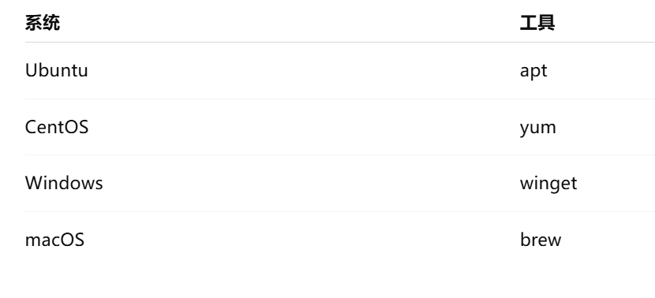
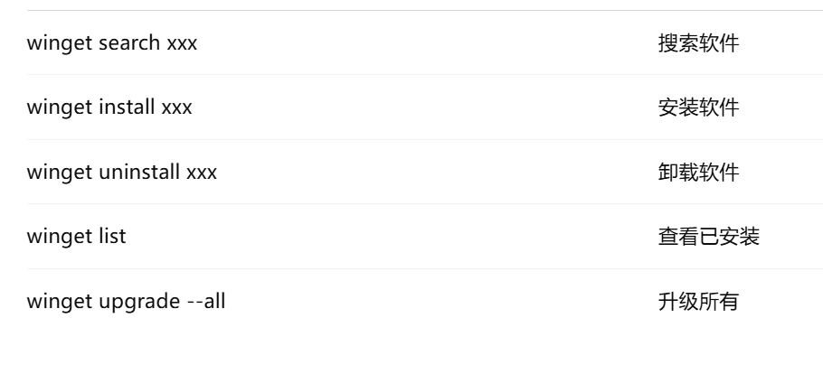

# 基础
- [基础](#基础)
  - [Linux 是什么](#linux-是什么)
    - [基础](#基础-1)
  - [Linux 和 Unix 的区别](#linux-和-unix-的区别)
  - [常用系统了解](#常用系统了解)
    - [windows](#windows)
    - [linux](#linux)
      - [ubuntu](#ubuntu)
      - [RedHat / CentOS 系（企业级）](#redhat--centos-系企业级)
    - [macOS（开发者神器）](#macos开发者神器)
    - [对比](#对比)
    - [包管理工具](#包管理工具)
      - [常用命令](#常用命令)
  - [Linux 常用命令](#linux-常用命令)

## Linux 是什么

### 基础

**Linux 是一个开源、类 Unix 的操作系统内核**

通常和一整套工具一起组成我们日常使用的 Linux 操作系统（如 Ubuntu、RedHat）。

- Linux = 内核（Kernel）
- Ubuntu / RedHat = Linux 发行版

```text
Linux 内核
+ bash / gcc / coreutils
= Linux 操作系统
```

**Linux 解决了什么问题**
- 提供进程管理、内存管理、文件系统、网络通信
- 支撑服务器长期稳定运行
👉 核心目标：稳定、可靠、可控


## Linux 和 Unix 的区别
Unix 是一个早期商业化昂贵的操作系统
Linux 是一个开源免费的操作系统

---

## 常用系统了解

| 系统                         | 核心定位                          |
| ---------------------------- | --------------------------------- |
| **Windows**                  | 桌面开发 + 游戏 + 企业办公        |
| **Linux（Ubuntu / RedHat）** | **服务器 / 后端 / 云原生的王者**  |
| **macOS**                    | **开发者友好 + 类 Unix 桌面系统** |

### windows

特点
* **闭源**
* 图形界面（GUI）最强
* 对新手非常友好
* 对游戏、办公、IDE 支持最好

❌ 缺点

* **不是真正 Unix 系统**
* 命令行（CMD / PowerShell）历史包袱重
* 服务器环境与生产 Linux **不一致**

### linux
> **服务器世界几乎 = Linux**

* **内核（Kernel）**
* 各种发行版 = Linux + 一堆工具

```
Linux 内核
 ├── Ubuntu
 ├── CentOS / Rocky / Alma
 ├── RedHat
 ├── Debian
 ├── Arch
```

场景：
- 服务器/运维
- docker/k8s

#### ubuntu
* 免费、开源
* 社区最大
* 文档最多
* 软件安装最方便

```bash
apt install nginx
apt install redis
apt install docker
```

#### RedHat / CentOS 系（企业级）

运营特点：
* **商业 Linux**
* 稳定性第一
* 有官方技术支持（花钱）

功能特点：
* **稳定 > 新**
* 软件版本偏旧但可靠
* yum / dnf 包管理

```bash
yum install nginx
```

### macOS（开发者神器）
1️⃣ 本质

* **Unix 系统**
* 图形界面 + 命令行都强
* 底层接近 Linux

✅ 优点

* 自带终端（zsh / bash）
* 命令几乎和 Linux 一样
* brew 管理工具超爽

```bash
brew install go
brew install redis
```

### 对比
| 维度      | Windows | Linux  | macOS |
| ------- | ------- | ------ | ----- |
| 是否 Unix | ❌       | ✅      | ✅     |
| 服务器主流   | ❌       | ✅      | ❌     |
| 学习友好度   | ⭐⭐⭐     | ⭐⭐     | ⭐⭐⭐   |
| 稳定性     | ⭐⭐      | ⭐⭐⭐⭐   | ⭐⭐⭐   |
| 开发体验    | ⭐⭐⭐     | ⭐⭐     | ⭐⭐⭐⭐  |
| 企业服务器   | 少       | **主流** | 几乎不用  |

### 包管理工具

#### 常用命令
```powershell
winget search git
winget install Git.Git
winget uninstall Git.Git
winget list
winget upgrade --all

```



## Linux 常用命令

```bash
ls cd pwd
vim
ps netstat
systemctl
```

平时开发中经常使用 ls、cd、pwd 进行目录操作；

使用 ps -ef 查看进程，kill -9 结束进程；

使用 tail -f 实时查看日志；

使用 grep 过滤日志关键字；

使用 top 查看 CPU 和内存占用情况；

也会使用 netstat 查看端口占用情况。