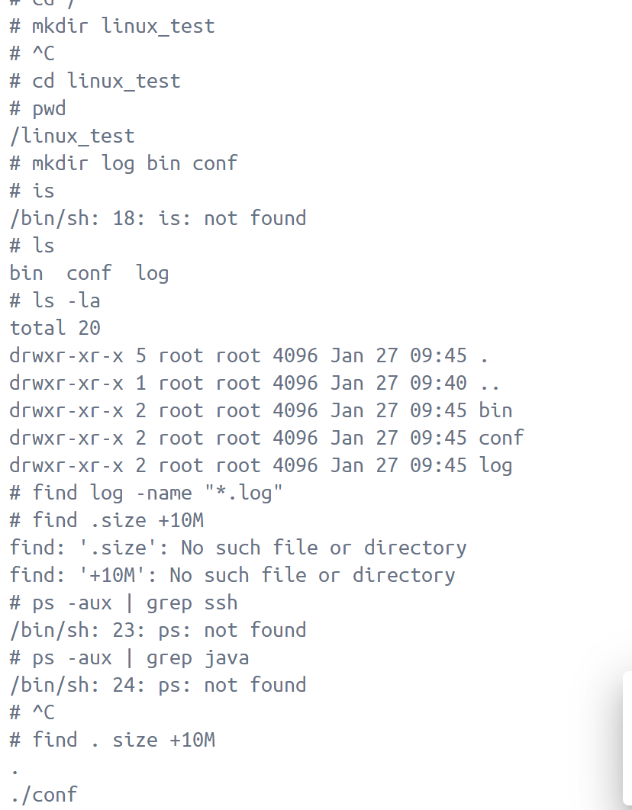

# Linux 常用命令


## 文件 & 目录（每天都在用 ⭐⭐⭐⭐⭐）

```bash
ls        # 查看目录
ls -l     # 详细列表
ls -a     # 包含隐藏文件
cd        # 切换目录
pwd       # 当前路径
mkdir     # 创建目录
rmdir     # 删除空目录
cp        # 复制
mv        # 移动 / 重命名
rm        # 删除
```

```bash
# -r 递归删除，循环遍历目录所有文件和目录
# -f == force 强制删除，无需确认
rm -rf /data/logs   # 强制递归删除（⚠️ 危险）
```


## 文件内容查看（排错必备 ⭐⭐⭐⭐⭐）

```bash
#  error.log 需要自己创建，是文件名称

cat error.log        # 一次性看完（小文件）
less error.log       # 翻页查看（推荐）
more error.log

head -n 20 error.log     # 前 20 行
tail -n 20 error.log     # 后 20 行

# 服务异常你怎么查？通过实时查看日志文件
tail -f error.log    # 实时看日志 ⭐
```

### 面试场景

>

👉 标准回答：

```bash
tail -f error.log
```

---

# 三、搜索 & 查找（非常重要 ⭐⭐⭐⭐）

## 1️⃣ 查文件

```bash
find / -name redis.conf
find . -type f -name "*.log"
```

## 2️⃣ 查内容（面试必问）

```bash
grep "ERROR" app.log
grep -n "panic" app.log
grep -r "userId" .
```

👉 面试官爱问：

> **日志里查关键字用什么？**

标准答案：**grep**

---

# 四、权限（新手必翻车 ⭐⭐⭐⭐）

## 查看权限

```bash
ls -l
```

```
-rw-r--r-- 1 root root app.log
```

## 修改权限

```bash
chmod 755 app.sh
chmod +x run.sh
```

## 用户切换

```bash
whoami
su
sudo
```

👉 面试点：

> Linux 权限由 **读(r) / 写(w) / 执行(x)** 组成

---

# 五、进程管理（后端面试高频 ⭐⭐⭐⭐⭐）

```bash
ps aux
top
htop
```

## 查进程

```bash
ps aux | grep go-shop
```

## 杀进程

```bash
kill PID
kill -9 PID   # 强制
```

👉 面试常问：

> 服务卡死了你怎么办？

👉 回答流程：

```bash
ps aux | grep 服务名
kill PID
```

---

# 六、端口 & 网络（⭐⭐⭐⭐⭐）

```bash
netstat -tunlp
ss -lntp
```

## 常用

```bash
netstat -tunlp | grep 8080
```

👉 面试问：

> 怎么查端口被谁占用了？

标准答案：**netstat / ss**

---

# 七、磁盘 & 内存（⭐⭐⭐⭐）

```bash
df -h      # 磁盘使用
du -sh *   # 当前目录大小
free -h    # 内存
```

👉 面试点：

> 服务器磁盘满了？

```bash
df -h
du -sh /data/*
```

---

# 八、压缩 & 解压（部署必用 ⭐⭐⭐）

```bash
tar -czvf app.tar.gz app/
tar -xzvf app.tar.gz
zip -r app.zip app/
unzip app.zip
```

---

# 九、软件管理（Ubuntu & RedHat）

## Ubuntu

```bash
apt update
apt install nginx
apt remove redis
```

## RedHat

```bash
yum install redis
dnf install redis
```

👉 面试问：

> Ubuntu 用什么包管理？

答：**apt**

---

# 十、服务管理（systemd ⭐⭐⭐⭐⭐）

```bash
systemctl start nginx
systemctl stop nginx
systemctl restart nginx
systemctl status nginx
systemctl enable nginx
```

👉 面试必考：

> Linux 如何管理后台服务？

标准答案：**systemctl**

---

# 十一、环境变量（Go / Java 必会 ⭐⭐⭐⭐）

```bash
echo $PATH
export GOPATH=/data/go
source ~/.bashrc
```

---

# 十二、管道 & 重定向（加分项 ⭐⭐⭐⭐）

```bash
|    # 管道
>    # 覆盖输出
>>   # 追加输出
```

```bash
ps aux | grep redis
echo "hello" > a.txt
echo "world" >> a.txt
```

---

# 十三、面试 20 条速背清单（🔥）

你至少要**不犹豫**说出这些👇

```
ls cd pwd
cp mv rm
cat less tail -f
grep find
chmod chown
ps aux top
kill kill -9
netstat ss
df du free
tar unzip
apt yum
systemctl
```

---

# 十四、给你一个「真实面试题」示例

> ❓ 服务访问不了，你怎么排查？

👉 标准回答（按步骤）：

1. `ps aux | grep 服务`
2. `netstat -tunlp | grep 端口`
3. `tail -f 日志`
4. `df -h`
5. `free -h`

---

# 下一步我建议你这样学（非常重要）

你现在已经到这个阶段了👇
我建议你继续 **“实战型 Linux”**

我可以直接带你做：
1️⃣ **Ubuntu 上部署 Go 项目（完整流程）**
2️⃣ **Go + systemd 后台服务**
3️⃣ **Nginx + 反向代理 + 日志排错**

你选一个，我直接按「跟着敲」模式教你。
这个点在面试里**非常现实**：
👉 面试官默认你**不是运维专家**，但**必须能在 Linux 上“活下来”**。

我按你现在的水平，给你讲到 **「能用 + 能答面试」**，不走偏、不讲虚的。

---

# 一、Linux 常用命令（后端必会 ⭐⭐⭐⭐⭐）

> 目标：
> **能看日志、查进程、改配置、排错**

---

## 1️⃣ 文件 / 目录操作（最常用）

### 查看

```bash
ls        # 列出目录
ls -l     # 详细信息
ls -a     # 包含隐藏文件
pwd       # 当前路径
```

---

### 进入 / 创建 / 删除

```bash
cd /usr/local
mkdir logs
rm test.txt
rm -rf temp/     # ⚠️ 非常危险
```

👉 面试官最爱问：
**`rm -rf /` 是什么？为什么危险？**

---

## 2️⃣ 文件内容查看（看日志必会）

### 小文件

```bash
cat config.yml
```

### 大文件（重点）

```bash
less app.log
```

常用操作：

* `/error` 搜索
* `n` 下一个
* `q` 退出

---

### 实时看日志（超级常用）

```bash
tail -f app.log
```

👉 **后端 100% 会用**

---

## 3️⃣ 查找 & 过滤（grep 必会）

```bash
grep "ERROR" app.log
grep -n "panic" app.log   # 显示行号
```

组合用法（真实排错）：

```bash
tail -f app.log | grep ERROR
```

---

## 4️⃣ 进程相关（服务器必会）

### 查进程

```bash
ps -ef | grep java
ps -ef | grep go
```

---

### 实时监控

```bash
top
```

* CPU
* 内存
* 负载

---

### 杀进程（慎用）

```bash
kill 1234
kill -9 1234   # 强制
```

---

## 5️⃣ 网络相关（后端重点）

```bash
netstat -anp | grep 8080
```

👉 常用于：

* 端口是否监听
* 程序是否启动成功

---

## 6️⃣ 权限（了解即可）

```bash
chmod +x run.sh
```

权限位：

```
r 读
w 写
x 执行
```

---

# 二、Shell 脚本到底是什么？（讲人话）

## 1️⃣ 一句话解释（面试版）

> **Shell 脚本就是把一堆 Linux 命令写到一个文件里，让系统一次性执行**

---

## 2️⃣ Shell ≠ Linux

* Linux：操作系统
* Shell：**命令解释器**

  * bash
  * sh
  * zsh

---

## 3️⃣ 第一个 Shell 脚本（你一定要会）

### 创建脚本

```bash
vim hello.sh
```

内容：

```bash
#!/bin/bash
echo "Hello Shell"
```

---

### 执行

```bash
chmod +x hello.sh
./hello.sh
```

---

## 4️⃣ `#!/bin/bash` 是啥？

> **告诉系统：用 bash 解释这个文件**

---

# 三、Shell 脚本你要会写到什么程度？（很重要）

面试要求说的是：

> **会写简单的 Shell 脚本**

👉 意味着你要会：

---

## 1️⃣ 变量

```bash
name=tom
echo $name
```

⚠️ 注意：
`=` 两边 **不能有空格**

---

## 2️⃣ if 判断（必会）

```bash
if [ $age -gt 18 ]; then
    echo "adult"
else
    echo "child"
fi
```

---

## 3️⃣ 循环

```bash
for i in 1 2 3
do
    echo $i
done
```

---

## 4️⃣ 实战例子（面试加分）

### 查看 Java / Go 服务是否运行

```bash
#!/bin/bash

pid=$(ps -ef | grep myapp | grep -v grep)

if [ -z "$pid" ]; then
    echo "app not running"
else
    echo "app is running"
fi
```

---

# 四、面试官最爱问的 5 个问题（你现在都能答）

### 1️⃣ 如何查看日志？

```bash
tail -f app.log
```

---

### 2️⃣ 如何查端口是否被占用？

```bash
netstat -anp | grep 8080
```

---

### 3️⃣ Shell 脚本是干嘛的？

> 把多个 Linux 命令组合起来自动执行。

---

### 4️⃣ Shell 脚本和程序的区别？

* Shell：运维 / 自动化
* 程序：复杂逻辑 / 高性能

---

### 5️⃣ 用 Shell 做过什么？

> 写过简单脚本检查服务状态、启动/停止程序、查看日志。

---

# 五、给你一个「后端 Linux 生存总结」

你现在只要记住一句话：

> Linux 命令是手动操作服务器，Shell 脚本是把这些操作自动化。

---

